# Quiet and RTK: What the Savings Figures Actually Measure

This document compares command-output tracking, local domain results, and retained-output reanalysis. The executed comparison uses RTK 1.1.0 and the local QuietCli2 implementation on 6 November 2026. Source-level findings use the official RTK 1.1.0 release tag, pinned to revision `753a3b0e939f2e4490fc24e3a1984010f40a103c`. Neither establishes a general performance ranking, and the CLI conclusions do not extend to RTK's API proxy metrics.

## Key points

Quiet is stricter about several aspects of measurement: it counts observed bytes and the bytes in the delivered string, preserves unknown values, separates allocations from output reduction, and allows negative savings. This supports more precise claims about these quantities.

However, concluding that “RTK is dishonest” would go too far. RTK documents its token estimation, has safeguards, and processes some structured formats. This analysis also identifies specific limitations in some calculations and output paths in the version examined.

The design difference can be summarized as follows:

- **RTK primarily provides a reduced textual representation**, intended for the agent to read. Depending on the execution path and configuration, content may be retained for later access through `recall`.
- **Quiet lets callers construct a local domain result**, then choose the representation to deliver. It supports explicit raw-output capture with `-Recall`, durable recording with `-SaveRecall`, and offline reanalysis by `-RecallId`. Default streaming still discards consumed native output. [Q9]
- **A shorter result proves neither a proportional reduction in the bill nor a correct domain answer.** Both require further verification.

## 1. The exact scope of this comparison

Sources examined:

- RTK: official release tag `v1.1.0`, declared version `1.1.0`, revision `753a3b0e939f2e4490fc24e3a1984010f40a103c`. The reviewed source is an isolated snapshot of this tag. The tested `rtk-x86_64-pc-windows-msvc` release is the full edition; the repository also defines an OSS edition without the optional compression engine. [R1]
- QuietCli2 measurement audit: base revision `2377c5b21e917d12887b9410a16ec1934d40a793`, including measurement change `9bb2ab8`. The measured subject includes local working-tree changes; the base revision alone does not identify the executed implementation.
- QuietCli2 Recall implementation: the local working tree includes the Recall implementation, durable store, ZIP64 transport, and companion qualification tools. The local validation covers this working-tree implementation, not the base revision alone. [Q9–Q12]
- Executed comparison corpus: RTK `1.1.0`, executable SHA-256 `10501153C7A65A7C5F8BF6A033BEA40052AC6C5DF4130008626463B2C44F3D7F`. The source audit and executable comparison target the same 1.1.0 release. The executable is an official release artifact; no claim of a reproducible local binary build is made. [Q11, Q12]

RTK source links pin revision `753a3b0e939f2e4490fc24e3a1984010f40a103c` (1.1.0). Line references and source-level conclusions apply to that release. Quiet links identify local implementation symbols. The executed corpus covers only the scenarios listed in section 8; source inspection is separate evidence and does not establish that every reviewed branch was exercised.

The analysis covers CLI command tracking, result delivery, allocations, and output recovery. The RTK dashboard can also display a section populated by the LLM proxy: that data has a separate scope. The CLI tracking formula described here must not be attributed indiscriminately to every RTK product and mode. [R1, R4]

## 2. The difference concerns the delivered result, not “regex versus intelligence”

### RTK: analyzing output to produce different output

The captured execution path in RTK's runner executes the command, captures its output, applies a filter, and prints text. The filter may remove repetition, group diagnostics, extract fields, or cap a list. [R2]

RTK uses regexes, but also parsers and typed structures. For example, its `go test` handling can request JSON, deserialize events into `GoTestEvent`, and aggregate results by package and test. Saying that RTK works “only through regexes” would therefore be incorrect. Its internal structures are already objects in the sense of data structures. [R5]

The relevant distinction for this comparison is that this CLI interface path primarily returns **text**, rather than a domain object retained in the caller's process.

### Quiet: constructing domain data, then deciding what to show

Quiet supplies native events to `-Output`, allows state to be maintained, and lets `-Complete` finalize the result. A reusable handler can implement this analysis. With `-AsObject`, the caller receives an envelope containing `Data`, execution states, completeness, and measurements. [Q1, Q2]

The result may be a list of files, a set of diagnostics, a test summary, or a new `[pscustomobject]`. Caller code can query it and combine it with other results before producing a JSON or YAML delivery.

This does not remove the need to write a parser when the input format requires one. A Quiet handler can also use regexes. The difference is **the result contract and its local reuse**, rather than an opposition between Rust and PowerShell, or between regexes and objects.

```mermaid
flowchart TD
    subgraph RTK["Examined RTK CLI path"]
        R1["Native command"] --> R2["Analysis and reduction"]
        R2 --> R3["Text delivered to the agent"]
        R2 -. "depending on path and configuration" .-> R4["Content retained for recall"]
        R4 --> R5["Later retrieval"]
    end
    subgraph Quiet["Quiet path"]
        Q1["Native command"] --> Q2["Output: analysis and state"]
        Q2 --> Q3["Complete: local domain object"]
        Q3 --> Q4["Local computations and queries"]
        Q3 --> Q5["Selected JSON or YAML projection"]
        Q5 --> Q6["Text delivered to the agent"]
        Q1 -. "explicit Recall or SaveRecall" .-> Q7["Ordered native-byte evidence"]
        Q7 --> Q8["Offline replay with new Output and Complete"]
        Q8 --> Q3
        Q7 -. "SaveRecall" .-> Q9["Durable journal identified by RecallId"]
        Q9 --> Q8
    end
```



A text-based agent does not directly “see” the .NET object: it sees what its tool returns. The benefit of `-AsObject` comes from code using the object locally and transmitting only the useful result. A variable such as `$r` does not automatically survive the launch of a new PowerShell process. A `-SaveRecall` journal can survive it, but stores native evidence and inert metadata rather than serializing the live `Data` object or its callbacks. A later session constructs a new domain result from that evidence. [Q9]

## 3. Token estimation in the inspected RTK 1.1.0 CLI tracker

The code shared by CLI tracking calculates:

```text
estimated_tokens(text) = ceiling(UTF8_byte_count / 4)
```

`estimate_tokens` uses the Rust string's byte length, then calls `estimate_tokens_from_len`. It does not tokenize the text with the model's tokenizer. `TimedExecution.track` applies this estimator to the input and output, then sends the values to the SQLite tracker. A `track_bytes` variant directly accepts a native input length, which is useful for avoiding a size inflated by transcoding. [R3]

For a recorded row, the tracker calculates:

```text
estimated_savings = estimated_input_tokens − estimated_output_tokens
rate = 100 × estimated_savings / estimated_input_tokens
```

These are reduction indicators based on text volume. They are not exact counts of billed tokens.

### Using the same estimator does not make the token reduction rate exact

Token density depends on the content and tokenizer. Raw output and a summary do not necessarily have the same density. A byte reduction percentage therefore does not become an exact token reduction percentage merely because both sizes are divided by four.

Rounding also introduces a difference from the exact byte ratio. A purely arithmetic example:

```text
Before: 4 bytes → 1 estimated token
After:  1 byte  → 1 estimated token

Exact byte reduction:       75%
Reduction by the estimator:  0%
```

This is not a measurement of an executed filter. It only illustrates the formula's limitation. With large strings, the relative effect of this rounding decreases; uncertainty related to the content and tokenizer remains.

RTK's documentation explicitly acknowledges the estimation and explains that reducing shell output does not reduce the entire bill by the same proportion. This is a point of transparency that should be retained in the comparison. However, its wording about reliable percentages should be understood as an approximation of the volume ratio, rather than a guarantee of exact token counts. [R6]

## 4. Calculation details in the inspected RTK 1.1.0 source

### 4.1 The SQLite row preserves losses, but one aggregate neutralizes them

`Tracker.record` stores a signed difference: if estimated output grows, `saved_tokens` and the percentage can be negative. This is appropriate for making a regression visible. [R3]

However, `get_summary_filtered`, which supplies the indicators in the textual `rtk gain` summary, applies `max(0)` to the savings of **each row**, then adds those savings. Input and output volumes are added without this adjustment. The displayed total savings can therefore differ from their net difference. [R4]

An illustrative example, if the table contains two rows below the exclusion threshold:

```text
Row A: input 1,000, output   500 → savings +500
Row B: input   500, output 1,000 → savings −500

Net difference: 1,500 − 1,500 = 0
Sum after neutralizing losses: 500 + 0 = 500
Rate of this aggregate: 500 / 1,500 = 33.3%
```

This example demonstrates that function's calculation, not how often such rows occur in real use. Some paths have a safeguard that falls back to raw text when the filtered representation is estimated to cost more; documented exceptions also exist. Other tracker views do not all use exactly the same aggregation. The criticism therefore concerns **this aggregate**, rather than every RTK figure. [R4, R7]

### 4.2 Large inputs are excluded from some aggregates

The summary excludes rows whose input exceeds `7 500` estimated token units, or approximately `30 000` bytes with this estimator. The code explains this rule through an assumed agent-side Bash output limit and exposes an `oversized_excluded` counter. [R4]

This is a useful precaution: an enormous native output would not necessarily have been presented to the model in full without RTK. However, the threshold is an assumption tied to the agent environment; it does not automatically establish the effective limit for every tool and agent.

### 4.3 The counted text depends on the execution path

In the captured path, the runner composes the output with any recovery hint, includes forwarded stderr, and counts the resulting emitted text. These details avoid presenting stderr that was merely forwarded as though it had been eliminated. [R2]

In the examined `RunMode::Streamed` branch, any recovery hint is printed separately, then the tracker receives `result.filtered`. That additional hint is therefore not included in this pair of counted strings. This is a visible limitation in this specific path; its production impact was not measured here. [R2]

### 4.4 Other RTK views have different accounting scopes

The headline is not the only calculation in 1.1.0. Command/day aggregates clamp after summing their signed savings, while `low_savings_commands` computes a signed rate and can identify regressions. The per-row loss example in section 4.1 must not be generalized to every report. [R4]

The full edition also renders `print_efficiency_ledger`: a 30-day hook-attribution view that separates estimated filter/compression volumes, measured LLM token expenditure, recovery counts and estimated standing directives. Its filter-removal percentage floors the net reduction at zero. When proxy pricing data exists, it displays actual versus modeled counterfactual cost; otherwise it explicitly reports size estimates rather than a bill. The proxy and shadow-rule figures have their own scopes. This CLI source review does not validate those cost models or compare the proxy against Quiet. [R10]

`show_recall_stats` separately reports SQLite entries recalled relative to elisions, distinguishes approximate tee observations, and warns that retrieving output can offset an initial reduction. This is useful recovery telemetry, but it is not a measured byte/token ledger of every repeated read. Neither this view nor the pipeline recovery count rewrites the original command row to subtract delivered recall bytes. [R8–R10]

## 5. What Quiet measures in bytes

Quiet distinguishes volumes actually read from native processes, invocation roles, and delivery size. With pipes, stdout and stderr have their own counters; with a PTY, output is merged and the separate counters remain unknown. [Q1]

When a delivery goes through `Out-QuietResult` or `ConvertTo-QuietJson`, Quiet measures the UTF-8 byte count of the JSON or YAML string actually produced, **including its envelope**. The entire object is not serialized a second time to establish a hypothetical size. [Q3]

The aggregate report calculates:

```text
ReductionBytes = SerializedBusinessBytesObserved − RootDeliveryBytes
```

The first term concerns business sources associated with the selected root deliveries; the second adds those deliveries. Sources are deduplicated, auxiliary invocations do not inflate business savings, and independent invocations without deliveries remain separately observable. Incomplete evidence or an unknown size makes the reduction unknown. [Q4]

Two important consequences:

- A larger serialized output can produce a negative reduction, which is preserved in the result.
- Multiple deliveries of the same result add their sizes without counting the same native source repeatedly. Savings from a first delivery should not be read as the balance of all future consultations.

This accuracy concerns **the string produced by Quiet**. It does not necessarily include terminators added by the host, the calling tool's envelope, or the entire transport to the model. Serialization performed elsewhere by another tool is not automatically tracked.

### With `-AsObject`, no delivery size is invented

With `-AsObject`, Quiet returns the local object; measurements do not traverse `Data` to assign it an output size. `OutputBytes`, `OutputTokens`, and `ReductionBytes` remain unknown until a corresponding delivery is produced. [Q2]

Saying that Quiet “saves 100% of tokens” in this case would be incorrect. It can allow computations to run locally and much less text to be delivered at the end, but demonstrating that requires measuring the delivery and defining a comparison baseline.

## 6. What Quiet can count in tokens

Tokenization is optional and disabled by default. With `-Tokenizer o200k_base` or `cl100k_base`, Quiet counts the tokens in the delivery string already produced, using that encoding. [Q3]

This provides an exact count **for that text and encoding**. It does not automatically tokenize the entire native output; `NativeTokens` remains unknown. Quiet therefore cannot infer exact before-and-after token savings from these fields alone. Enabling Recall does not change this: retaining bytes is not tokenization, and a ZIP compression ratio is not a token-reduction ratio. [Q9]

The delivery count also does not represent all the tokens in an API request: instructions, history, messages, tool schemas, and other elements may be added. Neither CLI indicator is sufficient to prove a reduction in total billing.

## 7. Memory allocations are a separate cost measurement

Quiet can measure managed bytes allocated during an invocation and during `-Complete`, even when the latter creates a new `[pscustomobject]`. The C# counter uses `GC.GetAllocatedBytesForCurrentThread` without traversing the domain object. [Q5]

This cost includes temporary objects and work performed on the calling thread within the measured interval. It is neither the memory retained by the result, nor the child process's native memory, nor a token count. Allocations during `-Complete` are already included in the invocation's allocations: adding them would count part of the cost twice.

If the ending thread differs from the starting thread, the `ThreadChanged` status, thread identifiers, and a `null` size explain this limitation in the persisted metadata. [Q5]

`Get-QuietEngine -IncludeAllocations` separately provides process-wide counters, including C# workers and concurrent work. `-Precise` explicitly selects the more expensive precise counter. In integrated mode, caller and engine share the same process: the counters under those two labels must not be added together. [Q6]

The RTK CLI tracker paths examined record estimated tokens and durations; they do not provide a comparable measurement of these allocations. **The absence of this measurement does not mean an absence of cost**, and the presence of Quiet's counter does not demonstrate that Quiet allocates less than RTK.

## 8. Recall: domain reuse, raw evidence, and durable reanalysis

### Recovery behavior in the inspected RTK 1.1.0 source

SQLite recovery is the declared default mode in `RetrieverConfig`. Recovery paths can retain the content supplied to them and produce an identifier for `rtk recall`. Depending on the caller, that content is raw output or an already prepared representation. Triggers differ: recovery after failure, a capped list, post-processing, and so on. For the ordinary failure-hint path, `tee_and_hint` requires at least 500 bytes and SQLite mode skips successful executions. Explicit forced hints and trimmed-list paths use different triggers. This is not universal archival of every output. [R8]

Storage is bounded and configurable: in the examined defaults, an entry is limited to 10 MiB, capacity to 200 entries, and retention to 30 days. The code supports lossless compression of retained content, but the content may have been truncated before storage if its limit was exceeded. Over the cap, a trimmed-list request preferentially stores a window starting at the first hidden line; otherwise it keeps a bounded prefix. Compression runs after this selection and cannot recover discarded bytes. `recall --full` returns the entire stored payload, which need not be the entire original output; truncated entries produce an explicit notice. [R8]

This mechanism provides a real capability: accessing retained content later, including after the original process has ended, without rerunning the native command.

The examined `run_recall` path re-emits stored bytes, supports line selection and byte-regex filtering, and marks the entry as recalled. `mark_recalled` increments the SQLite recall statistic only on the first successful mark for an entry, rather than counting every subsequent read. It does not rewrite the original tracker row's savings to subtract the retrieved bytes. These consultations must therefore be included separately in a workflow balance; initial savings are not automatically net savings after all recalls. This observation concerns the examined CLI path, rather than any external tracking or proxy tracking. [R8, R9]

### Quiet offers three distinct forms of reuse

Retaining domain data and retaining native evidence solve different problems:

- **Local domain reuse:** `$r.Data` contains the information constructed by the original analyzer. Code can query it and produce new deliveries while the object remains available. This does not recreate details that the analyzer discarded.
- **In-memory Recall:** `-Recall -AsObject` retains native byte events in `$r.Recall`, independently of `Data`. `Invoke-QuietRecall` can apply new `-Output` and `-Complete` callbacks without rerunning the executable. This capture disappears with its process unless explicitly saved.
- **Durable Recall:** `-SaveRecall -AsObject` records during execution into a journal identified by `RecallId`, with an optional `RecallName`. `quiet -RecallId` or `Invoke-QuietRecall -RecallId` can construct a new result in a later process, after reboot, or the next day. Saved names are searchable labels; the identity is the unambiguous lookup key. [Q2, Q9, Q10]

If the existing domain object answers the next question, querying it avoids another parse. If the analyzer omitted something or was wrong, retained native evidence allows a different analysis of the same observation.

### Explicit retention, completeness, and memory limits

`-Recall` defaults to 16 MiB of native bytes. `-RecallMaxBytes` accepts positive integral bytes, IEC sizes such as `90KiB`, or `All`. `Head`, `Tail`, and `HeadAndTail` select which bytes remain when bounded retention fills; `All` requires `Head` and imposes no configured memory ceiling. Object overhead and process memory still matter. [Q9, Q10]

`-SaveRecall` is independent of that memory budget: it streams all received output to disk without requiring unlimited RAM. With both flags, `Recall` is the disk-backed view and `Recall.MemoryCapture` is the separately bounded memory view. Default storage is durable user data (`%LOCALAPPDATA%/QuietCli2/recalls` on Windows), configurable through `QUIETCLI_RECALL_ROOT` or `-RecallRoot`.

Captured records distinguish stdout and stderr and preserve their **caller-observed order**; they do not establish exact write chronology across independent pipes. PTY output is already merged, and stdin is not retained. Received, retained, omitted, durable and source-complete values remain separate. At missing ranges, partial reanalysis requires `-AllowPartial` and resets decoding/framing instead of silently joining unrelated fragments. [Q9, Q10]

The durable journal is written before user output callbacks. An abandoned recorder can recover complete checksum-valid records while excluding an incomplete final frame; the recovered source remains explicitly incomplete. Checkpoints distinguish confirmed durable bytes from subsequently recovered bytes. This is not a guarantee that every byte survives every hardware or power failure.

### Change callbacks and projections without a new native invocation

For example, explicitly record a byte-oriented observation and a bounded memory preview:

```powershell
$r = quiet -AsObject -Recall -RecallMaxBytes 90KiB -SaveRecall `
    -RecallName 'status-investigation' -StdoutMode Bytes -StderrMode Bytes `
    -Output {} git status --porcelain=v2 -z

$id = $r.Recall.RecallId
Get-QuietSavedRecall -RecallName 'status-*'
```

A later PowerShell session can use the saved identity with a new analyzer. This example counts received bytes; a real domain parser can replace that callback:

```powershell
$analysis = quiet -AsObject -RecallId $id -Data @{ Bytes = 0L } -Output {
    param($event, $runtime)
    $runtime.Data.Bytes += $event.ByteCount
} -Complete {
    param($runtime)
    @{ NativeBytes = $runtime.Data.Bytes }
} -Projection {
    param($data, $budget)
    @{ ObservedBytes = $data.NativeBytes }
}

$text = Out-QuietResult $analysis -MaxOutputBytes 2048
```

The later session must obtain `$id` from its own saved configuration or `Get-QuietSavedRecall`; the original PowerShell variable is not itself persistent. `-RecallId` rejects executable arguments and native input/interaction options. No saved scriptblock or executable command line is loaded and executed. `-Projection` remains a delivery projection: changing it does not require rerunning the analyzer if the existing `Data` already suffices. [Q9, Q10]

`Get-QuietRecall` provides bounded evidence views; `New-QuietRecallReference` binds a diagnostic to a retained byte range without duplicating its content. `Save-QuietRecall` can persist an existing memory capture after execution, but cannot recover bytes already omitted. Companion tools compare analyzers, export independently asserted regression fixtures, and reduce reproducers under explicit budgets.

### Working storage and optional ZIP64 transport

The default working/export format is a directory containing `manifest.json` and the streaming `events.bin` journal, with a writer lock for active recordings. It has no 4 GiB content ceiling. Completed journals replay through bounded-memory cursors rather than loading the entire output into RAM.

`-Zip` explicitly selects transport, and `-Compress 0..9` selects a compression level rather than a promised ratio:

```powershell
Export-QuietRecall $r -Path ./status-evidence
$transport = Export-QuietRecall $r -Path ./status-evidence.zip `
    -Zip -Compress 6 -PassThru
```

`Transport.InputBytes` includes manifest and framing bytes; `OutputBytes` is the actual archive size. Their ratio can exceed one. ZIP64 import verifies journal frames with bounded buffers before publishing the imported manifest. Neither compression nor later replay automatically establishes model-token savings. [Q9, Q10]

### What was exercised locally

The saved 6 November 2026 development evidence records:

- 120 Windows Core/Git scenarios passed, including a runner with 46 internal C# cases; 15 focused Recall groups also passed.
- 23 targeted mutants were detected (16 C#, seven PowerShell), with eight successful baselines. This is a bounded mutation catalogue, not exhaustive coverage.
- A real controlled output of **4,296,015,872 bytes** (4 GiB + 1 MiB) was recorded, replayed by identity with **zero native requests during replay**, transported through ZIP64 and imported again. Worker peak working set was **291,749,888 bytes**, approximately **278.23 MiB**. This is process working set for that test, not the managed-allocation counter discussed in section 7.
- On that run, recording took 352.93 seconds and replay took 124.71 seconds. ZIP level 1 produced 67,482,974 bytes from 4,331,676,770 journal-plus-manifest input bytes. The producer repeats one byte, so this ratio must not be generalized to arbitrary output.
- The separate RTK **1.1.0** corpus contains 12 scenarios and 108 samples: eight states from the existing `New-QuietControlledStatusFixtures` generator and four C# producer controls. The producer controls use RTK's documented `bypass`; they are not generic filter benchmarks. RTK ran through QuietCli, with `RTK_RECALL=0` and `RTK_TEE=0`. This corpus therefore does **not** compare RTK recovery with Quiet durable replay, nor isolate standalone RTK overhead. [Q11, Q12]

The large-output campaign validates the journal, payload reader, ZIP64 transport and valid-ID replay on its recorded source identity. The focused suite and mutation campaign additionally cover identity validation. Linux/ARM execution and the complete publication qualification matrix are not covered by these reports.

The numerical results above describe the retained local reports. They do not prove a general performance advantage, lower allocations than RTK, a tokenizer-specific reduction or a smaller API bill.

### Executed RTK 1.1.0 comparison: 6 November 2026

The official Windows x64 release binary is RTK 1.1.0, SHA-256 `10501153C7A65A7C5F8BF6A033BEA40052AC6C5DF4130008626463B2C44F3D7F`. The release receipt records the latest-release lookup and archive verification. Environment: PowerShell 7.6.9, .NET 10.0.14, Windows x64.

Each scenario has three samples for each of three paths: native execution through Quiet, RTK through Quiet, and offline Recall reanalysis. Durations below are arithmetic means in milliseconds. Byte counts include stdout and stderr and are constant across the three samples. Facts are expected literal file paths from the controlled Git fixtures, not a complete semantic validation of Git status.

| Scenario | Native bytes | RTK bytes | RTK paths / expected | Native via Quiet (ms) | RTK via Quiet (ms) | Recall replay (ms) |
| --- | ---: | ---: | ---: | ---: | ---: | ---: |
| fixture-large-output | 1048576 | 1048576 | not applicable | 161.44 | 196.31 | 22.92 |
| fixture-mixed-streams | 49152 | 49152 | not applicable | 101.32 | 147.22 | 2.14 |
| fixture-native-failure | 17 | 17 | not applicable | 112.07 | 186.66 | 0.44 |
| fixture-unicode | 14 | 14 | not applicable | 324.70 | 365.38 | 1.70 |
| git-bulk | 25088 | 25087 | 512 / 512 | 70.27 | 121.24 | 1.51 |
| git-clean | 0 | 0 | 0 / 0 | 61.74 | 108.90 | 0.17 |
| git-conflict | 16 | 15 | 1 / 1 | 61.20 | 106.90 | 0.46 |
| git-detached | 0 | 0 | 0 / 0 | 64.04 | 110.32 | 0.20 |
| git-linked-worktree | 16 | 15 | 1 / 1 | 92.74 | 174.22 | 0.75 |
| git-mixed | 162 | 161 | 9 / 9 | 60.12 | 112.96 | 0.48 |
| git-submodule | 13 | 12 | 1 / 1 | 115.44 | 154.38 | 0.62 |
| git-unborn | 11 | 10 | 1 / 1 | 78.77 | 137.30 | 10.35 |

All eight Git scenarios retain every asserted path. For these short-status arguments, RTK removes zero or one byte per scenario; this corpus does not demonstrate substantial output reduction. The four producer scenarios use `rtk bypass` and preserve their measured volumes; they test passthrough rather than compression. The native-failure producer deliberately exits with code 7: native and RTK execution report failure, while successful replay describes the new analysis, not a successful original execution.

The corpus completes 12 scenarios and 108 samples with no harness failure. RTK recovery is disabled (`RTK_RECALL=0`, `RTK_TEE=0`), so recovery capabilities are not compared. Both execution paths include Quiet, child startup and callbacks; these timings do not isolate standalone RTK overhead or filter cost. Recall avoids another native execution and answers from the captured observation. Three repetitions on this controlled corpus are not a general performance ranking.

Commands: Git subjects run `git status --short --untracked-files=all` and `rtk git status --short --untracked-files=all` against the same eight generated fixture states. The four C# producers cover 1 MiB of repetitive output, mixed stdout/stderr, fragmented Unicode and deliberate native failure. [Q11]

Evidence: `%TEMP%/QuietCli2/874a99c9b658/comparisons/20261106-035038-3cbbc6/`, including `recall-rtk.json`, `summary.json`, `rtk-release-receipt.json` and source identities. The release is [RTK v1.1.0](https://github.com/rtk-ai/rtk/releases/tag/v1.1.0); release availability does not qualify every command in that version.

## 9. SQLite does not contain the same categories of data

RTK tracking stores command identities, estimates, project information, and duration in its history, among other fields. The recall store is separate storage intended to retain recoverable content. [R3, R8]

Quiet's measurement SQLite persists validated metadata, counters, relationships, states, and error codes. It does not store `Data`, delivery strings, native output or Recall names there. With `-SaveRecall`, native content is written to the separate explicit filesystem store described above. The technical serialization of measurement metadata for SQLite is not a domain delivery counted as savings. [Q8–Q10]

This difference affects available persistence, storage volumes, and the nature of the retained information. On its own, it does not establish that either tool is universally preferable.

## 10. What these measurements do not demonstrate

### Neither domain correctness nor preservation of all useful information

An RTK summary may remove information useful for a different question. A Quiet handler may construct an incomplete object or interpret a format incorrectly. Constructing an object does not prove that its contract is correct.

In Quiet, source and analysis completeness states describe execution conditions. They are not human validation or general proof of domain correctness. The contract and parser must be checked through independent assertions, properties, fuzzing, and suitable mutations.

### Neither overall acceleration nor billing savings

In the examined runner, RTK's tracked time covers execution and processing up to the measurement point; it is not an isolated measurement of filter overhead. Quiet exposes several durations, including execution, callback, and serialization times; their scopes can overlap. They cannot simply be added together and do not replace a baseline run without a wrapper. [R2, R3, Q1, Q3]

Likewise, native bytes observed by Quiet are not automatically the text an agent would have received without Quiet. A handler may request a machine representation different from human-readable output; the agent's tool may already truncate results. Quiet therefore provides an exact measurement of an observed volume, rather than automatically reconstructing the scenario without Quiet.

## 11. How to compare the tools fairly

A useful comparison should establish an identical domain question, inputs, and answer criteria, then measure the complete workflow:

1. Check that both answers meet the same criteria, with the same explicit coverage limitations.
2. Record the commands actually executed, their arguments, probes, requested formats, and the agent tool's limits. Distinguish a new observation from reanalysis of a saved observation.
3. Measure all text ultimately presented to the model: output, hints, errors, recalls, and additional deliveries.
4. Tokenize those texts with the same target tokenizer, separately from `bytes / 4` estimates.
5. Record scenario duration, processes, allocations, working set, recording/checksum I/O, storage volume and optional compression costs without confusing these units. Report replay costs separately and do not count a replay as another native source.
6. Separate the initial cost of creating and qualifying a Quiet handler from the cost of reusing it; apply the same rule to RTK customizations.

RTK has ready-made filters and may require less initial work to obtain compact output. Quiet provides fine control over the domain result and its local composition, at the cost of defining, implementing, and validating the contract when a handler is missing. Quiet Recall also allows missing or incorrect analyzer logic to be developed against retained evidence without repeating an expensive or state-changing command. Their value depends on what is already available, what was retained, and how often it will be reused.

## Conclusion

The defensible statement is: **Quiet makes some claims more rigorous by distinguishing measured bytes, allocations, actual deliveries, and unknown values.** The inspected RTK 1.1.0 CLI tracker relies on token estimation, and its documented aggregates and execution paths require care when interpreting their figures. The executable corpus has the narrower scope reported in section 8; the full-edition pipeline and proxy views have the distinct accounting scopes described in section 4.4.

This does not demonstrate Quiet's universal superiority. RTK is more than regexes, and its recall mechanism provides a real capability. Quiet combines domain-object reuse with explicit native-byte capture and durable, identity-based reanalysis using new callbacks and projections. Default streaming still retains no native history; the recovery guarantee depends on explicit capture, available bytes and their completeness.

The right criterion is not just “how much text disappeared?” It is also necessary to establish **which question receives a correct answer, which data remains available, and how much the complete scenario costs**.

## Verified sources and validation limits

**RTK**

- **R1** — [README](https://github.com/rtk-ai/rtk/blob/753a3b0e939f2e4490fc24e3a1984010f40a103c/README.md), edition descriptions and measurement overview; [Cargo.toml](https://github.com/rtk-ai/rtk/blob/753a3b0e939f2e4490fc24e3a1984010f40a103c/Cargo.toml), declared version; [gain.rs](https://github.com/rtk-ai/rtk/blob/753a3b0e939f2e4490fc24e3a1984010f40a103c/src/analytics/gain.rs), lines 678–757, CLI summary and proxy separation.
- **R2** — [runner.rs](https://github.com/rtk-ai/rtk/blob/753a3b0e939f2e4490fc24e3a1984010f40a103c/src/core/runner.rs), `emit_guarded`, `run_captured_filter`, and `run_inner`: counted text, hints, and stderr; lines 291–373 and 591–646 for the captured and streaming paths.
- **R3** — [text/src/lib.rs](https://github.com/rtk-ai/rtk/blob/753a3b0e939f2e4490fc24e3a1984010f40a103c/text/src/lib.rs), lines 79–85, estimator; [tracking.rs](https://github.com/rtk-ai/rtk/blob/753a3b0e939f2e4490fc24e3a1984010f40a103c/src/core/tracking.rs), `Tracker.record`, lines 776–816, and `TimedExecution`, lines 2114–2230.
- **R4** — [tracking.rs](https://github.com/rtk-ai/rtk/blob/753a3b0e939f2e4490fc24e3a1984010f40a103c/src/core/tracking.rs), threshold at lines 380–387, `get_summary_filtered` at lines 1189–1255 and neighboring aggregates; [gain.rs](https://github.com/rtk-ai/rtk/blob/753a3b0e939f2e4490fc24e3a1984010f40a103c/src/analytics/gain.rs), KPI display at lines 732–757.
- **R5** — [go_cmd.rs](https://github.com/rtk-ai/rtk/blob/753a3b0e939f2e4490fc24e3a1984010f40a103c/src/cmds/go/go_cmd.rs), `GoTestEvent`, `run_test`, and `filter_go_test_json`: JSON events and internal domain structures.
- **R6** — [How RTK Savings Work](https://github.com/rtk-ai/rtk/blob/753a3b0e939f2e4490fc24e3a1984010f40a103c/docs/guide/resources/savings-explained.md), documentation of estimation, ratios, and billing scope.
- **R7** — [guard.rs](https://github.com/rtk-ai/rtk/blob/753a3b0e939f2e4490fc24e3a1984010f40a103c/src/core/guard.rs), estimator-based `never_worse` safeguard and documented exceptions.
- **R8** — [retriever.rs](https://github.com/rtk-ai/rtk/blob/753a3b0e939f2e4490fc24e3a1984010f40a103c/src/core/retriever.rs), configuration at lines 17–65, storage and limits at lines 481–578, recovery at lines 658–739; [tee.rs](https://github.com/rtk-ai/rtk/blob/753a3b0e939f2e4490fc24e3a1984010f40a103c/src/core/tee.rs), recovery triggers and modes.
- **R9** — [lib.rs](https://github.com/rtk-ai/rtk/blob/753a3b0e939f2e4490fc24e3a1984010f40a103c/src/lib.rs), `Commands::Recall` dispatch at lines 3785–3799; [retriever.rs](https://github.com/rtk-ai/rtk/blob/753a3b0e939f2e4490fc24e3a1984010f40a103c/src/core/retriever.rs), `run_recall` and `mark_recalled`, recovery statistics separate from the command tracker.

- **R10** — [gain.rs](https://github.com/rtk-ai/rtk/blob/753a3b0e939f2e4490fc24e3a1984010f40a103c/src/analytics/gain.rs), `print_efficiency_ledger`, lines 1118–1254, and `show_recall_stats`, lines 1379–1454: hook attribution, proxy cost scope, recovery telemetry and explanatory limits.

**QuietCli2**

- **Q1** — [Core README](FrenchExDev2.QuietCli.Core.PoSh/README.md), contracts, transports, and measurements.
- **Q2** — [Invoke.ps1](FrenchExDev2.QuietCli.Core.PoSh/src/Invoke.ps1), `Invoke-QuietCall`, envelope construction and `AsObject` return, shared completion callbacks; [Contracts.ps1](FrenchExDev2.QuietCli.Core.PoSh/src/Contracts.ps1), callback emission cardinality.
- **Q3** — [Delivery.ps1](FrenchExDev2.QuietCli.Core.PoSh/src/Delivery.ps1), `Out-QuietResult`, bounded projection, UTF-8 size, tokenizer, delivery metadata and the offline telemetry exclusion.
- **Q4** — [GainAccumulator.cs](FrenchExDev2.QuietCli.Core.PoSh/engine/GainAccumulator.cs), delivery selection, deduplication, and reduction, lines 41–118.
- **Q5** — [AllocationMeter.cs](FrenchExDev2.QuietCli.Core.PoSh/engine/AllocationMeter.cs); [MeasurementModels.cs](FrenchExDev2.QuietCli.Core.PoSh/engine/MeasurementModels.cs), persisted metadata schema.
- **Q6** — [ProcessAllocationSnapshot.cs](FrenchExDev2.QuietCli.Core.PoSh/engine/ProcessAllocationSnapshot.cs); [Protocol.ps1](FrenchExDev2.QuietCli.Core.PoSh/src/Protocol.ps1), `Get-QuietEngine`.
- **Q7** — [StatusRecords.ps1](FrenchExDev2.QuietCli.Git.PoSh/src/StatusRecords.ps1), `Invoke-QuietGitStatus` handler, porcelain v2, entries, and counters.
- **Q8** — [MeasurementStore.cs](FrenchExDev2.QuietCli.Core.PoSh/engine/MeasurementStore.cs), validation and persistence; [allocation-and-delivery-metrics.md](docs/allocation-and-delivery-metrics.md), detailed measurement scopes.

- **Q9** — [Recall contract](docs/recall.md), memory versus durable capture, public commands, completeness, crash recovery, default storage, ZIP64 and compression scopes.
- **Q10** — [Recall.ps1](FrenchExDev2.QuietCli.Core.PoSh/src/Recall.ps1), replay routing and offline results; [Runtime.ps1](FrenchExDev2.QuietCli.Core.PoSh/src/Runtime.ps1), capture before callbacks; [RecallStore.cs](FrenchExDev2.QuietCli.Core.PoSh/engine/RecallStore.cs), durable identity lookup and recovery; [RecallJournalWriter.cs](FrenchExDev2.QuietCli.Core.PoSh/engine/RecallJournalWriter.cs) and [RecallJournalReader.cs](FrenchExDev2.QuietCli.Core.PoSh/engine/RecallJournalReader.cs), bounded records and checkpoints; [RecallArchive.cs](FrenchExDev2.QuietCli.Core.PoSh/engine/RecallArchive.cs) and [RecallZipWriter.cs](FrenchExDev2.QuietCli.Core.PoSh/engine/RecallZipWriter.cs), optional ZIP64 transport.
- **Q11** — [Recall.Rtk.ps1](FrenchExDev2.QuietCli.Core.Tests.PoSh/Recall.Rtk.ps1), explicit case adapter; [Recall.Corpus.Worker.ps1](FrenchExDev2.QuietCli.Core.Tests.PoSh/Recall.Corpus.Worker.ps1), isolated comparison corpus and limitations; [Status.Fixtures.ps1](FrenchExDev2.QuietCli.Core.Tests.PoSh/Status.Fixtures.ps1), the shared eight Git states and literal expectations.
- **Q12** — [Recall.Tests.ps1](FrenchExDev2.QuietCli.Core.Tests.PoSh/Recall.Tests.ps1), restart/crash/storage-failure cases; [RecallDurableCases.cs](FrenchExDev2.QuietCli.Core.Tests.PoSh/engine-tests/RecallDurableCases.cs), generated journals, malformed input and compression levels; [Recall.Large.Tests.ps1](FrenchExDev2.QuietCli.Core.Tests.PoSh/Recall.Large.Tests.ps1), actual large-output campaign; [Recall.Mutation.ps1](FrenchExDev2.QuietCli.Core.Tests.PoSh/Recall.Mutation.ps1), source-checked targeted catalogue.

Local report root: `%TEMP%/QuietCli2/874a99c9b658/tests/`. The cited runs are `20261106-033039-49a44f` (Core/Git), `20261106-033041-d4e9a0` (focused Recall and `VALIDATION.md`), `20261106-033041-9321bd` (mutations), and `20261106-031258-eb851c` (`recall-large.json` and the large capture/transport). The RTK 1.1.0 source audit is retained alongside the comparison under `comparisons/20261106-035038-3cbbc6/source-audit/`, with the official commit receipt, reviewed files and SHA-256 receipt. Reports include source/build identities and terminal states. These artifacts are local temporary evidence, not a published immutable evidence bundle; operating-system cleanup can remove them.

The arithmetic examples in sections 3–4 remain illustrative calculations. The executed corpus and large-output results have their own versions, inputs, units and limitations in section 8. No general comparative speed, memory, exact-token or billing result is claimed. Source review and local development runs do not qualify every command, platform, version, or variant of either tool.
