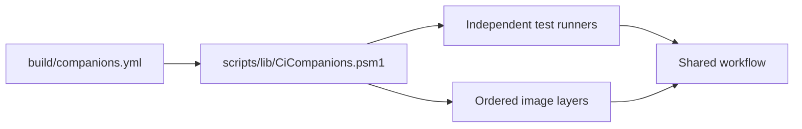

# Add a QuietCli companion

A companion owns the business meaning of a native tool. Core owns process execution, streaming,
hosting, lifecycle and bounded delivery. Keep tool-specific argument binding, parsing, projections,
supported-version policy and independent assertions in the companion and its test project.

This guide covers source integration, tests and CI. It does not authorize a push, image publication,
Gallery publication or release. A successful build or catalogue entry does not qualify a platform.

## 1. Define the business boundary

Choose the supported commands, argument forms and tool versions. Describe the business objects
returned to callers and how native failures, incomplete streams and unsupported forms are reported.
A command inventory is separate from semantic support.

Use [Vagrant](FrenchExDev2.QuietCli.Vagrant.PoSh/README.md) as the pure PowerShell example and
[Git](FrenchExDev2.QuietCli.Git.PoSh/README.md) for compiled parsers and a broader command catalogue.
See [companion modules](README-modules.md), [streaming](README-streaming.md) and
[PowerShell/C# boundaries](docs/README-powershell-csharp-boundaries.md).

## 2. Add the product and test projects

Use top-level workspace directories:

```text
FrenchExDev2.QuietCli.<Name>.PoSh/
  FrenchExDev2.QuietCli.<Name>.PoSh.psd1
  FrenchExDev2.QuietCli.<Name>.PoSh.psm1
  README.md
FrenchExDev2.QuietCli.<Name>.Tests.PoSh/
  FrenchExDev2.QuietCli.<Name>.Tests.PoSh.psd1
  FrenchExDev2.QuietCli.<Name>.Tests.PoSh.psm1
  README.md
```

Keep product dependencies in the manifests' `RequiredModules`. Product modules contain no tests.
The product manifest's `PrivateData.QuietCli` identifies its binary, test module and publication
eligibility. Test projects export their actual runner, following existing companions' summary and
progress contract. Imports must not rebuild, download dependencies or execute a native tool.

For a pure PowerShell companion, no compiled output is needed. For compiled code, add the project
to `Quietly.slnx` and declare its `PrivateData.QuietCli.BuildProjects` outputs. The shared build and
binary identity checks consume the same declarations:
[compiled distributions](docs/README-workspace-projects.md#compiled-distributions).

Stay in the monorepo. Do not create a child repository or an independent module history.

## 3. Implement and document the contracts

Register inert handlers on import. Reuse Core's execution and streaming APIs. Preserve exact native
argument vectors and keep only explicitly required business data. Do not add automatic raw-output
capture, output history, retries or implicit remote operations.

Declare actual version/platform coverage. Preserve source, licence and resource provenance. Missing
or incompatible resources must fail explicitly or be prepared by their owning consumer under the
documented guard. Review [resource preparation](README-resources.md) when adding a resource or reader.

Document public commands, supported forms, unsupported variants, installation and examples in the
companion README. New scripts belong under `scripts/`; dependent libraries belong under
`scripts/lib/`, with mirrored documentation under `docs/scripts/` and `docs/scripts/lib/`.

## 4. Add independent tests

Use the test companion for functional assertions, generated properties, malformed-input/fuzz corpora
and meaningful targeted mutations. Retain seeds, source identity, terminal summaries and failure
diagnostics. Mutating fixtures must be owned disposable repositories/directories.

Test observable effects independently of the returned projection. Distinguish native failures,
unsupported forms, missing tooling, skipped cases and incomplete runs. A metadata inventory is not
qualification, and running separate product suites does not establish cross-product integration.

## 5. CI

**Do not add a GitHub workflow file for each companion.** The shared
[companions-ci.yml](.github/workflows/companions-ci.yml) entry calls
[ci.yml](.github/workflows/ci.yml). [build/companions.yml](build/companions.yml) declares companions,
image requirements and independent test suites.

The entry scripts delegate to [scripts/lib/CiCompanions.psm1](scripts/lib/CiCompanions.psm1).
The library validates YAML, resolves dependencies and composes image plans. Existing image scripts
retain hash, architecture, identity and publication guards.



### Register a companion

Merge the entry into the existing `companions` section; keep only one occurrence of each YAML
section. Vagrant is already registered:

```yaml
companions:
  Vagrant:
    requires: [Core]
    image: none
```

Here, `requires` determines dependency ordering for CI image composition. Keep it consistent with
the product's requirements. Shared dependencies are deduplicated and cycles are rejected. Core
remains the base; test requirements do not add reverse product dependencies to it.

Image participation is explicit:

- `base`: the Core foundation.
- `none`: no additional native-tool image layer.
- `overlay`: prepare the companion-owned, locked tool layer.

Vagrant's current tests use fixtures without installing the Vagrant executable. `image: none`
describes that scope; it does not qualify real Vagrant execution.

### Register the functional suite

A suite names an existing test project and an exported runner. Vagrant's current declaration is:

```yaml
suites:
  Vagrant:
    test_project: FrenchExDev2.QuietCli.Vagrant.Tests.PoSh
    command: Invoke-QuietVagrantTests
    requires: [Vagrant]
    core_evidence: false
```

The resolver adds Core transitively. Importing Core does not execute its entire test suite.
`core_evidence` requests the standard Core evidence campaign, not merely the Core dependency.

`All` automatically includes every declared suite. Launcher choices and runner selection use the
same catalogue. Tool dependencies do not implicitly enable another suite's mutation campaigns.

### Add a dedicated Core–Vagrant integration suite

Implement a separate test project with Core and Vagrant import dependencies and a runner that
actually exercises their interaction. Once its manifest and runner exist, a declaration can be:

```yaml
suites:
  CoreVagrantIntegration:
    test_project: FrenchExDev2.QuietCli.CoreVagrant.Integration.Tests.PoSh
    command: Invoke-QuietCoreVagrantIntegrationTests
    requires: [Core, Vagrant]
    core_evidence: false
```

This is a **future registration example**. The delivered catalogue does not claim this integration
suite already exists. Missing projects and unexported commands are rejected. Follow the existing
runners' summary/progress contract consumed by
[Invoke-TestWorker.ps1](scripts/Invoke-TestWorker.ps1).

The test requirement belongs to the integration suite. Core's product dependencies remain unchanged.
Two independently successful functional suites do not replace a joint integration test.

### Add a native-tool layer when needed

If future assertions need the real Vagrant executable, provide a native, verified layer and change
its participation to `image: overlay`. The
[module-specific CI container reference](docs/README-module-specific-ci-container.md)
owns the file layout, contract fields, stage syntax, parent composition and fingerprint rules.
Follow that reference rather than duplicating image-building logic in a workflow.

Optional mutation controls belong to the suite's `qualification` section, with a RID, CLR major
version and variables implemented by its runner. YAML contains data and exported command identifiers,
not shell fragments. The shared workflow needs no companion-specific condition.

### Inspect and validate the selection

From the monorepo root:

```powershell
./scripts/Initialize-CiCompanions.ps1 -Suite Vagrant
./scripts/New-CiSuiteImage.ps1 -Suite Vagrant -RuntimeIdentifier linux-arm64 -PlanOnly
./scripts/New-CiSuiteImage.ps1 -Suite Vagrant -RuntimeIdentifier linux-x64 -WhatIf
```

The first command describes the selection. `PlanOnly` computes the final image without native
execution or registry access; its YAML reader may prepare the pinned parsing resource. Preparation
with `WhatIf` returns before effects.

Run the focused catalogue regression with the visible monitor:

```powershell
./scripts/Invoke-WorkspaceCi.ps1 -Suite Core -Case 'CI companion declarations*' -SkipBuild -SkipTty
```

Existing binaries must match their sources. This case checks generated graphs of 100 companions,
a dedicated integration runner, malformed YAML, parent identity and targeted mutations. It does not
replace the new companion's tests or complete platform qualification.

To deliberately execute the current Vagrant fixture suite locally:

```powershell
./scripts/Invoke-WorkspaceCi.ps1 -Suite Vagrant -SkipBuild
```

An implemented integration suite is selected by its own name. Local reports use the temporary root
printed by the monitored launcher.

### Understand triggers and qualification

`companions-ci.yml` covers `FrenchExDev2.QuietCli.*.PoSh/**`, `build/**` and shared sources.
Vagrant-only changes and future integration test projects therefore reach the common entry.
It currently requests `All`. Changed-suite selection, image build optimization and test scheduling
are separate work.

The reusable/manual workflow also accepts a declared suite. Image preparation/publication retains
its existing restrictions. A catalogue entry, a local checkpoint and an unexecuted platform plan
are not qualification evidence.

The shared entry replaces the old Core/Git entry workflows. Any required-check names in branch
protection must match that entry; repository scripts do not modify remote branch protection.

Core's suite declares its pinned Git tool requirement because the Git companion's supported range
starts at 2.40. This is a test-tool requirement, not a reverse product dependency.

## 6. Refresh documentation and source contracts

Review the documentation affected by the actual change. Regenerate the relevant indexes and lock:

```powershell
./scripts/Sync-ScriptsReadme.ps1 -Apply
./scripts/Sync-ScriptContracts.ps1 -Apply
./scripts/Sync-ResourcesReadme.ps1 -Apply
./scripts/Sync-DocsCredits.ps1 -Apply
./scripts/Update-WorkspaceLock.ps1
./scripts/Invoke-WorkspaceChecks.ps1
```

A real workflow edit also requires reviewing its `docs/ci/github/` contract, updating its SHA-256
receipt and running `Sync-GitHubWorkflowsReadme.ps1 -Apply`. Registering another companion or suite
in the catalogue does not require another workflow file.

Run the required qualification for the delivered revision before claiming release readiness.
A commit does not authorize pushing, and a push does not authorize publication.

<!-- credits:begin -->
## Credits

This document is covered by the mandatory [CREDITS.md](CREDITS.md), which records the licenses of [Git](https://github.com/git/git/blob/master/COPYING), [Vagrant](https://github.com/hashicorp/vagrant/blob/main/LICENSE) and [Microsoft .NET/PowerShell](https://github.com/PowerShell/PowerShell/blob/master/LICENSE.txt).
<!-- credits:end -->
