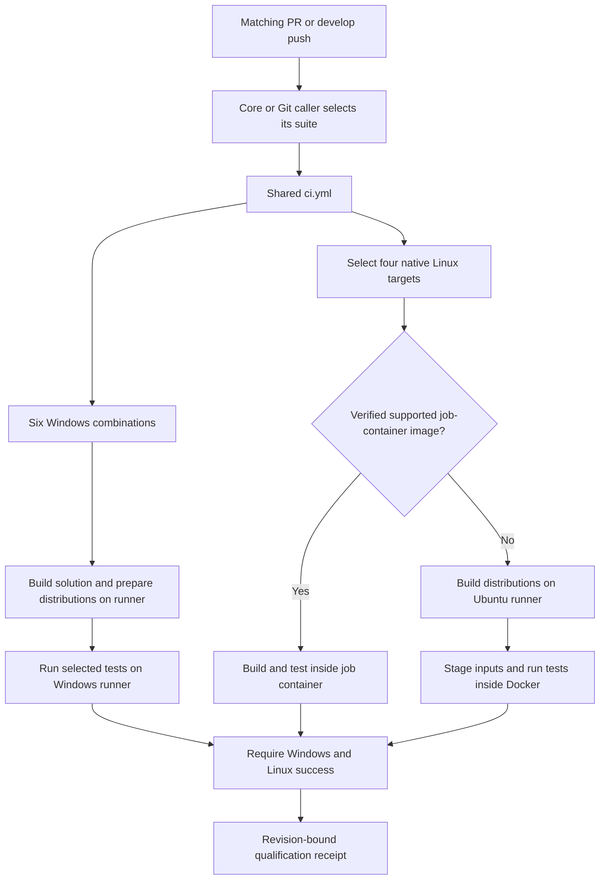

# Qualification: when, where and how

[QuietCli overview](README.md) · [Development](README-development.md) · [Tests and qualification](README-qualification.md) · [Documentation index](docs/README.md)

GitHub qualification builds the solution **and executes the selected companion tests**. Windows tests run directly on native runners; Linux tests run inside containers. A successful build alone does not qualify the software. This guide describes the configured execution paths, not the outcome of a particular workflow run.

## When tests run

The path-filtered callers select which suites enter the shared [ci.yml](.github/workflows/ci.yml) workflow:

- [core-ci.yml](.github/workflows/core-ci.yml) selects `Core` for PRs and `develop` pushes changing Core/Core.Tests, `scripts/**`, `build/**`, `.github/**`, `global.json`, `Quietly.slnx`, `Directory.Build.props`, `Directory.Packages.props`, `AGENTS.md` or `.gitattributes`.
- [git-ci.yml](.github/workflows/git-ci.yml) selects `Git` for PRs and `develop` pushes changing Git/Git.Tests, its own workflow, `Quietly.slnx`, `Directory.Build.props` or `Directory.Packages.props`.
- Opening a matching PR or updating its branch triggers the applicable PR workflows. Both callers can run for the same revision; Core and Git then have separate test matrices and qualification gates. A skipped caller due to its path filter is not evidence that its suite passed.
- A manual dispatch of `ci.yml` uses `All`. The reusable workflow accepts `suite`, defaulting to `All`; the Core/Git callers explicitly override that default.
- [publish-psgallery.yml](.github/workflows/publish-psgallery.yml) requests `All` qualification before packaging. Its Windows packaging job also rebuilds and rechecks the distributions. Publication has its own input and protected environment; qualification does not itself authorize publication.

`All` expands to the dependency-ordered companions discovered from manifests: currently Core, Git and Vagrant. It is an execution mode, not a module. Selecting `Git` imports required dependencies but does not execute the complete Core companion suite merely because that module is imported.

**Current Vagrant trigger gap:** neither PR caller selects Vagrant-only changes. A PR changing only Vagrant/Vagrant.Tests does not automatically run that suite through these two callers. Vagrant is covered when `All` is selected, including the publication qualification path and manual shared workflow. Adding a consumer to the project/build catalogue does not automatically create its GitHub trigger policy.

Local commits and pushes do not launch local companion suites. [Commit-Workspace.ps1](scripts/Commit-Workspace.ps1) checks source/documentation contracts and the source lock. [Push-Workspace.ps1](scripts/Push-Workspace.ps1) pushes and updates the existing PR; the resulting PR event can start GitHub tests independently.

Other path-filtered PR checks run on `ubuntu-latest`: [scripts-docs-check.yml](.github/workflows/scripts-docs-check.yml) checks the shared automation/documentation contracts, and [sync-credits-check.yml](.github/workflows/sync-credits-check.yml) checks credit aggregation and links. These jobs do not execute companion suites. A green documentation check alone does not establish functional test coverage.

## How a qualification job executes



The common build entry point is [Build-Workspace.ps1](scripts/Build-Workspace.ps1):

1. Verify build prerequisites and declared portable outputs.
2. Compile `Quietly.slnx` once, covering every project and target framework in the solution. `Directory.Build.props` treats compiler warnings as errors.
3. Prepare the declared portable distributions with `dotnet publish --no-build`. [Get-QuietWorkspaceBuildProjects](docs/README-workspace-projects.md#compiled-distributions) supplies the project/framework/output values from inert manifest declarations.
4. Build the engine's architecture-specific distributions and requested ReadyToRun slots separately, preserving their integrity receipts.

The workflow then calls [Invoke-GitHubCi.ps1](scripts/Invoke-GitHubCi.ps1) with the selected suite and `-SkipBuild`. **`-SkipBuild` skips rebuilding, not testing.** Existing binaries must still match their sources and integrity manifests. `Build-Workspace.ps1 -SolutionOnly` only compiles; it neither prepares all packaged distributions nor runs tests.

Without a fallback image argument, the GitHub entry calls [Invoke-TestWorker.ps1](scripts/Invoke-TestWorker.ps1) in the current runner/job-container PowerShell process. For Docker fallback, it calls [Invoke-ContainerWorker.ps1](scripts/Invoke-ContainerWorker.ps1), which stages the prepared workspace and invokes the same GitHub entry inside the guest.

The worker resolves the suite through [WorkspaceProjects.ps1](scripts/WorkspaceProjects.ps1), imports its test companion with `-DisableNameChecking`, and invokes the declared runner. It records case progress, passed/failed counts and a terminal summary. Importing a companion or compiling its projects is not equivalent to executing that runner.

## Where Windows tests run

Each selected suite has six native Windows combinations. For **each** of `win-x64` on `windows-latest` and `win-arm64` on `windows-11-arm`, the workflow runs:

- Stable PowerShell / CLR 10 with `Process`: the engine runs in a separate .NET 11 process.
- Stable PowerShell / CLR 10 with `InProcess`: the engine uses its compatible .NET 10 build in PowerShell.
- Preview PowerShell / CLR 11 with `InProcess`: the engine uses its .NET 11 build in PowerShell.

These jobs do not run in Windows containers. Each job selects its checksum-pinned PowerShell host, builds the required distributions and executes the selected suite. The source of exact host versions and archive checksums is [build/powershell-hosts.lock.json](build/powershell-hosts.lock.json), with the expected versions/modes declared in [the Windows matrix](.github/workflows/ci.yml).

The host CLR, engine hosting mode and compiled test executable framework are separate facts. In particular, the C# companion executables target .NET 11 even when the calling stable PowerShell host uses CLR 10. The SDK comes from [global.json](global.json).

## Where Linux tests run

Each selected suite has four native Linux targets:

- Debian x64, `linux-x64`, on an `ubuntu-latest` runner.
- Alpine x64, `linux-musl-x64`, on an `ubuntu-latest` runner.
- Debian ARM64, `linux-arm64`, on an `ubuntu-24.04-arm` runner.
- Alpine ARM64, `linux-musl-arm64`, on an `ubuntu-24.04-arm` runner.

The runner is the Ubuntu machine providing the CPU and Docker host. Debian/Alpine is the **guest environment where the tests execute**. ARM64 rows use ARM64 runners; an x64 execution is not accepted as ARM64 qualification. Current images use stable PowerShell hosts; Linux does not repeat the Windows Stable/Preview/Process matrix. Image and host pins are in [build/ci-images.lock.json](build/ci-images.lock.json).

[Select-GitHubCiMatrix.ps1](scripts/Select-GitHubCiMatrix.ps1) and [GitHubCi.ps1](scripts/GitHubCi.ps1) partition these four targets between two paths. Each target belongs to exactly one path:

- **GitHub job container:** when a compatible image is available at a verified immutable digest, both the source build and selected tests run inside that job container.
- **Docker fallback:** when that image is unavailable, build preparation runs on the Ubuntu runner. The selected image is prepared or reused, then sources, distributions, build policy and restored package inputs are copied into an owned container. The selected tests run inside it with `--network none`. The worker checks the guest's terminal report, real exit code and RID before accepting success.

Alpine ARM64 always uses Docker fallback because this execution policy excludes it from GitHub's JavaScript-action job-container path. Other targets use fallback when a verified image is unavailable. Therefore a skipped `Linux job container` job can be normal if the corresponding targets execute under `Linux Docker fallback`.

PR runs do not publish toolchain/consumer images. The image-publication jobs are restricted to the upstream `develop` push/manual conditions. Skipping those publication jobs does not skip the selected Linux tests: selection and execution have explicit dependency conditions. See [the execution model](docs/ci/execution-model.md) and [Linux images](docs/ci/linux-images.md).

## What tests execute

Companion runners execute both PowerShell cases and their compiled C# programs:

- Core invokes `QuietCli.Engine.Tests.dll` and its PowerShell cases, including functional integration evidence.
- Git invokes `QuietCli.Git.Parser.Tests.dll` and its PowerShell fixtures. Selected C# mutation catalogues are additionally enabled in Windows x64 Preview.
- Vagrant, when selected directly or through `All`, exercises parser/handler fixtures without requiring a real Vagrant provider. Real-provider smoke checks are separate opt-in runs.

The compiled programs are custom executable assertion runners, not a `dotnet test` discovery step. The shared worker evaluates their returned results. Adding a test project to the solution ensures it compiles; executing its tests still requires wiring it into its companion runner.

Core is a mixed suite: pure logic, temporary files/repositories, child processes, properties, malformed-input corpora and targeted mutations. It is not a unit-only suite. The focused `Integration` mode selects the import/performance workload, not every case with integration effects. See [test boundaries](docs/testing/commit-workspace.md) and [suite scopes](README-qualification.md).

For Core/All, Windows x64 Stable `InProcess` also runs the complete `RunProfiles` and `RunProfilesMutation` tooling suites. These tests are distinct from collecting performance profiles for every matrix row.

## What a green qualification does not include

- GitHub execution passes `-SkipTty`: native TTY/PTY execution and the standalone C property/fuzz/mutation campaigns are **excluded**, not successful by implication.
- PowerShell/CLR profiling and performance aggregation default to disabled. Manual `collect_performance=true` requests them. Functional integration assertions and revision-bound evidence bundles remain required without that option.
- Actual Vagrant-provider and interactive-console checks are not ordinary PR matrix tests.
- A filtered `-Case` run or a stopped/incomplete campaign establishes only its reported development scope.
- Ten configured environments per selected suite describe the intended matrix, not ten completed successes. Setup/build failures can prevent tests from starting. When both Core and Git callers apply, there are two independent ten-environment matrices, plus their tooling/control jobs.
- Successful job execution is distinct from repository branch-protection settings. A qualification receipt does not establish which checks GitHub requires before merge.

The shared qualification gate requires Windows and Linux success for the selected suite and emits a revision-bound `qualified_sha`. Linux aggregation requires the selected container/fallback paths to succeed. Requested performance reports can fail separately; performance aggregation is not a dependency of the functional qualification gate. Publication requests `All` and verifies the qualification revision before packaging.

## How to run local checks

From the repository root, build before importing the local modules:

```powershell
./scripts/Build-Workspace.ps1
```

Then use a **fresh PowerShell Core 7.6+ process with its normal profile** after rebuilding loaded assemblies. Select the required scope:

```powershell
# Choose the companion needed for the current development check.
./scripts/Invoke-WorkspaceCi.ps1 -Suite Core -SkipBuild
# Other selections: -Suite Git, -Suite Vagrant, or -Suite All.

# A focused, partial development regression rather than full qualification.
./scripts/Invoke-WorkspaceCi.ps1 -Suite Core -SkipBuild -Case 'solution build catalogue*'
```

These commands execute tests on the local host; they do not automatically create all ten GitHub environments. The local Windows launcher starts a background worker and visible read-only monitor, prints the report/reopening paths, and saves the terminal summary before closing the monitor. `-Headless` is for CI. Full local companion or mutation campaigns are explicit operations, not prerequisites automatically launched by a commit or push.

For prepared local Linux images, use [Invoke-ContainerCi.ps1](scripts/Invoke-ContainerCi.ps1) with the documented image, platform, suite and expected RID. It supervises tests in the guest through the local monitor. Runtime selection is explicit `-ContainerRuntime`, then the checkout's `.env`, then Podman-first application discovery. It does not silently pull an image, install tools or start a daemon. A local container result qualifies only its actual guest/runtime/suite scope.

## How to tell whether a GitHub job really tested

Open the PR's checks and expand the relevant workflow:

1. Identify the caller (`QuietCli2 Core` or `QuietCli2 Git`) and the Windows/RID or Linux target.
2. Check the build step separately from `Run selected suites ...`. Build success with a failed/skipped test step is not a passing test suite.
3. For Linux, inspect selection and the matching `Linux job container` or `Linux Docker fallback` job. Do not infer test coverage from image preparation/publication jobs.
4. Read case progress and the saved `summary.json` / suite reports. Inspect the uploaded evidence and, on failure, bounded diagnostic artifacts. The fallback worker preserves guest status, exit and identity evidence.
5. Check `linux-result` and the final qualification gate. An in-progress, skipped, cancelled or failed required path is not qualified.

Local reports are stored outside the checkout under the shared temporary report root resolved by [ReportPaths.ps1](scripts/ReportPaths.ps1). GitHub jobs retain their reports under `artifacts/` and upload evidence/diagnostics with workflow-specific retention. The launchers print the actual paths. Neither this guide nor the presence of a workflow proves that a particular revision has passed; use that revision's saved reports and GitHub check results.

<!-- credits:begin -->
## Credits

This document is covered by the mandatory [CREDITS.md](CREDITS.md), which records the licenses of [Git](https://github.com/git/git/blob/master/COPYING), [Vagrant](https://github.com/hashicorp/vagrant/blob/main/LICENSE) and [Microsoft .NET/PowerShell](https://github.com/PowerShell/PowerShell/blob/master/LICENSE.txt).
<!-- credits:end -->
