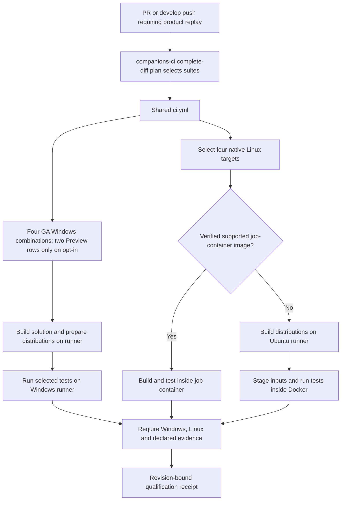

# Qualification: when, where and how

For All, one build and image serve the target: complete Core validation precedes bounded independent companion workers. Core.Tests generates its own scripted Git-status companion and requires no real Git module. Tooling runs separately. Develop reuses verified same-tree PR evidence, then runs integrity smoke and image-cache resolution; missing evidence falls back to All. Publication remains explicit-module-tag-only.

[QuietCli overview](README.md) · [Development](README-development.md) · [Tests and qualification](README-qualification.md) · [Documentation index](docs/README.md)

GitHub qualification builds the solution **and executes the selected companion tests**. Windows tests run directly on native runners; Linux tests run inside containers. A successful build alone does not qualify the software. This guide describes the configured execution paths, not the outcome of a particular workflow run.

[CI map, scripts and source-change dates](docs/ci/README.md) connects current execution paths to the changes through 12 November 2026. Dates refer to Git history, not checkout timestamps.

The shared [companions-ci.yml](.github/workflows/companions-ci.yml) caller selects suites for
[ci.yml](.github/workflows/ci.yml):

- Every PR receives a complete-diff plan. A companion-only change selects its dependent suites; shared/Core/unknown paths select All plus tooling. Multiple affected companions share one matrix.
- Opening or updating a PR triggers the caller. The unconditional QuietCli required CI check reports the planned scope, including intentional documentation-only omissions.
- Manual dispatch and reusable calls accept a YAML-declared `suite`, defaulting to `All`.
- A develop merge reuses successful PR qualification only for an identical Git tree and exact originating workflow attempt. It still runs merged-source integration smoke and refreshes missing image layers. Absent or mismatched proof requires full qualification; module tags separately request publication.
- [publish-psgallery.yml](.github/workflows/publish-psgallery.yml) requests `All` qualification before packaging. Its Windows packaging job also rebuilds and rechecks the distributions. Publication has its own input and protected environment; qualification does not itself authorize publication.

`All` expands to the independent suites in [build/companions.yml](build/companions.yml), currently
Core, Git and Vagrant. Products and suites are separate declarations: an integration suite can
require Core and Vagrant and name its own test runner. Tool requirements do not execute another
suite implicitly. Core's commit test requires Git's supported toolchain, but Core-only selection
does not execute Git's mutation campaigns. See [the CI catalogue](docs/scripts/lib/CiCompanions.md).

Local commits and pushes do not launch local companion suites. [Commit-Workspace.ps1](scripts/Commit-Workspace.ps1) checks source/documentation contracts and the source lock. [Push-Workspace.ps1](scripts/Push-Workspace.ps1) pushes and updates the existing PR; the resulting PR event can start GitHub tests independently.

Other path-filtered PR checks run on `ubuntu-latest`: [scripts-docs-check.yml](.github/workflows/scripts-docs-check.yml) checks the shared automation/documentation contracts, and [sync-credits-check.yml](.github/workflows/sync-credits-check.yml) checks credit aggregation and links. These jobs do not execute companion suites. A green documentation check alone does not establish functional test coverage.

## Profiling reports and manual PR runs

PR scopes declaring Core evidence request collect_performance=true. Core profiling runs across four GA Windows combinations and four Linux containers; explicitly selected next-version Preview adds two Windows combinations. A separate instrumented pass collects PowerShell line profiles and CLR traces outside the ordinary benchmark samples. The `Readable performance evidence for the complete matrix` job verifies the eight production evidence bundles (ten with Preview) and uploads `quietcli-performance-results-<sha>`, containing standalone `PERFORMANCES_RESULTS.html`, Markdown, JSON and integrity metadata. Download the artifact from the workflow run's **Artifacts** section and open the HTML locally. Raw profiles remain in the per-environment evidence artifacts. Missing or failed evidence prevents Core qualification; a partial report does not establish a completed matrix.

`RunProfiles` and `RunProfilesMutation` qualify the profiling tools themselves, in independent tooling jobs, outside the product timing runners. Mutation uses two matrix shards, each with its own green baseline and at most two isolated workers. Completion requires all 92 source-bound mutants exactly once, all Killed, with matching revision, source hashes, seed and iterations. Each shard alone is partial evidence. The GitHub entry accepts only validated partitions under explicit shard controls and retains Partial=true; complete aggregation remains required. See [the shard execution contract](docs/scripts/Invoke-GitHubCi.md#shard-execution-and-completion). The shard design does not enable or replace Core's selected eight- or ten-target profiling evidence. `collect_performance` controls that pass in CI; locally, `Invoke-WorkspaceCi.ps1 -Suite Integration -SkipBuild -Profiler` selects the focused instrumented workload. Keep profiler instrumentation outside A/A and A/B timing samples to avoid measuring the profiler's overhead as product performance.

To obtain profiling plus A/B evidence for a PR:

1. Push the intended commits to the PR branch. Matching changes automatically start the qualification/profiling workflow; the pushed revision must include this configuration.
2. Manually dispatch `quietcli2-readytorun.yml` on that same pushed branch. It compares IL and ReadyToRun builds of the selected revision after an A/A noise check; it does **not** compare the PR head with `develop`.
3. Check the source revision of both runs, then link the manual run in the PR. A PR-triggered run can use GitHub's merge ref, whereas manual dispatch tests the selected branch/tag; these are distinct checkout identities. The manual A/B run is informational and is not an automatic PR qualification dependency.

From the workspace root, the second step is:

```powershell
./scripts/Invoke-RemoteWorkflow.ps1 -Repository FrenchExDev2/QuietCli.PoSh -Workflow quietcli2-readytorun.yml -Ref fix/develop-pr-gh-wf
```

Replace the ref with the pushed PR branch. To rerun qualification manually as a separate run, use the same command with `-Workflow ci.yml`; that workflow defaults to `All` and `collect_performance=true`. To avoid duplicate qualification costs, the automatic PR run is normally sufficient.

In GitHub, open **Actions**, choose **QuietCli2 ReadyToRun profiling**, click **Run workflow** and select the PR branch. For manual qualification choose **QuietCli2 PR**, keep `suite=All` and `collect_performance` enabled. Dispatch requires the workflow to exist on the default branch, but the selected ref need not be `develop`. See [manual dispatch](docs/scripts/Invoke-RemoteWorkflow.md) and [the A/B report guide](docs/README-readytorun_profiling.md#manual-github-runs-and-pr-evidence).

## How a qualification job executes



The common build entry point is [Build-Workspace.ps1](scripts/Build-Workspace.ps1):

1. Verify build prerequisites and declared portable outputs.
2. Compile the selected dependency closure once, using an owned scoped solution; All builds `Quietly.slnx`. Undeclared cross-project references fail before compilation. `Directory.Build.props` treats compiler warnings as errors.
3. Prepare the declared portable distributions with `dotnet publish --no-build`. [Get-QuietWorkspaceBuildProjects](docs/README-workspace-projects.md#compiled-distributions) supplies the project/framework/output values from inert manifest declarations.
4. Build the engine's architecture-specific distributions and requested ReadyToRun slots separately, preserving their integrity receipts.

The workflow then calls [Invoke-GitHubCi.ps1](scripts/Invoke-GitHubCi.ps1) with the selected suite and `-SkipBuild`. **`-SkipBuild` skips rebuilding, not testing.** Existing binaries must still match their sources and integrity manifests. `Build-Workspace.ps1 -SolutionOnly` only compiles; it neither prepares all packaged distributions nor runs tests.

Without a fallback image argument, the GitHub entry calls [Invoke-TestWorker.ps1](scripts/Invoke-TestWorker.ps1) in the current runner/job-container PowerShell process. For Docker fallback, it calls [Invoke-ContainerWorker.ps1](scripts/Invoke-ContainerWorker.ps1), which stages the prepared workspace and invokes the same GitHub entry inside the guest.

The worker resolves the suite through [WorkspaceProjects.ps1](scripts/lib/WorkspaceProjects.psm1), imports its test companion with `-DisableNameChecking`, and invokes the declared runner. It records case progress, passed/failed counts and a terminal summary. Importing a companion or compiling its projects is not equivalent to executing that runner.

## Where Windows tests run

Each selected suite has four required native Windows combinations. `run_preview=true` explicitly adds two next-version Preview combinations; the default is false. For **each** of `win-x64` on `windows-latest` and `win-arm64` on `windows-11-arm`, the workflow runs:

- GA PowerShell 7.7.0 / CLR 11 with `Process`: the engine runs in a separate .NET 11 process.
- GA PowerShell 7.7.0 / CLR 11 with `InProcess`: the engine uses its .NET 11 build in PowerShell.
- Optional next-version Preview with `InProcess`: only a published release newer than GA is accepted. The current announced 7.8.0-preview.1 has no published archives, so opt-in fails explicitly until the lock is refreshed.

These jobs do not run in Windows containers. Each job selects its checksum-pinned PowerShell host, builds the required distributions and executes the selected suite. The source of exact host versions and archive checksums is [build/powershell-hosts.lock.json](build/powershell-hosts.lock.json), with the expected versions/modes declared in [the Windows matrix](.github/workflows/ci.yml).

The host CLR, engine hosting mode and compiled test executable framework are separate facts. In particular, the C# companion executables target .NET 11 while Alpine retains its explicitly accepted 7.6.9 / CLR 10 exception. The SDK comes from [global.json](global.json).

## Where Linux tests run

Each selected suite has four native Linux targets:

- Debian x64, `linux-x64`, on an `ubuntu-latest` runner.
- Alpine x64, `linux-musl-x64`, on an `ubuntu-latest` runner.
- Debian ARM64, `linux-arm64`, on an `ubuntu-24.04-arm` runner.
- Alpine ARM64, `linux-musl-arm64`, on an `ubuntu-24.04-arm` runner.

The runner is the Ubuntu machine providing the CPU and Docker host. Debian/Alpine is the **guest environment where the tests execute**. ARM64 rows use ARM64 runners; an x64 execution is not accepted as ARM64 qualification. Debian uses GA 7.7.0 / CLR 11; Alpine temporarily retains native 7.6.9-r0 / CLR 10 because its GA package and Microsoft musl ARM64 archive are unavailable; Linux does not repeat the Windows Stable/Preview/Process matrix. Image and host pins are in [build/ci-images.lock.json](build/ci-images.lock.json).

[Select-GitHubCiMatrix.ps1](scripts/Select-GitHubCiMatrix.ps1) and [GitHubCi.ps1](scripts/lib/GitHubCi.psm1) partition these four targets between two paths. Each target belongs to exactly one path:

- **GitHub job container:** when a compatible image is available at a verified immutable digest, both the source build and selected tests run inside that job container.
- **Docker fallback:** when that image is unavailable, build preparation runs on the Ubuntu runner. The selected image is prepared or reused, then sources, distributions, build policy and restored package inputs are copied into an owned container. The selected tests run inside it with `--network none`. The worker checks the guest's terminal report, real exit code and RID before accepting success.

Alpine ARM64 always uses Docker fallback because this execution policy excludes it from GitHub's JavaScript-action job-container path. Other targets use fallback when a verified image is unavailable. Therefore a skipped `Linux job container` job can be normal if the corresponding targets execute under `Linux Docker fallback`.

PR runs do not publish toolchain/consumer images. The image-publication jobs are restricted to the upstream `develop` push/manual conditions. Skipping those publication jobs does not skip the selected Linux tests: selection and execution have explicit dependency conditions. See [the execution model](docs/ci/execution-model.md) and [Linux images](docs/ci/linux-images.md).

## What tests execute

Companion runners execute both PowerShell cases and their compiled C# programs:

- Core invokes `QuietCli.Engine.Tests.dll` and its PowerShell cases, including functional integration evidence.
- Git invokes `QuietCli.Git.Parser.Tests.dll` and its PowerShell fixtures. Selected C# mutation catalogues are additionally enabled in Windows x64 Preview.
- Vagrant, when selected directly or through `All`, exercises parser/handler fixtures without requiring a real Vagrant provider. Real-provider smoke checks are separate opt-in runs.

The compiled programs are custom executable assertion runners, not a `dotnet test` discovery step. The shared worker evaluates their returned results. Adding a test project to the solution ensures it compiles; executing its tests still requires wiring it into its companion runner.

Core is a mixed suite: pure logic, temporary files/repositories, child processes, properties, malformed-input corpora and targeted mutations. It is not a unit-only suite. The focused `Integration` mode selects the import/performance workload, not every case with integration effects. See [test boundaries](docs/testing/commit-workspace.md) and [suite scopes](README-qualification.md).

`tooling-ci.yml` runs repository automation, functional RunProfiles, Distribution once using verified full IL outputs, a separate Core build/suite without the Git module, and the two mutation shards plus completion. Product rows do not repeat these packaging/tooling campaigns. Nine enabled Git mutation catalogues run in isolated process batches capped at two; each restores dependencies once and resets/recompiles pristine sources for every mutant. See [scheduling and mutations](docs/ci/scalable-companions.md).

## What a green qualification does not include

- GitHub execution passes `-SkipTty`: native TTY/PTY execution and the standalone C property/fuzz/mutation campaigns are **excluded**, not successful by implication.
- PowerShell/CLR profiling and HTML/Markdown/JSON matrix aggregation default to enabled for Core/All. Automatic companion/publication calls explicitly request them; qualification requires the successful combined report. A manual collection opt-out cannot qualify Core evidence. RunProfiles/RunProfilesMutation remain separate Windows tooling campaigns.
- Actual Vagrant-provider and interactive-console checks are not ordinary PR matrix tests.
- A filtered `-Case` run or a stopped/incomplete campaign establishes only its reported development scope.
- Eight production environments (ten with explicitly selected Preview) describe the configured scope; they do not establish completed successes. Several selected companions share one matrix; All runs Core before bounded independent companion workers. Setup/build failures can prevent tests from starting.
- Successful job execution is distinct from repository branch-protection settings. A qualification receipt does not establish which checks GitHub requires before merge.

The shared gate requires Windows and selected Linux paths, combined profiling for scopes declaring Core evidence, and tooling when requested. It emits `qualified_sha` only after acceptance and records revision, Git tree, run/attempt and TTY exclusion. A profiling opt-out cannot qualify Core. Git/Vagrant-only scopes expect profiling to be skipped. Publication requests All and verifies current-run exact-source evidence before packaging.

## How to run local checks

From the repository root, build before importing the local modules:

```powershell
./scripts/Build-Workspace.ps1
```

Then use a **fresh PowerShell Core 7.6+ process with its normal profile** after rebuilding loaded assemblies. Select the required scope:

```powershell
# Choose the companion needed for the current development check.
./scripts/Invoke-WorkspaceCi.ps1 -Suite Core -SkipBuild
# Other selections: -Suite Git, -Suite Vagrant, or -Suite All.

# A focused, partial development regression rather than full qualification.
./scripts/Invoke-WorkspaceCi.ps1 -Suite Core -SkipBuild -Case 'solution build catalogue*'
```

These commands execute tests on the local host; they do not automatically create the selected GitHub environments. The local Windows launcher starts a background worker and visible read-only monitor, prints the report/reopening paths, and saves the terminal summary before closing the monitor. `-Headless` is for CI. Full local companion or mutation campaigns are explicit operations, not prerequisites automatically launched by a commit or push.

For prepared local Linux images, use [Invoke-ContainerCi.ps1](scripts/Invoke-ContainerCi.ps1) with the documented image, platform, suite and expected RID. It supervises tests in the guest through the local monitor. Runtime selection is explicit `-ContainerRuntime`, then the checkout's `.env`, then Podman-first application discovery. It does not silently pull an image, install tools or start a daemon. A local container result qualifies only its actual guest/runtime/suite scope.

## How to tell whether a GitHub job really tested

Open the PR's checks and expand the relevant workflow:

1. Identify the `QuietCli2 Companions` impact plan, selected suites and Windows host/RID or Linux target. For manual/release runs, inspect explicit caller inputs.
2. Check the build step separately from `Run selected suites ...`. Build success with a failed/skipped test step is not a passing test suite.
3. For Linux, inspect selection and the matching `Linux job container` or `Linux Docker fallback` job. Do not infer test coverage from image preparation/publication jobs.
4. Read case progress and the saved `summary.json` / suite reports. Inspect the uploaded evidence and, on failure, bounded diagnostic artifacts. The fallback worker preserves guest status, exit and identity evidence.
5. Check `linux-result` and the final qualification gate. An in-progress, skipped, cancelled or failed required path is not qualified.

Local reports are stored outside the checkout under the shared temporary report root resolved by [ReportPaths.ps1](scripts/lib/ReportPaths.psm1). GitHub jobs retain reports under `artifacts/` with workflow-specific retention. Ordinary tooling artifacts select JSON/logs and case-worker reports, excluding nested workspaces/binaries/packages. Failed functional fixtures are uploaded separately for seven days; mutation artifacts are bound to SHA/shard/attempt. The launchers print the actual paths. Neither this guide nor the presence of a workflow proves that a particular revision has passed; use that revision's saved reports and GitHub check results.

<!-- credits:begin -->
## Credits

This document is covered by the mandatory [CREDITS.md](CREDITS.md), which records the licenses of [Git](https://github.com/git/git/blob/master/COPYING), [Vagrant](https://github.com/hashicorp/vagrant/blob/main/LICENSE) and [Microsoft .NET/PowerShell](https://github.com/PowerShell/PowerShell/blob/master/LICENSE.txt).
<!-- credits:end -->
