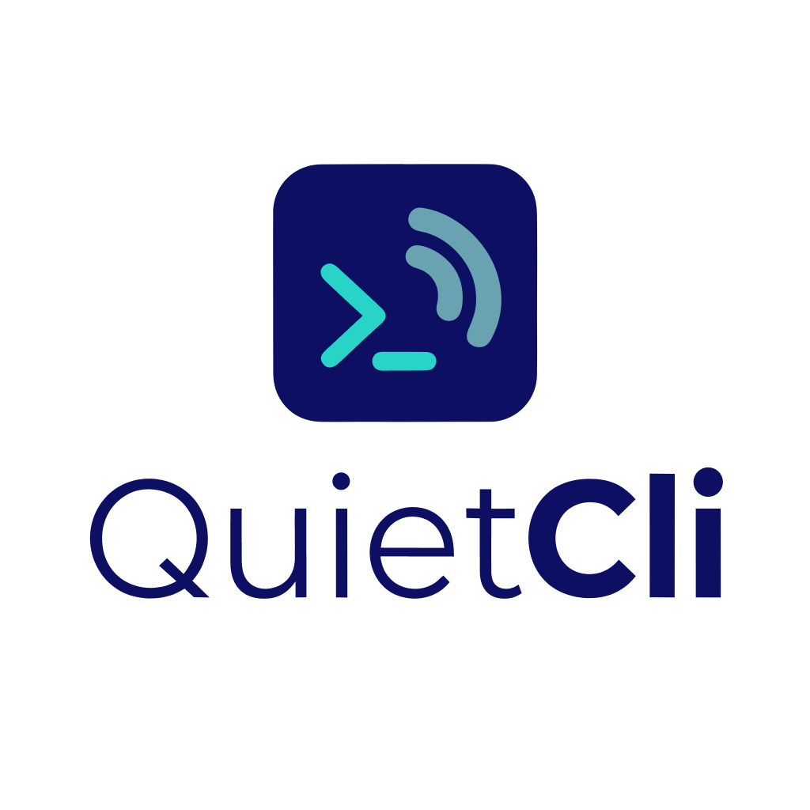

<p align="center">
  
</p>

# QuietCli

QuietCli (pronouced **Quietly**) turns native command output into structured PowerShell results for scripts and AI agents. The `quiet` command streams stdout and stderr, then uses your PowerShell callbacks or a companion module to extract the data you need.

Keep the result local with `-AsObject`, or share a bounded JSON or YAML view. Each result reports the execution outcome and whether the output and analysis are complete.

**Preview.** APIs and companion coverage may change. [Tests and qualification](readmes/README-qualification.md)

## How to install

Use PowerShell Core 7.6+ on Windows or Linux (x64 or ARM64). Install the native tools you plan to run separately. [Runtime and platform details](docs/README-PSGallery.md#runtime-requirements-and-supported-platforms)

### From PowerShell Gallery

```powershell
Install-PSResource -Name FrenchExDev2.QuietCli.Core.PoSh -Prerelease -Repository PSGallery -Scope CurrentUser
Import-Module FrenchExDev2.QuietCli.Core.PoSh -ErrorAction Stop
```

`-Prerelease` includes available preview packages.

### From a source checkout

From the repository root, use Git and the [.NET SDK pinned in `global.json`](global.json) to build Core. [SDK setup](readmes/README-dotnet-and-global-dot-json.md)

```powershell
./scripts/Initialize-Workspace.ps1 -Restore
./scripts/Build-Workspace.ps1
```

Open a fresh PowerShell session at the repository root and import the built module.

```powershell
Import-Module ./src/Core/src/FrenchExDev2.QuietCli.Core.PoSh/FrenchExDev2.QuietCli.Core.PoSh.psd1 -ErrorAction Stop
```

## Quick start

With a .NET SDK installed, turn `dotnet --version` into a result with a named `SdkVersion` field. QuietCli options go before the executable.

```powershell
$result = quiet -AsObject -RecordDelimiter "`n" -Data @{ Version = $null } `
    -StdOut {
        param($event, $runtime)
        $runtime.Data.Version = $event.Text.Trim()
    } -Complete {
        param($runtime)
        [pscustomobject]@{ SdkVersion = $runtime.Data.Version }
    } dotnet --version

$result.OnFailure({
    throw 'Could not read the .NET SDK version.'
}).Data
```

[Streaming, callbacks and results](readmes/README-streaming.md) · [Bounded delivery and privacy](readmes/README-measurements.md)

<a name="example-a-companion-module-git-under-development"></a>

## Companion modules

- [Git](src/Git/src/FrenchExDev2.QuietCli.Git.PoSh/README.md) supplies command handlers. With the companion imported, `quiet -AsObject git status` returns the branch, working tree entries and change counts.
- [Vagrant](src/Vagrant/src/FrenchExDev2.QuietCli.Vagrant.PoSh/README.md) provides structured events and a live dashboard for `vagrant up` and `vagrant provision`.

## Documentation

- [Documentation index](docs/README.md) for all guides, module READMEs, CI and audits.
- [AI agent setup](readmes/README-agents.md) for Codex and Claude Code.
- [Recall](readmes/README-recall.md) for capturing native output on demand and analyzing it later.

## License

[MIT](src/Core/src/FrenchExDev2.QuietCli.Core.PoSh/LICENSE)

<!-- credits:begin -->
## Credits

This document is covered by the mandatory [CREDITS.md](CREDITS.md), which records the licenses of all softwares which have QuietCli companions
<!-- credits:end -->
