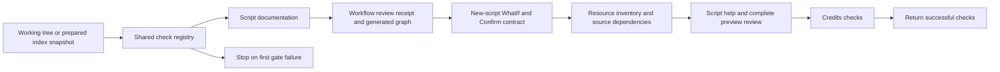

# Repository automation requirements as code

## RAC-WF-001: workflow documentation follows the source

Every file matching .github/workflows/*.* has a corresponding docs/ci/github/script-<basename>.md. The authored contract describes purpose, triggers, scripts/effects and validation limits. Any change to the source requires reviewing that document and updating its workflow-source-sha256 receipt; the generator never refreshes the receipt automatically. Duplicate basenames fail.

Sync-GitHubWorkflowsReadme.ps1 -Apply regenerates only the source-derived job/dependency Mermaid blocks, execution tables and README entry point. Test-GitHubWorkflowDocs.ps1 blocks missing docs, stale source receipts, required-section gaps and generated-content drift. Source hashes and graphs establish currency/structure, not semantic completeness or successful hosted execution.

## RAC-PS-001: new executable scripts support safe previews

New PowerShell scripts must support standard WhatIf and Confirm wherever an operation can mutate files, processes, containers, repositories or external services. Use CmdletBinding(SupportsShouldProcess) and guard the operation with $PSCmdlet.ShouldProcess before effects start. A hand-written WhatIf switch or unused attribute does not satisfy the rule. Add an actual no-write preview regression for a new mutating entry point.

Test-ScriptShouldProcess.ps1 inspects .ps1/.psm1 sources without executing them. Function-only libraries delegate mutation protection to their caller. A read-only entry point can use a reviewed exception with an explicit reason and exact code hash in build/script-shouldprocess.json; code changes invalidate the exception. The frozen inventory from revision f3bd449 is reported separately as legacy and remains unqualified. Never expand it to silently grandfather a new script. Generated/binary/artifact directories are excluded; authored scripts/lib remains included and links fail.

The AST check proves API/guard presence, not complete side-effect control flow. Runtime preview tests and review remain necessary. No fake Confirm or WhatIf parameter should be added to a purely read-only checker merely to satisfy a spelling test.

## Resource preparation and documentation

RAC-RES-001 treats resources as a documented contract. [README-resources.md](../README-resources.md) explains preparation; Sync-ResourcesReadme.ps1 derives the [inventory and source dependencies](resources/README.md) from the lock and readers/writers. Test-Resources.ps1 checks drift without downloading or building payloads.

Workflow parsing calls Ensure-QuietResource: verified bytes are reused, missing or tampered YamlDotNet bytes are restored selectively through ShouldProcess, then verified before loading. This works without a preceding GitHub step. WhatIf never restores a resource; a parser that is unavailable cannot complete the preview check. An incompatible loaded assembly requires a fresh process. dotnet restore does not prepare these module resources. Optional GitHub caching reuses archives and never replaces checksum validation.

## Script help, quiet loading and complete preview review

RAC-PS-002 removes objective comment headers and automatic objective announcements from automation ps1 files. Describe purpose in English comment-based help. Sync-ScriptContracts.ps1 removes obsolete boilerplate, preserves detailed guards, adds missing whole-operation guards, and generates mirrored execution contracts plus the [complete review](scripts/preview-support.md). Default mode and Test-ScriptContracts are check-only. Apply supports WhatIf/Confirm. Function-only libraries, profile data and read-only observers have distinct documented boundaries.

Comments alone produce no console output. A monitored before/after experiment removes only the header from a real Credits registry check and asserts identical output; 64 generated Unicode comments are also inert, and loading the resource/report libraries is silent. The earlier visible tags came from explicit Write-Host calls. Generic entry-point announcements are removed; useful operation progress and terminal summaries remain without that tag. Long tests stream bounded tails of existing reports in both the visible monitor and waiting launcher; bytes/lines are activity, not test counts. Reports survive monitor closure. This never enables raw product-output capture or event retention, which requires explicit -CollectEvents.

## Shared check pipeline

Invoke-WorkspaceChecks.ps1 is the ordered registry: ScriptsReadme, GitHubWorkflowDocs, ScriptShouldProcess, Resources, ScriptContracts, DocsCredits and Credits. Check selects names; SkipCheck explicitly reports omissions. Add a gate once in that registry. scripts-docs-check.yml invokes it on applicable PR/develop/manual events; only guarded parser preparation can write prerequisite resource/cache files, never generated documentation or repository metadata.

Commit-Workspace uses the same registry. Its default mode checks the working tree before guarded lock refresh/staging/commit. NoAll exports the prepared index, verifies that snapshot's source lock, then checks that snapshot's documentation and policy; unstaged repairs cannot qualify a bad index. WhatIf still runs checks, but performs no repository mutation. Temporary index exports are retained only for the duration of validation and removed from their checked owned root.

This local pipeline does not run companions. Feature/fix commits and pushes do not require a full local campaign; ask before starting one unless explicitly requested. Applicable GitHub workflows retain their qualification gates. [The commit-suite review](testing/commit-workspace.md) distinguishes pure logic, real Git/filesystem integration and optional local execution.

Compatibility switches include NoGitHubWorkflowDocsCheck, NoScriptShouldProcessCheck, NoResourcesCheck and NoScriptContractsCheck. Generic SkipCheck supports later registry additions. NoSyncChecks skips documentation checks and retains the independent ScriptShouldProcess gate. A skipped check is not evidence of compliance.

## Acceptance evidence

AutomationContracts.Tests.ps1 checks Docker/Podman availability combinations, generated ShouldProcess scripts, malformed contracts, actual WhatIf no-write execution, source/graph/index drift and explicit skip reporting. CommitWorkspace.Tests.ps1 checks disposable repositories, prepared-index isolation, WhatIf, commit-once behavior, documentation failures and targeted mutants. Local launchers retain visible monitoring and saved reports. Neither documentation generation nor a targeted campaign substitutes for the release qualification matrix.

[Workflow index](ci/github/README.md) · [Execution model](ci/execution-model.md) · [Script index](scripts/README.md).

<!-- credits:begin -->
## Credits

This document is covered by the mandatory [CREDITS.md](../CREDITS.md), which records the licenses of [Git](https://github.com/git/git/blob/master/COPYING), [Vagrant](https://github.com/hashicorp/vagrant/blob/main/LICENSE) and [Microsoft .NET/PowerShell](https://github.com/PowerShell/PowerShell/blob/master/LICENSE.txt).
<!-- credits:end -->
