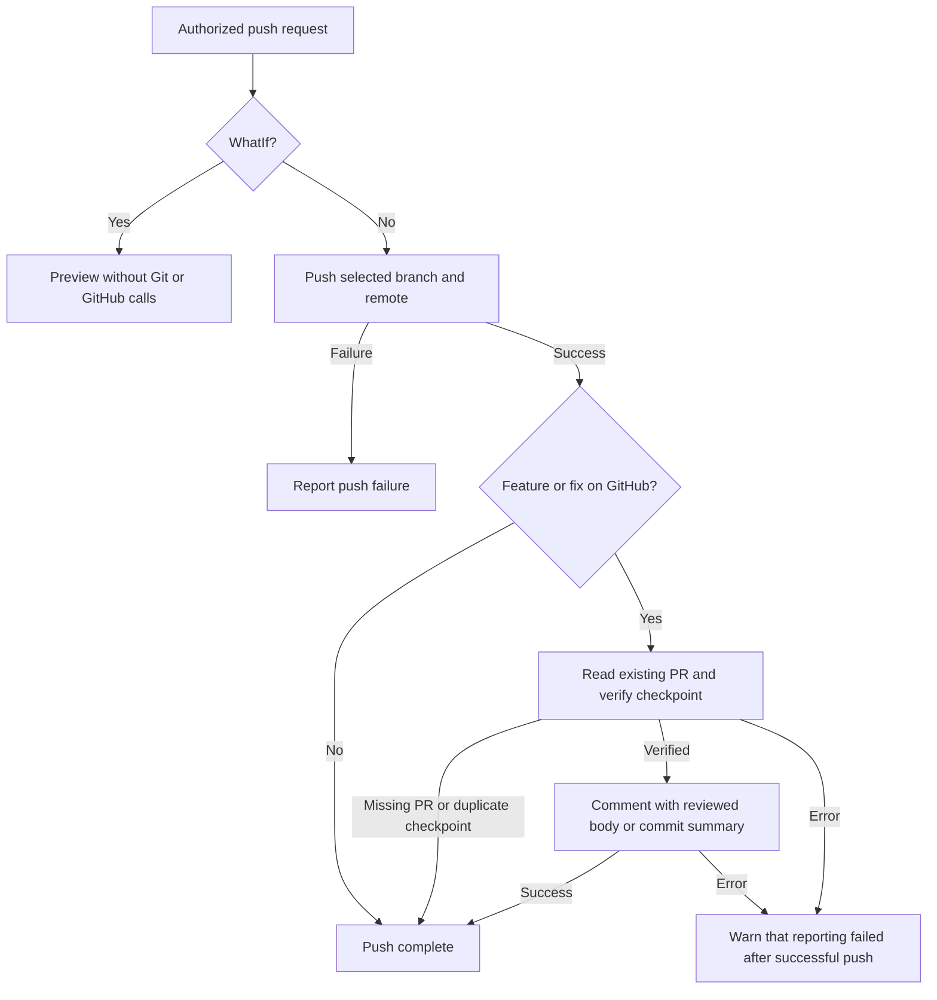
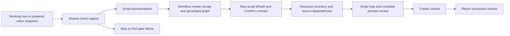

# Repository automation requirements as code

## RAC-BUILD-001: one solution build and declared consumer distributions

Local and GitHub build paths delegate to `Build-Workspace.ps1`. It compiles `Quietly.slnx` exactly once for portable outputs, with `TreatWarningsAsErrors=true`, then prepares each declared distribution using `dotnet publish --no-build`. `Get-QuietWorkspaceBuildProjects` reads inert `PrivateData.QuietCli.BuildProjects` declarations and supplies the same project/framework/output values to the build and binary identity. A future compiled consumer joins the solution and declares its outputs without edits to launcher lists; pure PowerShell consumers declare no compiled outputs. Core RID/ReadyToRun publications retain their architecture-specific builds.

Acceptance evidence is executable in the Core companion: the solution-build catalogue case discovers a synthetic Packer consumer, exercises 32 generated output paths, malformed declarations and three targeted source mutants, and checks generic dependency/policy hashing. The ReadyToRun case checks one solution compilation and all declared no-build portable publications for each of 64 RID subsets, no-effect WhatIf, SolutionOnly isolation and no publication after compilation failure. Container-input assertions require the solution and build policy in staged workspaces. Workflow filters include shared solution/build/package inputs, and the existing workflow documentation gate checks their receipts. Focused runs remain partial development evidence; successful hosted execution is established only by the GitHub matrix.

Shared workers import companion modules with `-DisableNameChecking`; the isolated helper-import regression rejects warning output from that import. Other PowerShell warnings remain visible.

## RAC-PR-001: feature/fix push reporting

After authorized feature/fix pushes to GitHub, the [push script](scripts/Push-Workspace.md) uses the
[shared reporting helper](scripts/lib/PullRequestUpdates.md) to read the PR, verify its checkpoint and
comment via GitHub CLI. Pass a reviewed Markdown body to document implementation details and actual
validation; the default lists current PR commits without claiming qualification. WhatIf performs
neither push nor comment, missing PRs are not created, duplicate checkpoints are skipped, and comment
errors remain distinct from push success. This repository rule applies to agent-authorized pushes;
it installs no Git hook or background automation on unrelated repositories.

## RAC-ENV-001: shared local and GitHub resolution

Configuration-dependent automation uses a shared resolver: explicit invocation options, then the
selected checkout's `.env`, then programmatic discovery. Invalid/empty or duplicate configured
runtime assignments fail explicitly. Discovery prefers Podman before Docker on Windows and Linux.
`Initialize-CiEnvironment.ps1 -Target Local|GitHub` generates the preset through the guarded dotenv
editor. Applicable GitHub jobs initialize their Docker preset after checkout. Tests cover precedence,
platform-independent Podman preference, malformed literals, idempotence and no-write previews. Only an effective
public runtime key is staged for containers; private dotenv files and other keys are not copied.
See [the environment contract](ci/environment.md).

## RAC-WF-001: workflow documentation follows the source

Every file matching .github/workflows/*.* has a corresponding docs/ci/github/script-<basename>.md. The authored contract describes purpose, triggers, scripts/effects and validation limits. Any change to the source requires reviewing that document and updating its workflow-source-sha256 receipt; the generator never refreshes the receipt automatically. Duplicate basenames fail.

Sync-GitHubWorkflowsReadme.ps1 -Apply regenerates only the source-derived job/dependency Mermaid blocks, execution tables and README entry point. Test-GitHubWorkflowDocs.ps1 blocks missing docs, stale source receipts, required-section gaps and generated-content drift. Source hashes and graphs establish currency/structure, not semantic completeness or successful hosted execution.

## RAC-PS-001: new executable scripts support safe previews

New PowerShell scripts must support standard WhatIf and Confirm wherever an operation can mutate files, processes, containers, repositories or external services. Use CmdletBinding(SupportsShouldProcess) and guard the operation with $PSCmdlet.ShouldProcess before effects start. A hand-written WhatIf switch or unused attribute does not satisfy the rule. Add an actual no-write preview regression for a new mutating entry point.

Test-ScriptShouldProcess.ps1 inspects .ps1/.psm1 sources without executing them. Function-only libraries delegate mutation protection to their caller. A read-only entry point can use a reviewed exception with an explicit reason and exact code hash in build/script-shouldprocess.json; code changes invalidate the exception. The frozen inventory from revision f3bd449 is reported separately as legacy and remains unqualified. Never expand it to silently grandfather a new script. Generated/binary/artifact directories are excluded; authored scripts/lib remains included and links fail.

The AST check proves API/guard presence, not complete side-effect control flow. Runtime preview tests and review remain necessary. No fake Confirm or WhatIf parameter should be added to a purely read-only checker merely to satisfy a spelling test.

## Resource preparation and documentation

RAC-RES-001 treats resources as a documented contract. [README-resources.md](../README-resources.md) explains preparation; Sync-ResourcesReadme.ps1 derives the [inventory and source dependencies](resources/README.md) from the lock and readers/writers. Test-Resources.ps1 checks drift without downloading or building payloads.

Workflow parsing calls Ensure-QuietResource: verified bytes are reused, missing or tampered YamlDotNet bytes are restored selectively through ShouldProcess, then verified before loading. This works without a preceding GitHub step. WhatIf never restores a resource; a parser that is unavailable cannot complete the preview check. An incompatible loaded assembly requires a fresh process. dotnet restore does not prepare these module resources. Optional GitHub caching reuses archives and never replaces checksum validation.

## Script help, quiet loading and complete preview review

RAC-PS-002 removes objective comment headers and automatic objective announcements from automation ps1 files. Describe purpose in English comment-based help. Sync-ScriptContracts.ps1 removes obsolete boilerplate, preserves detailed guards, adds missing whole-operation guards, and generates mirrored execution contracts plus the [complete review](scripts/preview-support.md). Default mode and Test-ScriptContracts are check-only. Apply supports WhatIf/Confirm. Function-only libraries, profile data and read-only observers have distinct documented boundaries.

Comments alone produce no console output. A monitored before/after experiment removes only the header from a real Credits registry check and asserts identical output; 64 generated Unicode comments are also inert, and loading the resource/report libraries is silent. The earlier visible tags came from explicit Write-Host calls. Generic entry-point announcements are removed; useful operation progress and terminal summaries remain without that tag. Long tests stream bounded tails of existing reports in both the visible monitor and waiting launcher; bytes/lines are activity, not test counts. Reports survive monitor closure. This never enables raw product-output capture or event retention, which requires explicit -CollectEvents.

## RAC-PS-003 / RAC-PS-004: entry points and imported libraries

Every executable `scripts/**/*.ps1` uses `Verb-Noun`: a capitalized alphabetic verb and
an alphanumeric noun. Custom verbs such as `Commit` remain valid; the gate checks syntax,
not the approved PowerShell verb catalogue. Inert profiles use `.profile.psd1`.
Entry points contain no functions or filters, including inside nested script blocks.
Functions live in `scripts/lib/**/*.psm1`, with explicit exports and dependencies.
Import using `-DisableNameChecking -ErrorAction Stop`; imports define commands without
running business operations. Compose paths using `System.IO.Path`, never `Join-Path`.

The [layout gate](scripts/Test-ScriptLayout.md) statically parses the supplied checkout or
prepared index snapshot. It rejects invalid names, function placement, misplaced modules,
module dot sourcing, imports without enabled name-check suppression, `Join-Path`, syntax
errors and links. Legacy preview exceptions never waive this structural policy. The
shared registry runs it first for local checks, `Commit-Workspace` and GitHub CI;
`-NoSyncChecks` keeps it active and `-SkipCheck ScriptLayout` reports an omission.

Moved entry points keep their public parameters and defaults and forward explicitly bound
options to one exported library operation. Keeping that orchestration with its nested
helpers preserves variable scope and delegated preview guards. The preview checker resolves
only a literal local library and matching forwarded command; it does not import the subject.
Static checks cannot establish runtime side-effect safety or resolve arbitrary dynamic aliases.
The Tooling companion checks generated valid names, malformed sources, nested functions,
imports, qualified commands and targeted policy mutations. Focused runs remain development
evidence; GitHub qualification remains separate.

## Shared check pipeline

The TestCaseMetadata gate also validates the test manifest's inert `PrivateData.QuietCli.TestExecution` declarations. Only explicitly isolated Core cases can share a bounded batch; Ordered defaults and Exclusive measurement/source-lock barriers preserve their order. `-Plan` exposes the prepared stages without execution; every actual Core run saves the resolved plan. Child workers receive one internal slot, private configuration/database/reports, exact case selection and the same host/RID expectations. Failure, timeout, cancellation and receipt mismatches cannot yield qualification. See [classification and concurrency](README-test-classification-and-concurrency.md).

Invoke-WorkspaceChecks.ps1 is the ordered registry: ScriptLayout, TestCaseMetadata, ScriptsReadme, GitHubWorkflowDocs, ScriptShouldProcess, Resources, ScriptContracts, DocsCredits and Credits. Check selects names; SkipCheck explicitly reports omissions. TestCaseMetadata reads the complete Core case catalogue without executing it; missing or invalid metadata fails before costly tests. Core's runtime guard also precedes selection and TTY exclusion. See [classification and concurrency](README-test-classification-and-concurrency.md). Add a gate once in that registry. scripts-docs-check.yml invokes it on applicable PR/develop/manual events, including Core test-source changes; only guarded parser preparation can write prerequisite resource/cache files, never generated documentation or repository metadata.

Commit-Workspace uses the same registry. Its default mode checks the working tree before guarded lock refresh/staging/commit. NoAll exports the prepared index, verifies that snapshot's source lock, then checks that snapshot's documentation and policy; unstaged repairs cannot qualify a bad index. WhatIf still runs checks, but performs no repository mutation. Temporary index exports are retained only for the duration of validation and removed from their checked owned root.

This local pipeline does not run companions. Feature/fix commits and pushes do not require a full local campaign; ask before starting one unless explicitly requested. Applicable GitHub workflows retain their qualification gates. [The commit-suite review](testing/commit-workspace.md) distinguishes pure logic, real Git/filesystem integration and optional local execution.

Compatibility switches include NoGitHubWorkflowDocsCheck, NoScriptShouldProcessCheck, NoResourcesCheck and NoScriptContractsCheck. Generic SkipCheck supports later registry additions. NoSyncChecks skips documentation checks and retains the independent ScriptLayout and ScriptShouldProcess gates. A skipped check is not evidence of compliance.

## Acceptance evidence

AutomationContracts.Tests.ps1 checks Docker/Podman availability combinations, generated ShouldProcess scripts, malformed contracts, actual WhatIf no-write execution, source/graph/index drift and explicit skip reporting. CommitWorkspace.Tests.ps1 checks disposable repositories, prepared-index isolation, WhatIf, commit-once behavior, documentation failures and targeted mutants. Local launchers retain visible monitoring and saved reports. Neither documentation generation nor a targeted campaign substitutes for the release qualification matrix.

[Workflow index](ci/github/README.md) · [Execution model](ci/execution-model.md) · [Script index](scripts/README.md).

<!-- credits:begin -->
## Credits

This document is covered by the mandatory [CREDITS.md](../CREDITS.md), which records the licenses of [Git](https://github.com/git/git/blob/master/COPYING), [Vagrant](https://github.com/hashicorp/vagrant/blob/main/LICENSE) and [Microsoft .NET/PowerShell](https://github.com/PowerShell/PowerShell/blob/master/LICENSE.txt).
<!-- credits:end -->
