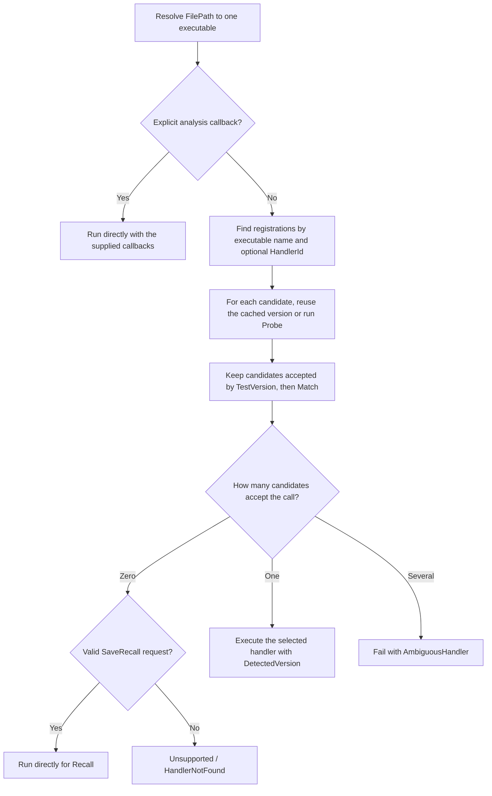
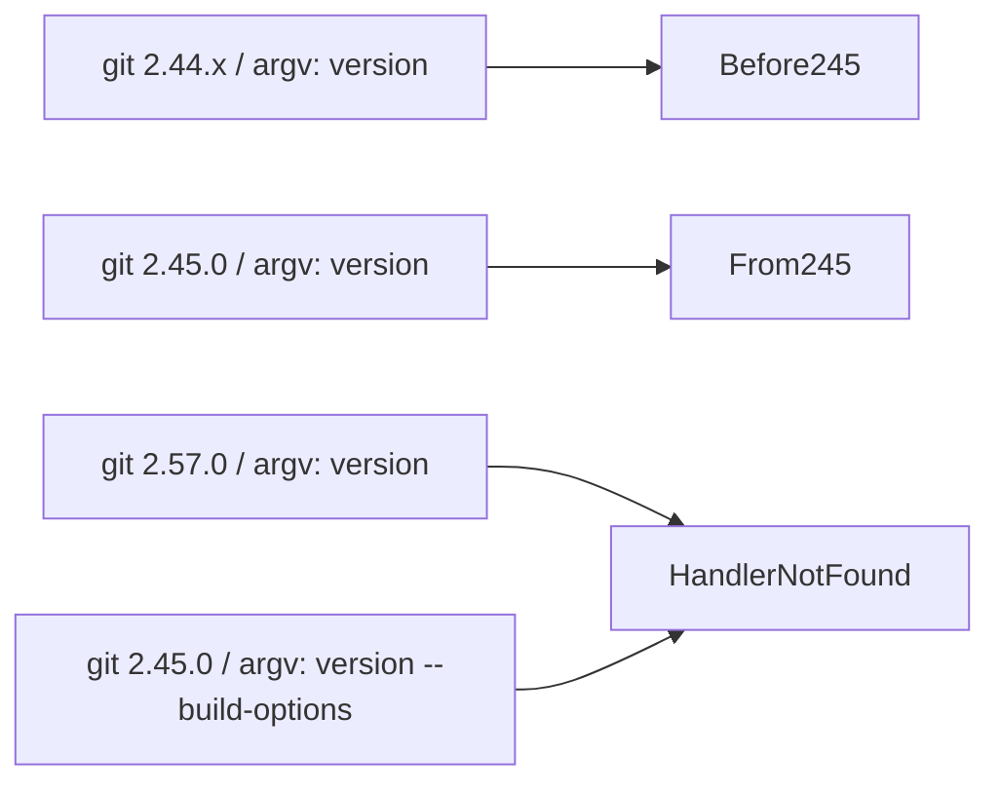

# How to support multiple versions of a native executable

QuietCli can register several handlers for the same executable name. Each invocation resolves one executable path, detects a version through a handler's probe, and selects the registered handler whose version and argument checks accept the call.

## Run two installations in the same session

Pass an explicit **executable path** with `-FilePath` to choose an installation. Keep the native command and its arguments in `-ArgumentList`. With the published Git companion imported and the variables set to your two Git executable paths:

```powershell
$older = quiet -AsObject -FilePath $git244 -ArgumentList @('status')
$newer = quiet -AsObject -FilePath $git245 -ArgumentList @('status')
```

Run those calls from a Git working tree or supply `-WorkingDirectory`. Inspect each result's `Outcome`, `Error`, `Execution` and both `Completeness` flags before consuming `Data`. With `-FilePath git`, QuietCli uses the first executable found in the host's `PATH`. The path you pass should retain the registered executable name. On Windows, `git.exe` matches `Binary = 'git'`.

The published Git companion registers one handler and accepts stable Git from 2.40.0 up to, but excluding, 2.57.0, including Git for Windows builds. It adapts its internal `status` probe from 2.45.0 onward by adding `rev-parse --show-ref-format`. Vagrant's `up` and `provision` handlers have distinct IDs and argument checks and share a version policy. [Git version policy](../src/Git/src/FrenchExDev2.QuietCli.Git.PoSh/FrenchExDev2.QuietCli.Git.PoSh.psm1#L23) · [Git status probe](../src/Git/src/FrenchExDev2.QuietCli.Git.PoSh/src/StatusState.ps1#L61) · [Vagrant registrations](../src/Vagrant/src/FrenchExDev2.QuietCli.Vagrant.PoSh/FrenchExDev2.QuietCli.Vagrant.PoSh.psm1#L30)

## How the resolver decides



`TestVersion` and `Match` each return one Boolean. `Match` receives the request and detected version. A missing `Match` accepts every argument form for a compatible version. `VersionRange` and `SupportedForms` are descriptive metadata. Use `Get-QuietHandler -Binary git` to inspect them without running a probe. `-HandlerId` restricts the candidate set while retaining executable, version and argument checks.

The probe cache key includes the handler ID, resolved path, file size, last-write timestamp and explicit child environment overrides. Two handler IDs can therefore run the same probe separately on their first call. Two executable paths get separate cache entries. An ambiguous selection or a callback error surfaces as `InvocationFailed`, with the reason in the error message. A valid `-SaveRecall -AsObject` call can run directly when zero handlers match. [Selection and diagnostics](README-companion-handler-selection.md) · [Probe cache identity](../src/Core/src/FrenchExDev2.QuietCli.Core.PoSh/engine/ProbeIdentity.cs#L14)

## Register two handlers for the same Git command

Use a fresh PowerShell session with Core installed and leave the Git companion unloaded. The example splits the exact `git version` command at 2.45.0. The two handlers share their argument matcher and native reader. Each returns its handler ID along with the Git version so you can observe which route was selected. The ranges are for this routing example.

Set `$gitPaths` to both binary paths to exercise both routes in one session. The default uses the Git on your `PATH`.

```powershell
if (-not (Get-Module FrenchExDev2.QuietCli.Core.PoSh)) {
    Import-Module FrenchExDev2.QuietCli.Core.PoSh -ErrorAction Stop
}
if (Get-QuietHandler -Binary git) {
    throw 'Run the example in a session with only QuietCli Core loaded.'
}

$gitPaths = @((Get-Command git -CommandType Application -ErrorAction Stop)[0].Source)
# $gitPaths = @('/opt/git-2.44/bin/git', '/opt/git-2.45/bin/git')

$readVersion = {
    param($parent, $role, $form)
    $result = quiet -Mode Script -AsObject -Role $role -FilePath $parent.Request.FilePath `
        -ArgumentList @($form) -WorkingDirectory $parent.Request.WorkingDirectory `
        -Environment $parent.Request.Environment -TimeoutSeconds $parent.Request.TimeoutSeconds `
        -RecordDelimiter "`n" -MaxRecordBytes 1024 -Data @{ Version = $null } -StdOut {
            param($event, $runtime)
            if ($null -ne $runtime.Data.Version -or
                $event.Text.TrimEnd("`r") -cnotmatch '\Agit version (\S+)\z') {
                throw 'Unexpected Git version record'
            }
            $runtime.Data.Version = $Matches[1]
        }
    [void]$result.OnFailure({ throw 'Git version observation failed' })
    if (!$result.Data.Version) { throw 'Git version observation failed' }
    $result.Data.Version
}

$probe = {
    param($runtime)
    & $readVersion $runtime Probe '--version'
}.GetNewClosure()
$matchVersionCommand = {
    param($request, $version)
    $request.ArgumentList.Count -eq 1 -and $request.ArgumentList[0] -ceq 'version'
}

$registeredIds = [Collections.Generic.List[string]]::new()
try {
    foreach ($variant in @(
        @{ Id = 'Example.Git.Version.Before245'; Min = '2.40.0'; Max = '2.45.0' }
        @{ Id = 'Example.Git.Version.From245'; Min = '2.45.0'; Max = '2.57.0' }
    )) {
        $id = $variant.Id
        $min = [version]$variant.Min
        $max = [version]$variant.Max
        Register-QuietHandler -Id $id -Definition @{
            Binary = 'git'
            VersionRange = "stable >=$min <$max, including .windows.N"
            SupportedForms = @('version')
            Qualification = 'Example'
            Probe = $probe
            TestVersion = {
                param($version)
                if ($version -cnotmatch '\A([0-9]+\.[0-9]+\.[0-9]+)(?:\.windows\.[0-9]+)?\z') {
                    return $false
                }
                $number = $null
                [version]::TryParse($Matches[1], [ref]$number) -and $number -ge $min -and $number -lt $max
            }.GetNewClosure()
            Match = $matchVersionCommand
            Execute = {
                param($runtime)
                [pscustomobject]@{
                    Handler = $id
                    Version = (& $readVersion $runtime Business 'version')
                }
            }.GetNewClosure()
        } -ErrorAction Stop
        $registeredIds.Add($id)
    }

    foreach ($path in $gitPaths) {
        $result = quiet -Mode Script -AsObject -FilePath $path -ArgumentList @('version')
        [void]$result.OnFailure({
            param($r)
            throw "Version routing failed for $path ($($r.Outcome)): $($r.Error.Message -join ', ')"
        })
        $result.Data
    }
} finally {
    foreach ($id in $registeredIds) { Unregister-QuietHandler -Id $id }
}
```



A companion module should register the IDs during import and unregister its own IDs on removal. If you introduce these variants into the production Git companion, narrow its current registration's `Match` so only the variants accept the migrated form. Include that remaining registration in the overlap tests. For production Git forms, reuse the companion's argument binding to handle global flags, options and literal `--`. Use a local capability check within a single handler when only one internal native argument changes. Split handlers when versions require materially different native forms or parsers, and keep the documented result contract stable. [Standalone companion setup](README-create-git-handler.md#load-the-handler-from-a-standalone-module) · [Git argument binding](../src/Git/src/FrenchExDev2.QuietCli.Git.PoSh/FrenchExDev2.QuietCli.Git.PoSh.psm1#L34)

## What to improve and test

| Proposed improvement | Acceptance tests |
| --- | --- |
| **Test selection through `quiet`.** Retain Core's existing resolver. Add synthetic registrations with the same binary and controlled probes. Call the facade without `-HandlerId` and count every handler's `Execute` call. | Reversing registration order gives the same selection. Exercise 2.39.x, 2.40.0, 2.44.x, 2.45.0, 2.56.x and 2.57.0, a `.windows.N` suffix, a prerelease and unknown arguments. Check one match, `HandlerNotFound` for zero, `AmbiguousHandler` for overlap, and `InvocationFailed` when a probe rejects an unexpected banner. Every rejected call executes zero business handlers. A known incompatible `-HandlerId` stays rejected. |
| **Share compatible probes.** Give registrations an explicit shared probe identity for the same component and probe contract. Reuse the result only for the same executable and relevant context. Define how changing the probe, re-registering an ID or replacing the executable invalidates the cache. | Count one successful cold probe for two opted-in handlers with the same identity, then zero additional probes on a warm call. Distinct paths, changed file identity, different explicit environments or incompatible probe contracts require distinct observations. A failed probe must leave no reusable result. |
| **Declare and explain route selection.** Add typed version constraints and optional argument metadata for prefiltering candidates. Preserve callback-based registrations. Report the resolved path, observed version when available, selected or conflicting IDs and the stage that rejected the call. | A declarative policy with a boundary at 2.45.0 routes the boundary once. Generated version and argument vectors preserve the single-match rule. Fuzz malformed version and argument data. Mutation tests detect removed argument checks, widened version bounds, first-match selection and a cache key that ignores the executable path. |
| **Qualify actual Git versions.** Add Git companion cases using two real, explicitly selected installations in the same test process. Start with one read-only command and a disposable repository. Pin the exact versions and record the paths, platform, observed version, selected route and scenario outcome. | Alternate calls between the two paths to catch cross-installation cache reuse. Assert equivalent business results using independent native observations, and check the actual argument difference where applicable. Include an outside-range case. Report missing binaries or unexecuted matrix rows explicitly. |

The generic selection tests belong to [Core.Tests](../src/Core/test/FrenchExDev2.QuietCli.Core.Tests.PoSh/README.md). The native version and argument tests belong to [Git.Tests](../src/Git/test/FrenchExDev2.QuietCli.Git.Tests.PoSh/README.md). Wire each new case into its [companion test catalogue](README-add-companion-tests.md). A fixture probe tests routing. Qualification requires executing the native versions and command forms claimed in the report.

<!-- credits:begin -->
## Credits

This document is covered by the mandatory [CREDITS.md](../CREDITS.md), which records the licenses of all softwares which have QuietCli companions
<!-- credits:end -->
