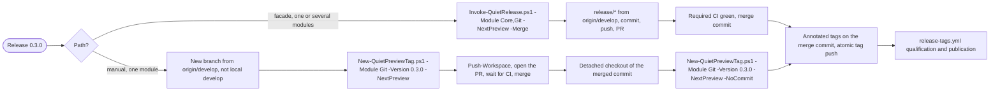

# Preview versions and GitHub publication

Version-mode operator tags share an annotated batch. One dependency-ordered leader runs release qualification and packaging once, then publishes selected modules in order. Followers validate the plan without another matrix. PR qualification stays independent, with no cross-run receipt reuse. Legacy/manual tags without batch metadata remain standalone; existing immutable tags are not rewritten.

Keep the package name, GUID and numeric target release stable while iterating on a preview. For a target `0.2.0`,
the packaging workflow produces identities such as:

```text
0.2.0-preview00000042a0001
0.2.0-preview00000042a0002
0.2.0-preview00000043a0001
0.2.0
```

The eight-digit number is `GITHUB_RUN_NUMBER`; the four-digit attempt is `GITHUB_RUN_ATTEMPT`. The label is
alphanumeric and zero-padded for lexical ordering. A rerun that prepares packages gets a new identity. Keep the
workflow's counter continuity; if the workflow is replaced/reset, select a new target release rather than reusing
existing identities. Counters outside 1..99999999 and attempts outside 1..9999 fail explicitly.

The numeric version represents the target product release, not the number of CI attempts. Change it intentionally
for the next feature release or patch. The stable release removes the prerelease label. Gallery-compatible prerelease
labels do not use `preview1.42` or `+build42`; the numeric `ModuleVersion` stays separate from `PSData.Prerelease`.
See Microsoft's [module prerelease contract](https://learn.microsoft.com/powershell/gallery/concepts/module-prerelease-support)
and [NuGet ordering rules](https://learn.microsoft.com/nuget/concepts/package-versioning).

## Module release tags and independent versions

Merge into `develop` runs qualification and profiling without Gallery publication. Public releases use independent module tag namespaces:

| Tag example | Package | Current capability |
| --- | --- | --- |
| `FrenchExDev2.QuietCli.Core.PoSh/v0.2.0-preview` | Existing `FrenchExDev2.QuietCli.Core.PoSh` | Available after full tagged-revision qualification |
| `FrenchExDev2.QuietCli.Git.PoSh/v0.2.0-preview1` | Existing `FrenchExDev2.QuietCli.Git.PoSh` | Enabled; parser payload/dependency validation and isolated installation required |
| `FrenchExDev2.QuietCli.Vagrant.PoSh/v0.1.0-preview` | `FrenchExDev2.QuietCli.Vagrant.PoSh` | CI release rejected while the manifest is nonpublishable and companion packaging is unavailable |

The tag must exactly match the owning source manifest's numeric version and optional prerelease suffix. Stable publication requires a manifest without `PSData.Prerelease`. No CI version override or automatic numeric bump occurs. Test modules remain internal and are not Gallery releases.

From a committed, clean checkout, preview or create a local release tag:

```powershell
./scripts/Get-QuietReleasePlan.ps1 -Tag FrenchExDev2.QuietCli.Core.PoSh/v0.2.0-preview
./scripts/New-QuietPreviewTag.ps1 -Release -WhatIf
$release = ./scripts/New-QuietPreviewTag.ps1 -Release
$release.Tag
```

Release with the facade: `./scripts/Invoke-QuietRelease.ps1 -Module Core,Git -Version 0.3.0 -NextPreview -Merge` (add `-WhatIf` first). After one confirmation it creates a `release/*` branch from origin/develop, commits the version edits, pushes only that branch, opens the pull request, waits for `QuietCli required CI`, merges with a merge commit (only with `-Merge` and a green check), tags the merge commit, pushes only those tags and restores your branch. Ctrl+C, a failure or a timeout leaves `artifacts/releases/<id>/release-flow.json`; continue with `-Resume <receipt>`. See [the facade](scripts/Invoke-QuietRelease.md) and [its phases](scripts/lib/ReleaseFlow.md).



The manual path uses New-QuietPreviewTag.ps1 with Version and exactly one Module alias; several modules or All fail with `PreviewTagRequiresOneModule`, because only the facade releases modules together in one pull request and one tag batch. NextPreview computes preview1, preview2, etc. per module/base from exact local and remote tags; Preview accepts an explicit number or null. The protected `develop` branch only receives pull requests, so a manual release has two steps. First, on a `fix/*`, `feature/*` or `release/*` branch created from origin/develop (not from a local develop that may have diverged), `./scripts/New-QuietPreviewTag.ps1 -Module Git -Version 0.3.0 -NextPreview` commits the version edit without tags. Second, after the pull request is merged, run `./scripts/New-QuietPreviewTag.ps1 -Module Git -Version 0.3.0 -NextPreview -NoCommit` on a checkout of the merged commit. Keep the base version and `-NextPreview`: they recompute the same preview number, whereas a full `-Version 0.3.0-previewN -NoCommit` must match the committed manifest exactly. That step creates the annotated tags and pushes only those tags. The tool never pushes a branch. Add WhatIf to preview either step; NoPush keeps created tags local, and `-PushTag <tags>` later pushes existing local tags once their commit is contained in origin/develop. Existing local or remote tags are refused without force. See [all operator options and recovery rules](scripts/New-QuietPreviewTag.md).

Namespaced tag pushes request publication through release-tags.yml: validate the selected manifest, qualify All with profiling, prepare verified packages and publish those bytes on PowerShell Gallery. After the complete selected Gallery publication succeeds, a separate job creates one GitHub Release per module tag with the identical nupkg, package-set.json and successful publication.json. Preview versions become GitHub prereleases. Releases do not change the repository-wide latest pointer. Legacy local timestamp/exact-manifest tag modes without Version still never push, and a published identity is never overwritten.

Publish a compatible Core version before a companion that depends on it. Git CI publication now preserves its existing script-module/package name and RequiredModules dependency, validates net10.0/net11.0 parser payloads and exercises isolated installation plus a Git handler. Versions advance independently; a Core release does not imply republishing every companion. Partial command/version and real-provider qualification remains explicit.

## Create a local timestamped Git tag

From the repository root, preview the name or create an annotated tag on the current commit:

```powershell
./scripts/New-QuietPreviewTag.ps1 -WhatIf
$tag = ./scripts/New-QuietPreviewTag.ps1
$tag.Tag
```

The script reads `ModuleVersion` from the Core `.psd1` in the selected repository. For version `0.2.0`,
an example is `v0.2.0-preview20261108T1330001234567Z`: UTC date/time followed by seven fractional-second
digits. `-Timestamp <DateTimeOffset>` supplies a reproducible instant; `-WorkspaceRoot <path>` selects another
QuietCli2 repository root. The default repository is the script's checkout, regardless of the current directory.
Creation requires a clean working tree and targets the exact observed HEAD. `-WhatIf` also works in a dirty
checkout and returns `Clean=false`. Existing tags are rejected without replacement or retry. Nothing is pushed
or published, and manifests are unchanged. These local Git tags are independent of the CI package counter below;
creating or pushing a tag does not trigger the develop-branch publication workflow.

The monitored `GalleryPreview` suite includes owned-repository lifecycle tests, seeded timestamp properties,
malformed version inputs and targeted tag identity mutations.

## Prepare and validate without publication

From a built checkout, PowerShell 7.6+:

```powershell
$packages = Join-Path ([IO.Path]::GetTempPath()) 'quietcli-preview-42-1'
./scripts/New-QuietPreviewPackage.ps1 -OutputDirectory $packages -BuildNumber 42 -Attempt 1
./scripts/Publish-QuietGallery.ps1 -PackageDirectory $packages -Version '0.2.0-preview00000042a0001' -ValidateOnly
```

The destination must be new. The scripts create the public Core `.nupkg`, `package-set.json` and `preview.json`.
They need no key and do not contact PSGallery. `-QualifiedRevision <sha>` optionally requires the actual checkout HEAD
to match a qualification receipt. Source manifests are unchanged: only copied package manifests receive the generated
label. Their numeric versions and GUIDs are preserved. Git's existing Gallery entry is independent; this Core packager never includes the Git companion in the Core nupkg.
Package preparation does not mark a release as published.

Use the dedicated offline qualification suite, with the shared visible monitor:

```powershell
./scripts/Invoke-WorkspaceCi.ps1 -Suite GalleryPreview -SkipBuild
```

Microsoft recommends a local/private repository for testing the publication process. Public previews are actual
releases for consumption and feedback, rather than disposable publication-test objects.

## Manual preview and exact-version artifacts

`preview-psgallery.yml` is manual on `develop` in the original repository and always passes `publish=false`.
It calls `publish-psgallery.yml`, which uses `ci.yml` with `suite=All` and matrix profiling. Only the exact
qualified revision may be packaged. GitHub CI excludes native TTY/PTY qualification; receipts record that scope
explicitly. Local TTY campaigns remain available. Builds cover all embedded runtime distributions; the packaging
job checks its actual build again.

The packaging job has no Gallery key. It uploads the Core nupkg and its plans as a run/version/attempt-specific
artifact. The publication job checks out the qualified revision, downloads that exact artifact and verifies its hashes,
version and the Core-only package set before publishing Core for an explicit matching tag push. It never rebuilds
between artifact creation and publication and does not depend on the current develop head.

For generated preview artifacts, dispatch **QuietCli2 manual preview artifacts** on `develop`.
For exact-version artifacts, dispatch **QuietCli2 qualified PowerShell Gallery release** with the source-manifest
version. Neither manual dispatch publishes. PRs, forks and branch pushes do not publish modules.

## Repository setup and receipts

- Keep `PSGALLERY_API_KEY` only in the existing `psgallery` GitHub environment. Never add it to source, command arguments,
  artifact contents or logs. GHCR continues to use its separate ephemeral `GITHUB_TOKEN`.
- That environment must allow **tags** matching `FrenchExDev2.QuietCli.Core.PoSh/v*`. A branch rule for develop alone does not authorize tag
  deployments. Existing approval protection still applies; the workflow does not change account settings. See
  [GitHub's environment rules](https://docs.github.com/en/actions/reference/workflows-and-actions/deployments-and-environments).
- The workflow files must be committed and pushed before GitHub can run them. A local test does not activate remote CI
  or prove that an environment secret, branch policy or public package is available.
- Publication receipts distinguish Prepared, Publishing, Published and Failed, including unknown effects and the modules
  already confirmed. A published version is never overwritten or retried automatically. After a partial publication,
  inspect the receipt and use a fresh packaging attempt; rerunning only the failed publication job reuses the old artifact
  and deliberately fails if that identity already exists.
- GitHub Release creation uses only the ephemeral GITHUB_TOKEN with contents:write; the Gallery key remains in the protected publication job. The GitHub job verifies each remote tag's exact peeled commit, creates a draft, uploads and checks asset sizes/SHA-256 digests, then publishes it. Existing drafts/releases are refused without replacement. A failed upload leaves an unpublished draft for deliberate recovery. A GitHub job failure does not undo Gallery publication; inspect and recover that job separately instead of repeating Gallery publication. No rollback or automatic retry is provided.
- A full workflow rerun increments the attempt and prepares a new preview identity. `GITHUB_RUN_NUMBER` does not increase
  for a rerun, which is why the attempt is part of the suffix.

GitHub documents the [run counters](https://docs.github.com/actions/reference/workflows-and-actions/variables)
and [deployment environment settings](https://docs.github.com/actions/how-tos/deploy/configure-and-manage-deployments/manage-environments).

<!-- credits:begin -->
## Credits

This document is covered by the mandatory [CREDITS.md](../CREDITS.md), which records the licenses of all softwares which have QuietCli companions
<!-- credits:end -->
