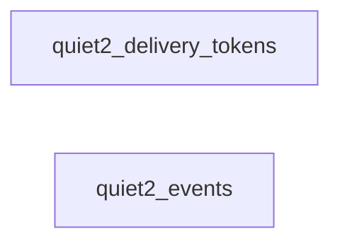

# QuietCli SQLite schema and queries

<!-- Generated by scripts/Export-SqliteDocumentation.ps1. -->

SQLite catalog read from a disposable database initialized from the source checkout.

## Schema

## Tables

### ` quiet2_delivery_tokens `

| Column | Type | Constraints |
| --- | --- | --- |
| ` delivery_id ` | ` TEXT ` | ` PK 1 · NOT NULL ` |
| ` token_profile ` | ` TEXT ` | ` PK 2 · NOT NULL ` |
| ` token_version ` | ` TEXT ` | ` PK 3 · NOT NULL ` |
| ` output_tokens ` | ` INTEGER ` | ` NOT NULL ` |

**Table constraints**

- ` CHECK(output_tokens>=0) `

### ` quiet2_events `

| Column | Type | Constraints |
| --- | --- | --- |
| ` id ` | ` TEXT ` | ` PK 1 ` |
| ` kind ` | ` TEXT ` | ` NOT NULL ` |
| ` timestamp_ms ` | ` INTEGER ` | ` NOT NULL ` |
| ` parent_id ` | ` TEXT ` | — |
| ` root_id ` | ` TEXT ` | — |
| ` session_id ` | ` TEXT ` | — |
| ` context ` | ` TEXT ` | — |
| ` role ` | ` TEXT ` | — |
| ` command ` | ` TEXT ` | — |
| ` outcome ` | ` TEXT ` | — |
| ` payload ` | ` TEXT ` | ` NOT NULL ` |

## Schema definitions

~~~sql
CREATE INDEX quiet2_context ON quiet2_events(context,session_id)
~~~

~~~sql
CREATE INDEX quiet2_time ON quiet2_events(timestamp_ms)
~~~

~~~sql
CREATE TABLE quiet2_delivery_tokens(delivery_id TEXT NOT NULL,token_profile TEXT NOT NULL,token_version TEXT NOT NULL,output_tokens INTEGER NOT NULL CHECK(output_tokens>=0),PRIMARY KEY(delivery_id,token_profile,token_version))
~~~

~~~sql
CREATE TABLE quiet2_events(id TEXT PRIMARY KEY,kind TEXT NOT NULL,timestamp_ms INTEGER NOT NULL,parent_id TEXT,root_id TEXT,session_id TEXT,context TEXT,role TEXT,command TEXT,outcome TEXT,payload TEXT NOT NULL)
~~~

## Source statements

The inventory includes DDL, prepared statements, transaction commands and appended SQL clauses as they appear in C#.

### MeasurementProjection.cs

- [MeasurementProjection.cs:24](../src/Core/src/FrenchExDev2.QuietCli.Core.PoSh/engine/MeasurementProjection.cs#L24) · Statement

~~~sql
PRAGMA secure_delete=ON
~~~

- [MeasurementProjection.cs:25](../src/Core/src/FrenchExDev2.QuietCli.Core.PoSh/engine/MeasurementProjection.cs#L25) · Statement

~~~sql
BEGIN IMMEDIATE
~~~

- [MeasurementProjection.cs:28](../src/Core/src/FrenchExDev2.QuietCli.Core.PoSh/engine/MeasurementProjection.cs#L28) · Statement

~~~sql
SELECT id,payload FROM quiet2_events WHERE id>? ORDER BY id LIMIT 16
~~~

- [MeasurementProjection.cs:34](../src/Core/src/FrenchExDev2.QuietCli.Core.PoSh/engine/MeasurementProjection.cs#L34) · Statement

~~~sql
UPDATE quiet2_events SET payload=? WHERE id=?
~~~

- [MeasurementProjection.cs:39](../src/Core/src/FrenchExDev2.QuietCli.Core.PoSh/engine/MeasurementProjection.cs#L39) · Statement

~~~sql
COMMIT
~~~

### MeasurementStore.cs

- [MeasurementStore.cs:28](../src/Core/src/FrenchExDev2.QuietCli.Core.PoSh/engine/MeasurementStore.cs#L28) · Statement

~~~sql
INSERT INTO quiet2_events(id,kind,timestamp_ms,parent_id,root_id,session_id,context,role,command,outcome,payload) VALUES(?,?,?,?,?,?,?,?,?,?,?) ON CONFLICT(id) DO UPDATE SET payload=excluded.payload,outcome=excluded.outcome
~~~

- [MeasurementStore.cs:30](../src/Core/src/FrenchExDev2.QuietCli.Core.PoSh/engine/MeasurementStore.cs#L30) · Statement

~~~sql
INSERT INTO quiet2_events(id,kind,timestamp_ms,parent_id,root_id,session_id,context,role,command,outcome,payload) VALUES(?,?,?,?,?,?,?,?,?,?,?) ON CONFLICT(id) DO NOTHING
~~~

- [MeasurementStore.cs:32](../src/Core/src/FrenchExDev2.QuietCli.Core.PoSh/engine/MeasurementStore.cs#L32) · Statement

~~~sql
SELECT kind,payload FROM quiet2_events WHERE id=?
~~~

- [MeasurementStore.cs:34](../src/Core/src/FrenchExDev2.QuietCli.Core.PoSh/engine/MeasurementStore.cs#L34) · Statement

~~~sql
INSERT INTO quiet2_delivery_tokens(delivery_id,token_profile,token_version,output_tokens) VALUES(?,?,?,?) ON CONFLICT(delivery_id,token_profile,token_version) DO NOTHING
~~~

- [MeasurementStore.cs:36](../src/Core/src/FrenchExDev2.QuietCli.Core.PoSh/engine/MeasurementStore.cs#L36) · Statement

~~~sql
SELECT output_tokens FROM quiet2_delivery_tokens WHERE delivery_id=? AND token_profile=? AND token_version=?
~~~

- [MeasurementStore.cs:73](../src/Core/src/FrenchExDev2.QuietCli.Core.PoSh/engine/MeasurementStore.cs#L73) · DDL

~~~sql
CREATE TABLE IF NOT EXISTS quiet2_delivery_tokens(delivery_id TEXT NOT NULL,token_profile TEXT NOT NULL,token_version TEXT NOT NULL,output_tokens INTEGER NOT NULL CHECK(output_tokens>=0),PRIMARY KEY(delivery_id,token_profile,token_version))
~~~

- [MeasurementStore.cs:150](../src/Core/src/FrenchExDev2.QuietCli.Core.PoSh/engine/MeasurementStore.cs#L150) · Statement

~~~sql
BEGIN IMMEDIATE
~~~

- [MeasurementStore.cs:162](../src/Core/src/FrenchExDev2.QuietCli.Core.PoSh/engine/MeasurementStore.cs#L162) · Statement

~~~sql
COMMIT
~~~

- [MeasurementStore.cs:182](../src/Core/src/FrenchExDev2.QuietCli.Core.PoSh/engine/MeasurementStore.cs#L182) · Appended clause

~~~sql
 ORDER BY timestamp_ms,id LIMIT 129
~~~

- [MeasurementStore.cs:202](../src/Core/src/FrenchExDev2.QuietCli.Core.PoSh/engine/MeasurementStore.cs#L202) · Appended clause

~~~sql
 AND (timestamp_ms>? OR (timestamp_ms=? AND id>?))
~~~

- [MeasurementStore.cs:212](../src/Core/src/FrenchExDev2.QuietCli.Core.PoSh/engine/MeasurementStore.cs#L212) · Statement

~~~sql
SELECT id,timestamp_ms,payload FROM quiet2_events WHERE timestamp_ms>=? AND timestamp_ms<?
~~~

- [MeasurementStore.cs:214](../src/Core/src/FrenchExDev2.QuietCli.Core.PoSh/engine/MeasurementStore.cs#L214) · Appended clause

~~~sql
 AND context=?
~~~

- [MeasurementStore.cs:215](../src/Core/src/FrenchExDev2.QuietCli.Core.PoSh/engine/MeasurementStore.cs#L215) · Appended clause

~~~sql
 AND context IS NULL
~~~

- [MeasurementStore.cs:216](../src/Core/src/FrenchExDev2.QuietCli.Core.PoSh/engine/MeasurementStore.cs#L216) · Appended clause

~~~sql
 AND session_id=?
~~~

- [MeasurementStore.cs:217](../src/Core/src/FrenchExDev2.QuietCli.Core.PoSh/engine/MeasurementStore.cs#L217) · Appended clause

~~~sql
 AND json_extract(payload,'$.HandlerId')=?
~~~

- [MeasurementStore.cs:237](../src/Core/src/FrenchExDev2.QuietCli.Core.PoSh/engine/MeasurementStore.cs#L237) · Statement

~~~sql
SELECT name FROM sqlite_master WHERE type='table' AND name='quiet2_delivery_tokens'
~~~

- [MeasurementStore.cs:239](../src/Core/src/FrenchExDev2.QuietCli.Core.PoSh/engine/MeasurementStore.cs#L239) · Statement

~~~sql
BEGIN
~~~

- [MeasurementStore.cs:248](../src/Core/src/FrenchExDev2.QuietCli.Core.PoSh/engine/MeasurementStore.cs#L248) · Appended clause

~~~sql
 AND (timestamp_ms>? OR (timestamp_ms=? AND id>?))
~~~

- [MeasurementStore.cs:252](../src/Core/src/FrenchExDev2.QuietCli.Core.PoSh/engine/MeasurementStore.cs#L252) · Appended clause

~~~sql
 ORDER BY timestamp_ms,id LIMIT ?
~~~

- [MeasurementStore.cs:263](../src/Core/src/FrenchExDev2.QuietCli.Core.PoSh/engine/MeasurementStore.cs#L263) · Statement

~~~sql
SELECT token_profile,token_version,output_tokens FROM quiet2_delivery_tokens WHERE delivery_id=?
~~~

### SqliteNative.cs

- [SqliteNative.cs:188](../src/Core/src/FrenchExDev2.QuietCli.Core.PoSh/engine/SqliteNative.cs#L188) · Statement

~~~sql
PRAGMA user_version
~~~

- [SqliteNative.cs:191](../src/Core/src/FrenchExDev2.QuietCli.Core.PoSh/engine/SqliteNative.cs#L191) · Statement

~~~sql
BEGIN IMMEDIATE
~~~

- [SqliteNative.cs:193](../src/Core/src/FrenchExDev2.QuietCli.Core.PoSh/engine/SqliteNative.cs#L193) · Statement

~~~sql
PRAGMA user_version
~~~

- [SqliteNative.cs:194](../src/Core/src/FrenchExDev2.QuietCli.Core.PoSh/engine/SqliteNative.cs#L194) · Statement

~~~sql
COMMIT
~~~

- [SqliteNative.cs:195](../src/Core/src/FrenchExDev2.QuietCli.Core.PoSh/engine/SqliteNative.cs#L195) · Statement

~~~sql
SELECT COUNT(*) AS n FROM sqlite_master WHERE type='table' AND name NOT LIKE 'sqlite_%'
~~~

- [SqliteNative.cs:197](../src/Core/src/FrenchExDev2.QuietCli.Core.PoSh/engine/SqliteNative.cs#L197) · DDL

~~~sql
CREATE TABLE quiet2_events(id TEXT PRIMARY KEY,kind TEXT NOT NULL,timestamp_ms INTEGER NOT NULL,parent_id TEXT,root_id TEXT,session_id TEXT,context TEXT,role TEXT,command TEXT,outcome TEXT,payload TEXT NOT NULL)
~~~

- [SqliteNative.cs:198](../src/Core/src/FrenchExDev2.QuietCli.Core.PoSh/engine/SqliteNative.cs#L198) · DDL

~~~sql
CREATE INDEX quiet2_time ON quiet2_events(timestamp_ms)
~~~

- [SqliteNative.cs:199](../src/Core/src/FrenchExDev2.QuietCli.Core.PoSh/engine/SqliteNative.cs#L199) · DDL

~~~sql
CREATE INDEX quiet2_context ON quiet2_events(context,session_id)
~~~

- [SqliteNative.cs:200](../src/Core/src/FrenchExDev2.QuietCli.Core.PoSh/engine/SqliteNative.cs#L200) · Statement

~~~sql
PRAGMA user_version=1
~~~

- [SqliteNative.cs:201](../src/Core/src/FrenchExDev2.QuietCli.Core.PoSh/engine/SqliteNative.cs#L201) · Statement

~~~sql
COMMIT
~~~

- [SqliteNative.cs:285](../src/Core/src/FrenchExDev2.QuietCli.Core.PoSh/engine/SqliteNative.cs#L285) · Statement

~~~sql
ROLLBACK
~~~

<!-- credits:begin -->
## Credits

This document is covered by the mandatory [CREDITS.md](../CREDITS.md), which records the licenses of all softwares which have QuietCli companions
<!-- credits:end -->
