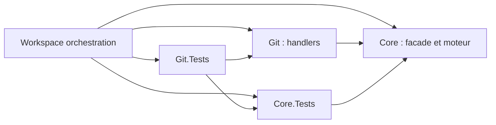

# Audit sécurité et conception logicielle — QuietCli2

Date : **4 novembre 2026**, Europe/Paris. Périmètre : ce workspace et ses quatre modules compagnons. Audit du code présent, sans correction des sources produit, commit, push, changement de profil ou redémarrage de service.

Suivi : les [correctifs et leurs critères de vérification](2026-11-04-remediation.md) sont documentés séparément. Les constats ci-dessous décrivent l’état initial audité.

## Avis

La séparation moteur/façade/modules constitue une bonne base. Le passage des arguments sans shell, les buffers natifs bornés, la séparation des flux de contrôle et l’absence de sérialisation métier avec `-AsObject` sont des choix à conserver.

**Je déconseille de présenter la distribution comme vérifiée pour des paquets non fiables avant correction de SEC-01.** Je déconseille aussi de s’appuyer sur l’état de complétude pour décider automatiquement de répéter une mutation tant que REL-01 reste ouvert. L’audit ne démontre aucune exécution de code distante dans le moteur ; les callbacks et binaires s’exécutent volontairement avec les droits de l’appelant et ne constituent pas une sandbox.

La suite existante passe **59/59 sur Windows** : 27 scénarios Core, 32 Git. Le harnais d’audit a terminé **9 reproductions : 8 constats confirmés et 1 scénario non concluant**. Le succès du harnais indique qu’il a collecté ses preuves ; il ne signifie pas que les contrôles de sécurité passent.

Les constats et 77 empreintes de fichiers sources, ressources et distribution moteur sont conservés dans [les preuves JSON](2026-11-04-evidence.json). La gravité est une priorité de traitement dans ce contexte local, pas un score CVSS ni une qualification de conformité.

## Méthode et limites

Lecture du moteur C#, de la façade PowerShell, des neuf fichiers de handlers Git, des scripts d’orchestration, des workflows et du packaging. Relecture du sens des états, des permissions, du stockage et des dépendances. Les recherches natives ont utilisé `pump` avec un contrat explicite ; les tests ont ouvert leur moniteur PowerShell visible.

Les reproductions utilisent uniquement des données synthétiques sous `artifacts/audit`, une base SQLite dédiée et des fichiers témoins. Aucun dépôt métier ni remote n’est muté. La simulation de perte d’accusé remplace une fonction en mémoire dans le worker de test, puis la restaure. Les fichiers et handles du scénario d’artefact raté sont explicitement libérés.

- Régression Windows : `artifacts/tests/20261104-211105-2cbc92/summary.json`.
- Audit Windows : `artifacts/audit/20261104-211636-ab41c3/summary.json`.
- Reproduction : `./FrenchExDev2.QuietCli.Core.Tests.PoSh/audit/Invoke-Audit.ps1` depuis la racine.
- Recherche heuristique de clés privées, tokens GitHub et identifiants AWS dans les sources Core/Git, scripts et workflows : aucun fichier correspondant. Ce contrôle n’est pas une recherche exhaustive de secrets.
- Pas de nouvelle qualification de sécurité Linux, Dockur ou des 17 versions Git. Pas de campagne de fuzzing, de pentest réseau ni d’analyse exhaustive des avis de vulnérabilité des bibliothèques embarquées.

Les deux premières tentatives du harnais ont rencontré des erreurs de harnais, corrigées avant les preuves citées. Elles ne sont comptées ni comme vulnérabilités ni comme contrôles réussis.

## Priorités

| Priorité | Constat | État de preuve | Conséquence principale |
|---|---|---|---|
| P1 | SEC-01 — import hors manifeste | Reproduit | Le vérificateur exécute un module non attesté et retourne `Verified=true` |
| P1 | REL-01 — lancement dont l’accusé est perdu | Injection de panne reproduite | Processus lancé, mais source déclarée complète sans état natif ni effet inconnu |
| P1 avant activation de la CI | CI-01 — Linux depuis un checkout propre | Analyse statique | Construction et provisionnement d’image manquants avant un lancement avec `SkipBuild`/`pull=never` |
| P2 | REL-02 — réponse de gains trop grande | Reproduit | Une requête valide échoue au plafond du protocole |
| P2 | REL-03 — casse des références Git | Reproduit | Une modification réelle peut disparaître de la comparaison |
| P2 | REL-04 — artefact créé avant un démarrage raté | Reproduit | Handle ouvert et objet technique renvoyé à la place du résultat métier |
| P2 | SEC-02 / SEC-03 — politique de métadonnées | Reproduit | Messages non expurgés et formes métier imbriquées acceptées en base |
| P2 | SEC-04 / SEC-05 — permissions et lecture administrative | Analyse statique | Confidentialité Unix dépendant de l’umask ; lignes de logs sans limite |
| P2 | REL-06 / SEC-06 — IPC et chaîne de distribution | Analyse statique | Blocage sans délai de transport ; provenance des dépendances insuffisante |
| P2 | DES-01 — identité d’un binaire contenant un point | Reproduit | Handler déclaré mais introuvable |

### SEC-01 — Le vérificateur importe des fichiers absents du manifeste contrôlé

**Gravité élevée si les paquets sont non fiables ou proviennent d’un emplacement modifiable par un tiers.**

Source : [Test-WorkspacePackage.ps1](../../scripts/Test-WorkspacePackage.ps1), lignes 15–26.

Le script extrait chaque archive dans une destination commune. Il contrôle ensuite les empreintes et le nombre de fichiers seulement sous `$manifest.Module`, puis importe les noms Core et Git attendus sans établir que leurs fichiers appartiennent à un manifeste effectivement vérifié.

La reproduction fournit un unique manifeste `Innocent`, avec un seul fichier attesté. Son ZIP contient cinq fichiers, dont deux modules supplémentaires sous les noms Core et Git. Le module Core ajoute uniquement un témoin dans son répertoire d’extraction. Le vérificateur importe ce module et retourne `Verified=true`. Le témoin existe alors qu’aucun fichier de ce module ne figure dans le manifeste contrôlé.

Ce constat est distinct d’une archive qui contiendrait simplement du code malveillant correctement haché : **le contrôle d’exhaustivité lui-même est contourné**. La vérification des empreintes n’authentifie par ailleurs pas l’auteur d’un manifeste fourni avec son archive.

Correction recommandée : définir les quatre modules attendus ; contrôler les noms, chemins et entrées ZIP avant extraction ; refuser tout fichier hors du module annoncé, doublon et fichier non déclaré ; extraire séparément ; vérifier l’ensemble complet avant tout import. Séparer une vérification de données sans exécution d’un test explicite d’import. Ajouter des quotas de nombre de fichiers, taille totale décompressée et taille par fichier. Les contrôles doivent porter sur les tailles après décompression, conformément aux recommandations [OWASP sur les archives](https://cheatsheetseries.owasp.org/cheatsheets/File_Upload_Cheat_Sheet.html).

Critère de fermeture : le paquet synthétique de l’audit est rejeté **avant** la création du témoin ; le paquet normal reste vérifiable hors des sources. Aucun import ne précède la vérification exhaustive.

### REL-01 — Une perte d’accusé de lancement peut produire une complétude trompeuse

**Gravité élevée pour les automatisations qui pilotent des mutations.**

Sources : [Invoke.ps1](../../FrenchExDev2.QuietCli.Core.PoSh/src/Invoke.ps1), lignes 92–103 et 137–141 ; [Program.cs](../../FrenchExDev2.QuietCli.Core.PoSh/engine/Program.cs), lignes 34–38.

`NativeStarted` passe à `true` seulement après le retour de la requête `start`. Pourtant le moteur crée déjà le processus avant d’envoyer sa réponse. Si l’accusé ne parvient pas à la façade, le chemin d’erreur considère qu’aucun natif n’a démarré. L’expression de complétude traite ensuite `Execution=null` comme une source complète.

La panne injectée laisse le moteur confirmer réellement la création d’une fixture indépendante, puis masque cette réponse au code appelant. Résultat observé : `Outcome=Failed`, `Completeness.Source=true`, `Execution.Native=null`. Le statut `EffectStatus=Unknown` attendu en cas d’incertitude ne figure pas dans l’exécution native, puisqu’elle est absente.

Correction recommandée : distinguer `NotStarted`, `StartRequested`, `Started` et `StartAcknowledged` ; conserver l’identifiant avant l’envoi ; marquer l’effet inconnu et la source incomplète dès qu’un lancement demandé ne peut pas être établi. La récupération d’un état par identifiant doit être une observation, jamais une nouvelle exécution de la commande.

Critère de fermeture : la même injection indique source incomplète et effet inconnu, sans répéter la fixture ni une mutation.

### REL-02 — Le plafond en nombre de lignes SQLite ne respecte pas le budget IPC

**Gravité moyenne : disponibilité des rapports de gains, sans suppression du résultat métier.**

Sources : [MeasurementStore.cs](../../FrenchExDev2.QuietCli.Core.PoSh/engine/MeasurementStore.cs), lignes 57–69 ; [Protocol.cs](../../FrenchExDev2.QuietCli.Core.PoSh/engine/Protocol.cs), lignes 19–21 et 48–52.

La requête charge jusqu’à 1 001 événements et renvoie 1 000 objets. La réponse entière doit pourtant tenir dans un header de 1 Mio. Ces deux limites ne sont pas coordonnées.

La reproduction stocke 180 événements synthétiques avec un message d’erreur de 6 500 caractères chacun, tous acceptés individuellement. La lecture du contexte échoue avec `ResponseTooLarge`, emballé en `EngineCommunicationFailed`, au lieu de fournir une page bornée. La connexion existe toujours : l’erreur n’est pas une déconnexion.

Correction recommandée : pagination par curseur et budget en bytes ; agrégations SQL des compteurs ; relations et sources uniques plutôt que copie des mêmes sous-arbres dans chaque événement. Garder les erreurs de requête structurées distinctes des erreurs de transport.

Critère de fermeture : les 180 événements sont consultables en plusieurs pages, sans dépassement de frame ; les totaux et le marqueur de complétude restent exacts.

### REL-03 — Les références Git sont comparées sans respecter la casse

**Gravité moyenne : exactitude des effets métier observés.**

Source : [Repository.ps1](../../FrenchExDev2.QuietCli.Git.PoSh/src/Repository.ps1), lignes 27–34.

Les hashtables PowerShell `$old` et `$new`, ainsi que le tri unique par défaut, confondent les noms qui ne diffèrent que par leur casse. Les noms de références doivent être traités comme des identifiants distincts ; la possibilité de les matérialiser dépend ensuite du stockage et du système de fichiers.

La reproduction compare `refs/heads/Feature` et `refs/heads/feature`. Seule la première référence change d’objet : **1 changement attendu, 0 renvoyé**. Aucun dépôt n’est muté pour cette preuve.

Correction recommandée : dictionnaires et union utilisant `StringComparer.Ordinal`, puis scénarios avec références de casse différente, références symboliques et noms représentés en bytes. Ne pas appliquer les règles de comparaison des chemins Windows aux identifiants Git.

### REL-04 — Un démarrage raté laisse un artefact ouvert et expose son état technique

**Gravité moyenne : ressources, contrat métier et fichiers temporaires.**

Source : [History.ps1](../../FrenchExDev2.QuietCli.Git.PoSh/src/History.ps1), lignes 74–89.

Le fichier et le hash sont créés avant l’appel natif. Leur libération dépend du callback `Complete`, qui ne doit justement pas être appelé pour une invocation non démarrée. En cas d’échec de démarrage, la fonction continue, enregistre l’artefact et retourne le sink technique resté dans `Data`.

Avec un répertoire de travail inexistant, la reproduction obtient un `FileStream` encore ouvert, aucun descripteur `Artifact` métier et un chemin sous le répertoire d’audit. Le harnais a fermé le stream et le hash, puis supprimé cet artefact avec sa preuve de propriété.

Correction recommandée : une durée de vie externe en `try/finally`, indépendante des callbacks ; un résultat métier explicite pour les contenus partiels ; ne jamais renvoyer le sink technique. Un objet de possession/disposition ou une primitive locale de fichier privé peut porter cette responsabilité.

Critère de fermeture : démarrage refusé, callback raté et finalisation ratée ne laissent aucun handle ouvert ; les artefacts partiels sont soit supprimés, soit rendus sous un descripteur documenté.

### SEC-02 — Les messages d’exception peuvent conserver des données sensibles

**Gravité moyenne, conditionnelle au contenu des callbacks.**

Sources : [Runtime.ps1](../../FrenchExDev2.QuietCli.Core.PoSh/src/Runtime.ps1), lignes 80–81 ; [Gain.ps1](../../FrenchExDev2.QuietCli.Core.PoSh/src/Gain.ps1), lignes 8–10 et 20–23.

Le moteur ne capture pas automatiquement stderr. En revanche, le texte brut d’une exception de callback est copié dans `Error.Message`, puis enregistré dans SQLite par défaut. Un handler qui construit ce message à partir d’un événement peut donc y conserver un token ou un contenu métier.

Un marqueur synthétique levé par un callback est retrouvé dans un événement SQLite. Aucune donnée réelle n’a été utilisée. Cela ne donne pas l’accès à la base à un tiers : les permissions de la base réduisent l’exposition, mais ne suppriment pas la rétention.

Correction recommandée : codes, phases et diagnostics sûrs par défaut ; messages détaillés explicitement autorisés, bornés et expurgés ; politique documentée de durée de conservation. Conserver localement le diagnostic utile au besoin sans le recopier automatiquement dans la télémétrie. [OWASP recommande d’exclure ou d’expurger les secrets dans les journaux](https://cheatsheetseries.owasp.org/cheatsheets/Logging_Cheat_Sheet.html).

### SEC-03 — La liste blanche des métadonnées est seulement superficielle

**Gravité moyenne de validation et de confidentialité ; pas une élévation de privilèges démontrée.**

Source : [MeasurementStore.cs](../../FrenchExDev2.QuietCli.Core.PoSh/engine/MeasurementStore.cs), lignes 37–51.

Les noms de propriétés de premier niveau sont contrôlés, mais `Execution`, `Sources`, `Error` et `Completeness` restent des `JsonElement` arbitraires. `Execution.Data.ArbitraryBusinessMarker` est accepté, stocké et relu dans la reproduction.

L’API publique normale ne transmet pas `Data` pour ses mesures : ce bon comportement reste établi. Le défaut est que **la frontière moteur n’impose pas elle-même la restriction annoncée**. Le client local est déjà de confiance et peut exécuter du code ; ce constat porte sur le contrat de stockage et les erreurs futures d’intégration, pas sur un attaquant distant.

Correction recommandée : DTO explicites et validation récursive des types, longueurs, nombres, profondeurs et cardinalités ; refus des propriétés inconnues aux niveaux imbriqués ; séparation des types d’événements invocation/livraison.

### DES-01 — La résolution retire arbitrairement la dernière extension du binaire

**Gravité moyenne pour l’extensibilité et la portabilité.**

Source : [Registry.ps1](../../FrenchExDev2.QuietCli.Core.PoSh/src/Registry.ps1), ligne 45 ; [Scaffold.ps1](../../FrenchExDev2.QuietCli.Core.PoSh/src/Scaffold.ps1), validation de `Binary`.

`GetFileNameWithoutExtension` transforme `audit.tool` en `audit`. Le handler déclaré pour `audit.tool` n’est alors jamais candidat. La reproduction montre le défaut sans exécuter de binaire. Le générateur interdit également les points dans les noms, alors que de tels exécutables existent notamment sous Unix.

Correction recommandée : identité logique explicite du binaire ; normalisation limitée aux suffixes exécutables effectivement pertinents pour la plateforme ; prise en charge des noms contenant des points et des chemins résolus.

## Risques de sécurité établis par lecture du code

### SEC-04 — Les blobs temporaires Git n’ont pas de permissions Unix explicites

Source : [History.ps1](../../FrenchExDev2.QuietCli.Git.PoSh/src/History.ps1), lignes 74–77. À comparer avec [PrivateDirectory.cs](../../FrenchExDev2.QuietCli.Core.PoSh/engine/PrivateDirectory.cs), lignes 8–13, et [SqliteNative.cs](../../FrenchExDev2.QuietCli.Core.PoSh/engine/SqliteNative.cs), lignes 185–195.

Les mécanismes C# utilisent des modes privés. Le handler blob crée son répertoire et son fichier sans mode explicite : leur confidentialité dépend de l’environnement. Sous un Unix avec umask permissif, un autre utilisateur local pourrait lire un blob temporaire avant sa suppression. Ce risque n’a pas été reproduit dans une session Unix de cet audit ; les ACL Windows ne sont pas assimilées à des permissions Unix.

Utiliser un répertoire `0700` et un fichier `0600` dès la création, avec les [surcharges de permissions de Directory.CreateDirectory](https://learn.microsoft.com/en-us/dotnet/api/system.io.directory.createdirectory?view=net-10.0) et [FileStreamOptions.UnixCreateMode](https://learn.microsoft.com/en-us/dotnet/api/system.io.filestreamoptions.unixcreatemode?view=net-10.0). Garder les artefacts métier dans le processus PowerShell : cette correction n’exige aucun transfert d’objet métier au moteur.

### SEC-05 — Le bootstrap administratif lit des lignes sans limite

Sources : [Bootstrap.ps1](../../scripts/Bootstrap.ps1), lignes 35–43 ; [Common.ps1](../../scripts/Common.ps1), limitation des diagnostics aux dix dernières lignes.

`ReadLineAsync` peut accumuler une ligne arbitrairement longue avant que le callback ne la voie. Limiter le nombre de lignes dans le callback ne borne donc pas la mémoire. Ce chemin concerne les commandes administratives du workspace ; il ne remet pas en cause les blocs bornés du moteur produit.

Remplacer cette lecture par des blocs et un cadrage limité, avec signalement explicite du dépassement. Un test doit produire une longue ligne sans séparateur et mesurer la mémoire, sans générer de fichier énorme. La sortie stderr du moteur est aussi lue par `ReadToEndAsync` dans `Protocol.ps1` ligne 15 ; son producteur actuel est interne et limité, mais ce choix deviendrait fragile si la journalisation moteur augmentait.

### SEC-06 — La provenance des dépendances binaires et CI doit être renforcée

Sources : [SqliteNative.cs](../../FrenchExDev2.QuietCli.Core.PoSh/engine/SqliteNative.cs), lignes 27–35 ; [Delivery.ps1](../../FrenchExDev2.QuietCli.Core.PoSh/src/Delivery.ps1), lignes 98–101 ; [.github/workflows/ci.yml](../../.github/workflows/ci.yml), références `@v4` ; [Containerfile.debian](../../.github/containers/Containerfile.debian), lignes 2–11.

Le répertoire `resources` contient 18 fichiers, environ 15,96 Mo, dont des DLL managées, SQLite natif et les bridges. Aucun inventaire de versions/licences/provenance n’y a été trouvé. Le `FileVersion` Windows de SQLite est vide. Un audit de références NuGet ne suffirait donc pas à couvrir ces dépendances. Aucune CVE précise n’est affirmée ici.

Les actions GitHub utilisent des tags, les images des tags et les paquets apt des versions non verrouillées. La somme du bridge est vérifiée, ce qui protège contre une altération accidentelle ; un hash placé à côté du fichier ne suffit pas à authentifier un distributeur non fiable. Les scripts chargent également des assemblies tokenizer dont la version déclarée est codée en dur.

Établir un inventaire vérifiable avec version réelle, origine, licence, RID, empreinte et politique de mise à jour ; épingler les actions par SHA complet et les images par digest ; associer les artefacts de build aux sources. [GitHub recommande le SHA complet pour figer une action](https://docs.github.com/en/actions/reference/security/secure-use).

Le fallback SQLite charge des noms de bibliothèques non qualifiés si le binaire embarqué ne se charge pas. Réduire la recherche aux emplacements de confiance et distinguer « bibliothèque absente » de « bibliothèque présente mais invalide ». Une exploitation par détournement de DLL n’a pas été démontrée ; elle dépend de l’ordre de recherche et des répertoires contrôlables. [Microsoft documente précisément ces conditions](https://learn.microsoft.com/en-us/windows/win32/dlls/dynamic-link-library-security).

## Fiabilité et qualification supplémentaires

### REL-05 — Complétude après le délai interne de drainage : à qualifier

Sources : [Invocation.cs](../../FrenchExDev2.QuietCli.Core.PoSh/engine/Invocation.cs), lignes 107–114, 162–168 et 194–203.

Après la sortie du processus principal, le drainage dispose de 30 secondes. Son annulation interne n’alimente ni `error`, ni `cancelled`, ni `timedOut` dans ce chemin. `Snapshot` peut donc annoncer `SourceComplete=true` sans avoir observé EOF.

Le scénario de stdout hérité termine après environ 31,27 s avec `Outcome=Success`, source complète et zéro byte stdout. Le témoin indépendant d’écriture tardive n’est pas apparu : **la preuve dynamique ne démontre pas la perte des 21 bytes envisagés**. Le scénario reste non concluant et n’est pas compté parmi les huit constats confirmés.

Il faut distinguer EOF, annulation, limite de drainage et erreur de lecture dans le résultat final. Ajouter un producteur indépendant dont les signaux de début, d’EOF et d’arrêt sont observables ; conserver le scénario jusqu’à une preuve non ambiguë. Ne jamais convertir un arrêt de drainage en succès complet par défaut.

### REL-06 — Aucun délai propre aux échanges IPC

Sources : [Protocol.ps1](../../FrenchExDev2.QuietCli.Core.PoSh/src/Protocol.ps1), lignes 36–46 et 60 ; [Program.cs](../../FrenchExDev2.QuietCli.Core.PoSh/engine/Program.cs), usages de `CancellationToken.None`.

Les échanges attendent les streams et l’arrêt du moteur sans token ni délai indépendant. Si le moteur se fige, le délai natif ne peut pas débloquer le client, et le client ne peut pas envoyer son annulation sur cette même connexion synchrone. Ce risque concerne la résistance aux pannes du moteur ; le callback PowerShell arbitrairement bloqué reste une limite distincte, déjà documentée.

Prévoir un délai de requête, une fermeture forcée du moteur détenu après échéance, une classification transport/protocole/exécution et un statut d’effet inconnu pour les mutations concernées. Le code emploie déjà des méthodes async ; le problème est l’absence de politique de cancellation, pas l’utilisation de `.GetAwaiter().GetResult()` dans la façade. La [cancellation .NET est coopérative et doit être transmise aux opérations](https://learn.microsoft.com/en-us/dotnet/standard/threading/cancellation-in-managed-threads).

### CI-01 — Le workflow Linux n’est pas exploitable depuis des sources seules

Sources : [ci.yml](../../.github/workflows/ci.yml), lignes 36–53 ; [Invoke-ContainerWorker.ps1](../../scripts/Invoke-ContainerWorker.ps1), création de conteneur avec `--pull=never` et lancement avec `-SkipBuild` ; [Build-Workspace.ps1](../../scripts/Build-Workspace.ps1), lignes 14–15 ; `.gitignore` des modules.

Le job Linux restaure les dépôts puis lance le conteneur. Il ne construit ni le moteur ni les fixtures. Or les dossiers `lib` sont ignorés dans Git et le conteneur ne construit pas. Une variable donnant le nom d’une image ne la rend pas non plus disponible sur un runner hébergé neuf lorsque le pull est interdit.

Ajouter la construction et un provisionnement d’image explicite, ou utiliser un runner préparé dont les prérequis sont vérifiés. Les révisions et remotes du verrouillage sont actuellement absents : cette précondition est annoncée honnêtement dans le README et reste nécessaire avant d’activer les workflows. Aucun lancement GitHub n’a été effectué pour cet audit ; le constat est statique.

Le script de qualification complète est un garde-fou qui échoue explicitement, pas un runner fini. Son dernier chemin est `QualificationRunnerNotImplemented`. Les 183 entrées d’inventaire ne sont pas 183 implémentations qualifiées.

### REL-07 — Les rapports de tests n’attachent pas suffisamment les binaires aux sources

Sources : [Invoke-TestWorker.ps1](../../scripts/Invoke-TestWorker.ps1), construction de `source-identity.json` ; [Update-WorkspaceLock.ps1](../../scripts/Update-WorkspaceLock.ps1), calcul des empreintes ; [Protocol.ps1](../../FrenchExDev2.QuietCli.Core.PoSh/src/Protocol.ps1), identité du moteur.

Les rapports hachent les sources de quatre dépôts et excluent les `lib` exécutés. Le dépôt d’orchestration n’est pas intégré à cette liste de fichiers. Avec `-SkipBuild`, une ancienne DLL peut être exécutée alors que le rapport décrit les sources courantes, sans lien de build contrôlé entre les deux.

Conserver l’identité des cinq dépôts, l’état modifié, les empreintes des assemblies et ressources réellement exécutées, le manifeste de build et les identités d’images/guests. L’évidence de cet audit inclut séparément les fichiers présents ; elle ne reconstruit pas rétroactivement une provenance de compilation manquante.

## Audit SOLID

| Principe | Appréciation fondée sur le code | Action utile |
|---|---|---|
| S — responsabilité unique | Séparation réelle de Protocol, Invocation, MeasurementStore et des modules métier. La façade d’invocation orchestre cependant résolution, états, exceptions, finalisation, mesures et livraison avec des objets partagés. `Invocation` choisit aussi le transport et gère pumps, temps et compteurs. | Isoler un superviseur de processus, la politique de finalisation et les modèles de mesure. Garder un orchestrateur explicite : une fonction qui orchestre n’est pas, à elle seule, une violation de SRP. |
| O — ouvert/fermé | Le registre permet une extension par module sans grammaire métier dans Core. En revanche les familles Git croissantes exigent de modifier plusieurs listes et dispatchers centraux ; les transports sont construits directement dans un ternaire. | Table de handlers Git appartenant au module Git et fabrique de transports. Un switch stable sur un petit protocole n’exige pas automatiquement un framework. |
| L — substitution | Pipe et ConPTY partagent `IProcessChannel`, mais EOF, stderr et redimensionnement ont des capacités différentes. La documentation reconnaît une partie de ces différences. | Tests contractuels des transports et capacités explicites. Pas de violation LSP générale démontrée par cet audit. |
| I — interfaces adaptées | `IProcessChannel` est petit, mais impose `Resize` au pipe, qui lève une exception. Les hashtables de runtime exposent à chaque callback bien plus que ses besoins. | Exposer les capacités terminal ; restreindre la vue de callback quand c’est utile. Éviter une interface par méthode sans besoin réel. |
| D — inversion des dépendances | Les handlers injectés par scriptblock sont un bon point. En C#, le domaine d’invocation dépend directement de `JsonElement` et des transports concrets ; le store instancie lui-même `Database`. | Adapter JSON vers des commandes typées à la frontière, injecter une fabrique de processus et un store de mesures testable depuis la racine de composition. |

Les états d’exécution sont des chaînes et des objets PowerShell mutables. Le fait d’écrire `Finalized` ne rend pas le snapshot immuable. Les callbacks peuvent conserver des références vers ces objets. Pour l’invariant « un état finalisé ne change plus », utiliser des transitions validées et des snapshots d’exécution non modifiables, tout en laissant `Data` métier locale et mutable pour les nouvelles livraisons.

Le choix d’un processus moteur séparé doit rester : il permet à PowerShell sur .NET 10 de piloter .NET 11 RC. Le typage de la façade ne doit pas conduire à charger l’assembly moteur dans l’hôte PowerShell ni à sérialiser `Data` pour la mesurer.

## Audit DRY et modularité

| Zone | Duplication ou couplage observé | Refactoring proposé |
|---|---|---|
| Protocole C#/PowerShell | Versions, tailles, noms d’actions et champs sont répétés dans deux langages. | Spécification versionnée et tests de conformité croisés ; éventuellement constantes générées. |
| Git log / refs / branch / stash | Accumulation de champs NUL, compteur de champs, nettoyage et finalisation répétés. | Petit lecteur de groupes de champs dans Git, paramétré par arité et mapping. Ne pas déplacer la grammaire Git dans Core. |
| Entrée native | `WriteInputAsync` et `FeedFileAsync` répètent écriture, flush, comptage et gestion d’erreur avec des différences de catches. | Primitive commune de comptage/écriture et producteurs d’entrée distincts. Tester les écritures partielles ou en erreur. |
| Callbacks | Contrôles zéro/une émission répétés, avec traitement différent du dernier record Git dans `Complete-QuietGitRecord`. | Contrat de callback centralisé et tests avec/sans délimiteur final. |
| Identités de sources | Énumération et filtres répétés dans lock et worker ; un premier filtre du lock comporte un espace terminal inopérant. | Une routine de manifeste déterministe, utilisée au build et en qualification. |
| Listes de commandes | Catalogue, listes de dispatch et formes publiées évoluent séparément. | Déclaration métier unique du handler et contrôles de cohérence ; garder les assertions métier indépendantes du candidat. |

Les dépendances de dépôts vont dans le bon sens :

Les tests sont hors des modules métier, Git dépend explicitement de Core et Core ne dépend pas de Git. Le registre est inerte à l’import. Cette organisation est à préserver. En revanche, cinq dépôts multiplient les surfaces de versionnement et de livraison : le verrouillage doit réellement les relier, et les scanners doivent inclure les dépôts enfants ignorés par le dépôt racine.

Le lexer Git est la zone de plus forte concentration de branches : `Get-GitArgumentToken` comporte 145 lignes et 53 nœuds `if`/`switch`/boucle/catch ; `Read-QuietArguments`, 49 lignes et 29 nœuds. Ce sont des mesures AST, **pas** des scores de complexité cyclomatique normalisés. La densité de plusieurs instructions sur une même ligne rend la revue d’erreurs et de ressources difficile. Mettre en forme et extraire des unités sémantiques testables avant d’ajouter d’autres variantes. Des commentaires XML présents mais génériques ne remplacent pas la description des invariants, exceptions et durées de vie.

## Patterns : conserver et compléter

- **Strategy / registre** : adapté à la sélection binaire/version et aux callbacks de modules. Compléter les contrats et métadonnées inspectables plutôt que multiplier les conditions centrales.
- **Producteur-consommateur à capacité bornée** : bon choix pour stdout/stderr et stdin. Ajouter une sémantique explicite de fin de flux et de drainage interrompu.
- **Worker sérialisé de stockage** : adapté à SQLite. La sérialisation du travail n’est pas une validation de son contenu ; les DTO et budgets restent nécessaires.
- **Envelope** : utile aux IA pour état, données, erreurs et mesures. Stabiliser ses formes et ses états ; distinguer rejet de requête, faute de transport et échec natif.
- **State machine** : actuellement implicite par chaînes et booléens. La rendre explicite, notamment autour du lancement non accusé et des états terminaux.
- **Ownership / disposition** : à appliquer aux artefacts et processus. Leur libération doit dépendre d’un propriétaire, pas du succès d’un callback.
- **Ports et adaptateurs** : utiles pour isoler IPC, horloge, processus et stockage dans les tests de panne. Quelques ports ciblés suffisent ; une migration générale vers CQRS ou un bus de messages n’est pas justifiée par les constats.

## Ordre de correction proposé

1. Fermer l’import hors manifeste et conserver sa reproduction comme test de non-régression bloquant.
2. Corriger le protocole de lancement et les états d’effet/complétude ; établir un scénario de coupure de drainage indépendant et concluant.
3. Garantir la libération des artefacts et leurs permissions ; sécuriser les messages persistés et valider les métadonnées imbriquées.
4. Corriger les comparaisons Git, les budgets/pagination des gains et l’identité des binaires.
5. Rendre la CI propre reproductible, rattacher binaires et sources, inventorier les dépendances réelles.
6. Refactorer les états, le typage, les lecteurs Git et les politiques partagées à l’aide des tests existants et des contre-exemples de cet audit.

Une fermeture de ces constats doit conserver les bytecounts exacts, l’absence de capture automatique, l’objet métier local, les callbacks imbriqués et **zéro sérialisation métier avec `-AsObject`**. Les améliorations de sécurité et de conception ne doivent pas réintroduire le travail superflu que l’API cherche précisément à éviter.
