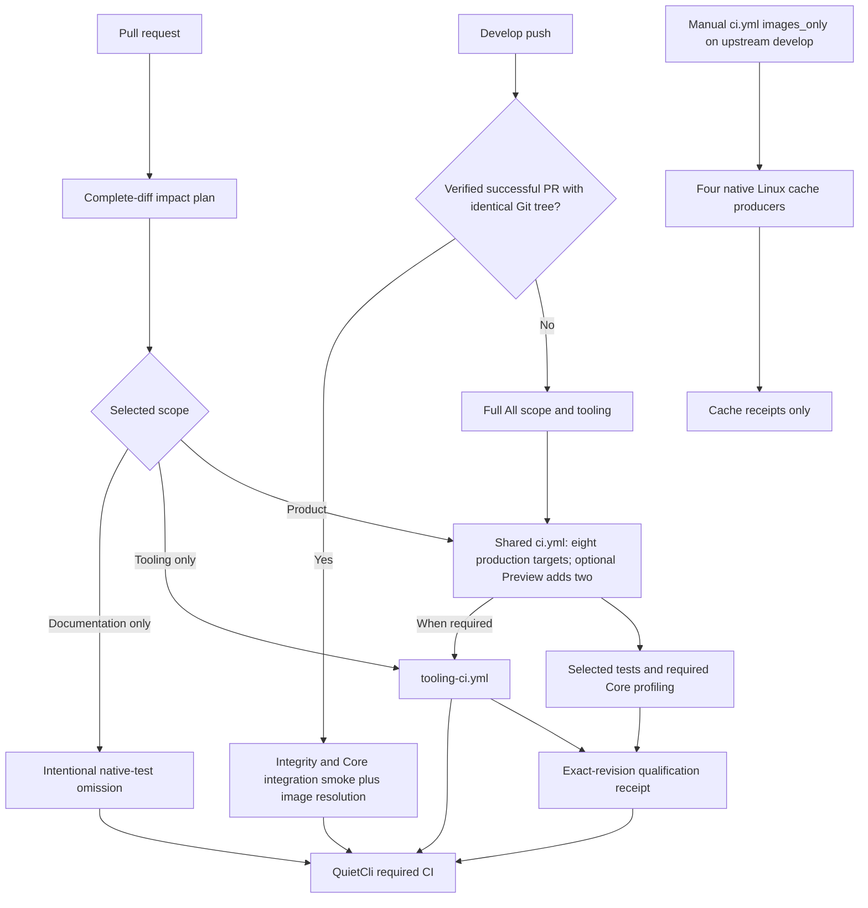
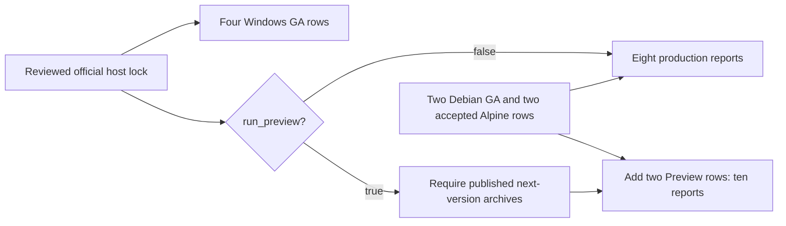

# Continuous integration

Start with [qualification: when, where and how](../../README-qualification-when-where-how.md) for triggers, targets and evidence. The [workflow index](github/README.md) contains the reviewed YAML contracts and generated job graphs. This page connects those workflows to their scripts.

## Source-change landmarks

Source review: **12 November 2026**. Dates below come from Git commits, not filesystem modification times, which change on checkout. These landmarks explain the current configuration; they do not assert a successful hosted run.

| Date (Europe/Paris) | Source checkpoint | Documentation consequence |
| --- | --- | --- |
| 11 Nov., `c49aae6` | Shared qualification, native Windows hosts, Linux image routing and module-tag releases | Separate local supervision, hosted testing, cache publication and Gallery publication. |
| 12 Nov., 07:36, `10a91e7` | Affected-suite planning, Core independence and same-tree develop reuse | One companion entry point; tooling runs outside the ten product environments. |
| 12 Nov., 13:08, `bc93b5f` | Distribution checks run once in tooling | Native product rows publish their tested RID; release packaging still prepares all required RIDs. |
| 12 Nov., 13:58, `ba24640` | Profiler scopes and test dependency preparation | Core profiling remains required; tool qualification and product measurements have distinct runners. |
| 12 Nov., 15:51–15:59, `2eeb2c2` / `60d95d4` / `8f5b3b5` | Reviewed tooling-only paths, bounded artifacts and cache-only dispatch | Avoid unrelated product replay, retain failed fixtures separately, prime trusted develop caches without qualification. |
| 12 Nov., 16:11, `d947f39` | Two run-profile mutation shards and strict completion | Each shard is partial; only their verified complete union satisfies tooling. |
| 12 Nov., 16:48–16:57, `eac3f7d` / `b0154d1` | Isolated Git mutation batches and aggregation-condition regressions | Two catalogue workers, one restore per catalogue; cache-only mode cannot produce profiling/qualification evidence. |

The shard-entry correction following these checkpoints validates intermediate reports without changing their Partial status; see [validated shard execution](#validated-shard-execution).

Historical [audits](../README.md#dated-audits-and-evidence) retain their original revision and conclusions.

## End-to-end routing

The stable final check rejects missing required campaigns. Documentation-only omissions apply to PR planning; develop requires verified reuse before omitting product replay. A release tag follows its separate [release/publication flow](execution-model.md#gallery-publication).

## PowerShell resource policy

Production selects locked GA 7.7.0 on Windows and Debian. Alpine keeps the explicitly accepted native 7.6.9-r0 / CLR 10 exception until both native architectures can advance. Next-version Windows Preview is optional (`run_preview=false`); the announced 7.8.0-preview.1 is currently unavailable. Explicit opt-in requires verified published archives. Matrix planning and profile aggregation agree on eight production targets or ten with Preview.

## Script map

| Responsibility | Shared implementation |
| --- | --- |
| Complete diff and affected suites | [New-CiImpactPlan](../scripts/New-CiImpactPlan.md), [CiImpact](../scripts/lib/CiImpact.md) |
| Same-tree successful PR receipt | [Get-DevelopQualification](../scripts/Get-DevelopQualification.md) |
| Suite, tools and image declarations | [CiCompanions](../scripts/lib/CiCompanions.md), [Initialize-CiCompanions](../scripts/Initialize-CiCompanions.md) |
| Compile selected dependency closure | [Build-Workspace](../scripts/Build-Workspace.md) |
| Runner/job-container execution | [Invoke-GitHubCi](../scripts/Invoke-GitHubCi.md) |
| Desktop worker and visible monitor | [Invoke-WorkspaceCi](../scripts/Invoke-WorkspaceCi.md), [Invoke-ContainerCi](../scripts/Invoke-ContainerCi.md) |
| Networkless Docker/Podman transport | [Invoke-ContainerWorker](../scripts/Invoke-ContainerWorker.md) |
| Final image, base and overlays | [New-CiSuiteImage](../scripts/New-CiSuiteImage.md), [New-CiImage](../scripts/New-CiImage.md), [New-CiModuleImage](../scripts/New-CiModuleImage.md), [CiImages](../scripts/lib/CiImages.md) |
| GA resources, native hosts and optional Preview | [Availability audit](../scripts/Test-PowerShellReleaseAvailability.md), [lock updater](../scripts/Update-PowerShellCiLock.md), [host preparation](../scripts/Initialize-PowerShellHost.md), [Windows selection](../scripts/Select-PowerShellCiMatrix.md) |
| Linux routing and result policy | [Select-GitHubCiMatrix](../scripts/Select-GitHubCiMatrix.md), [GitHubCi](../scripts/lib/GitHubCi.md) |
| Core without the Git module | [Test-CoreIndependence](../scripts/Test-CoreIndependence.md) |
| Mutation partition and completion | [MutationShards](../scripts/lib/MutationShards.md), [Assert-RunProfileMutationShards](../scripts/Assert-RunProfileMutationShards.md) |
| Profiles and combined evidence | [New-CoreEvidenceBundle](../scripts/New-CoreEvidenceBundle.md), [New-CorePerformanceReport](../scripts/New-CorePerformanceReport.md) |
| Qualification and bounded failure diagnostics | [Assert-QualificationGate](../scripts/Assert-QualificationGate.md), [Export-CiFailureDiagnostics](../scripts/Export-CiFailureDiagnostics.md) |
| Documentation/source checks | [Invoke-WorkspaceChecks](../scripts/Invoke-WorkspaceChecks.md), [workflow generator](../scripts/Sync-GitHubWorkflowsReadme.md) |

Read [execution boundaries](execution-model.md), [scheduling](scalable-companions.md), [Linux caches](linux-images.md), [Windows ARM64](windows-arm64.md) and [environment resolution](environment.md) for the corresponding policies. Exact versions and hashes belong to checked-in locks, rather than copied version numbers in these guides.

## Validated shard execution

The GitHub entry distinguishes validated RunProfilesMutation partitions from complete qualification. Both shard controls, source/revision, exact catalogue partition, green baseline/settings and successful summary counters are checked; intermediate results retain Partial=true. Product partial/incomplete evidence stays rejected. Only the dependent completion job accepts the complete union. See [the entry contract and regression](../scripts/Invoke-GitHubCi.md#shard-execution-and-completion).
## Evidence and maintenance

Ordinary tooling artifacts retain reports and logs; failed functional fixtures have a separate seven-day artifact. Product diagnostics, performance bundles and release packages have distinct contracts. A cache hit, successful build or partial test report cannot replace required qualification.

After a source change, review its matching script/workflow document, update authored workflow source receipts only when YAML changes, regenerate workflow graphs/index, script contracts and credits, then run `./scripts/Invoke-WorkspaceChecks.ps1`. This checks documentation structure and source alignment; hosted Windows/ARM64/Linux outcomes and elapsed-time gains require their own run evidence.

<!-- credits:begin -->
## Credits

This document is covered by the mandatory [CREDITS.md](../../CREDITS.md), which records the licenses of [Git](https://github.com/git/git/blob/master/COPYING), [Vagrant](https://github.com/hashicorp/vagrant/blob/main/LICENSE) and [Microsoft .NET/PowerShell](https://github.com/PowerShell/PowerShell/blob/master/LICENSE.txt).
<!-- credits:end -->
