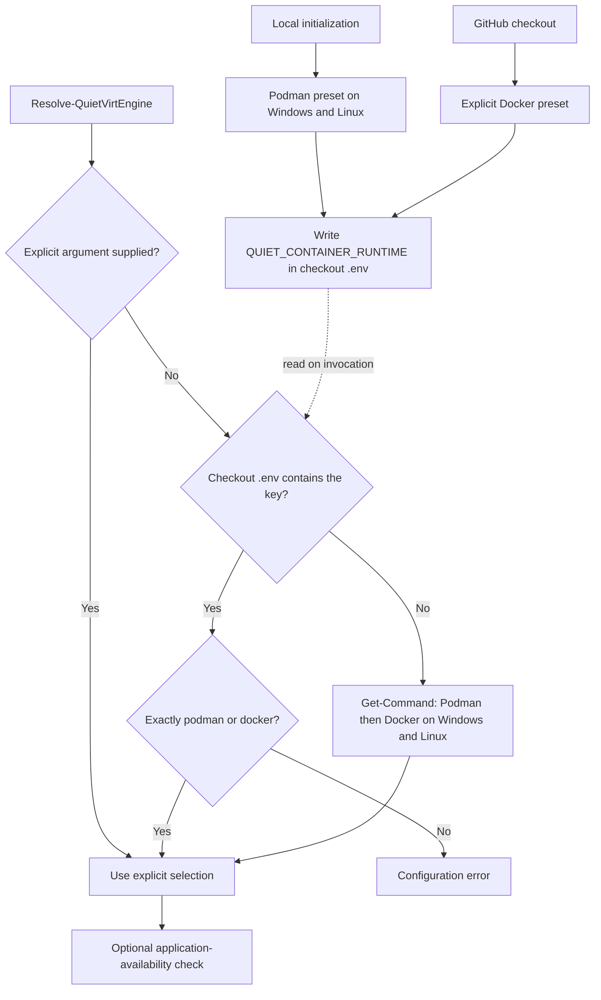

# Deterministic local and GitHub environment

RAC-ENV-001 uses the same configuration and resolution functions in both contexts. Generate the
checkout's ignored `.env` explicitly; do not depend on a workstation profile, current directory,
ambient environment variable or a manually edited CI value.

```powershell
./scripts/Initialize-CiEnvironment.ps1 -Target Local
```

The Local preset selects Podman on Windows and Linux. GitHub execution jobs run
`Initialize-CiEnvironment.ps1 -Target GitHub -ContainerRuntime docker` immediately after checkout.
Both presets write one canonical assignment and preserve unrelated keys:

```dotenv
QUIET_CONTAINER_RUNTIME="podman"
```

`Resolve-QuietVirtEngine -WorkspaceRoot $root [-ContainerRuntime docker|podman] [-Available]` uses
an explicit invocation argument first, then `QUIET_CONTAINER_RUNTIME` from that checkout's `.env`,
then application discovery. With no assignment, Windows and Linux probe Podman before Docker. A present invalid/empty value or duplicate assignment fails rather than silently
changing engines. `-Available` verifies the chosen application exists; it does not start a daemon or
prove daemon health. A configured unavailable engine does not silently fall back to another one.



`EnvFile.ps1` reads a bounded UTF-8 literal format without variable expansion or shell evaluation.
`Update-EnvFile.ps1` exposes one-key reads/edits with standard WhatIf/Confirm. Write metadata never
contains values; explicit read mode returns only the requested key. Production credentials remain
outside reports and commits. The container staging helper creates a fresh file containing only the
effective public runtime key; it does not copy a private `.env` wholesale.

The companion checks generated Unicode values, malformed/duplicate assignments, idempotence,
no-write previews, deterministic presets, platform-independent Podman-first discovery and explicit override
behavior. Workflow receipts, generated execution tables and Mermaid graphs track the initialization
step. This configuration does not dispatch or publish a workflow and adds no trigger to the manual
ReadyToRun benchmark.

<!-- credits:begin -->
## Credits

This document is covered by the mandatory [CREDITS.md](../../CREDITS.md), which records the licenses of [Git](https://github.com/git/git/blob/master/COPYING), [Vagrant](https://github.com/hashicorp/vagrant/blob/main/LICENSE) and [Microsoft .NET/PowerShell](https://github.com/PowerShell/PowerShell/blob/master/LICENSE.txt).
<!-- credits:end -->
