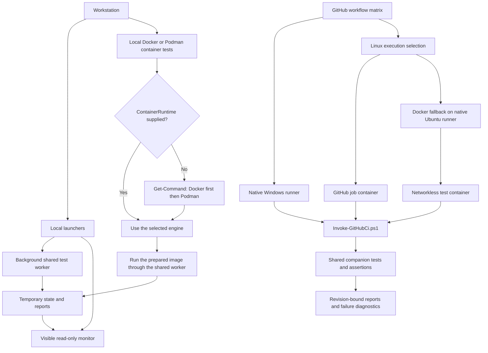
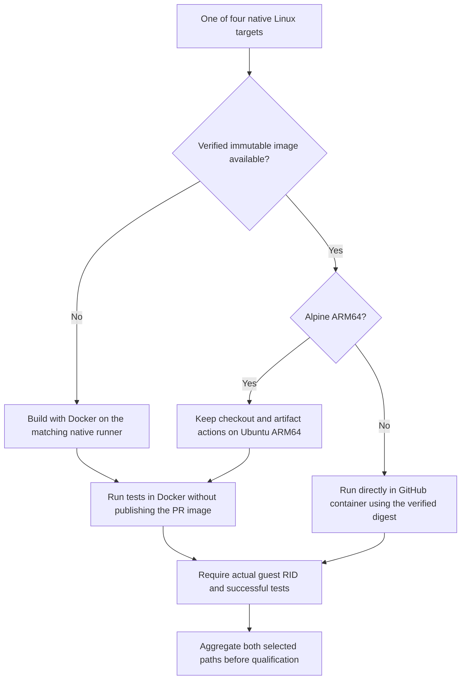
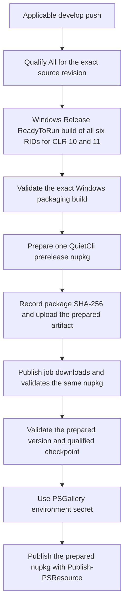
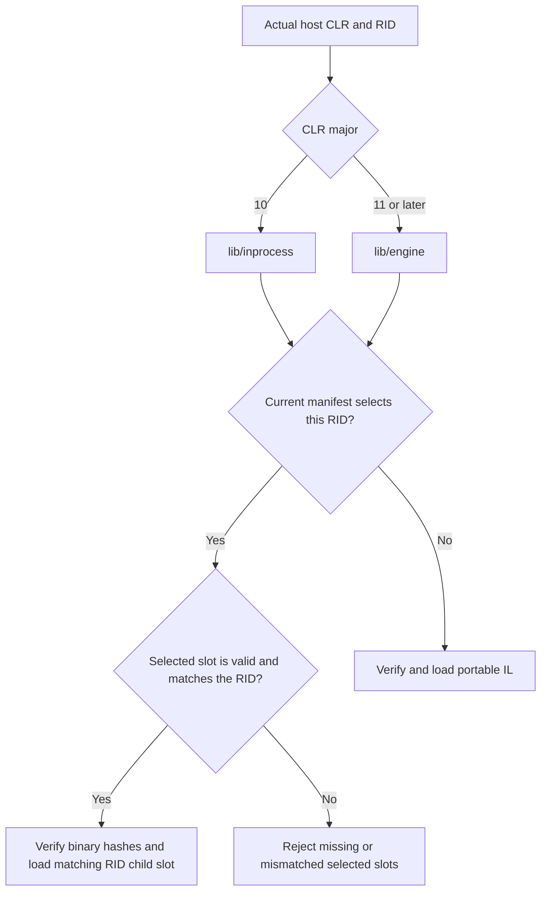
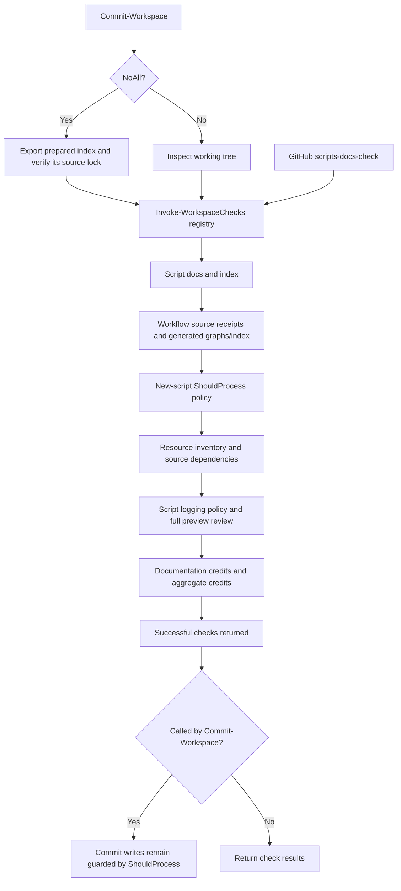

# CI execution model and local boundaries

## Execution paths

The main workflow separates workstation supervision from GitHub execution. Its Linux matrix uses
verified GitHub job containers where supported, or Docker fallback without PR image publication.
Windows runs directly on its native GitHub runner. Local supervision remains a separate entry point.
The workflow is implemented locally; hosted execution remains separate qualification evidence.

Linux selection writes its JSON receipt atomically and creates missing parent directories on a
clean checkout. The selected container and Docker jobs use an explicit `!cancelled()` condition,
require successful selection and check their own flag. This prevents skipped image-publication
jobs on PRs from implicitly skipping the downstream test matrices; cancellation and selection
failure still block both paths. The dependency graph below keeps publication optional on PRs.

The Alpine ARM64 branch preserves musl testing without pretending GitHub's JavaScript action host
supports that environment. The [runner implementation](https://github.com/actions/runner/blob/main/src/Runner.Worker/Handlers/StepHost.cs)
rejects Alpine JavaScript actions outside x64. The native runner still matches the target CPU;
Docker fallback is not architecture emulation.

## Gallery publication and RID handling

The current publication model creates one public `QuietCli` module package containing six embedded
engine RIDs. Windows prepares that package after source-revision qualification. The publish job
downloads and verifies the prepared bytes; it does not rebuild or replace a per-RID package.
GHCR toolchain images remain separate from the PowerShell Gallery module.

The matrix qualifies a source revision. The Windows packaging job rebuilds its embedded binaries
afterward; the current pipeline does not assemble the final package from per-RID binaries downloaded
from the matrix. This distinction must remain visible when describing binary-level qualification.
Stable publication remains a separate explicitly requested version; a develop preview does not
publish a stable release. See [the Gallery workflow](../../.github/workflows/publish-psgallery.yml).
Each successful checkpoint can publish its uniquely versioned prepared package even if `develop`
has advanced. Publication validates that checkpoint and the prepared bytes, never the current branch HEAD.

## ReadyToRun builds

Every main GitHub matrix row explicitly selects `Release`, `ReadyToRun` and its tested RID.
Linux rows precompile their Linux target; they do not attempt Windows Crossgen2 from Linux.
The Windows x64 packaging job precompiles all six RIDs for both supported CLR builds and uses
`-RequireReadyToRun` before compression. One public nupkg contains all twelve RID/CLR publications.
The package plan records ReadyToRun, and package validation reads the embedded native headers.

Portable IL stays available for ordinary local builds; the loader never chooses an unrelated
platform's R2R image. Old generated child directories cannot override a later portable build.
ReadyToRun still contains IL and may use JIT at runtime; startup improvement requires measurement,
as explained by the [.NET documentation](https://learn.microsoft.com/en-us/dotnet/core/deploying/ready-to-run).
The separate manual A/B workflow compares an IL baseline with an R2R candidate. It has only
`workflow_dispatch`, publishes no package/image, and is absent from qualification dependencies.

## Workflow dependencies

| Workflow | Execution environment |
| --- | --- |
| `ci.yml` | Native Windows; verified Linux job containers; Docker image preparation/fallback on native Ubuntu runners. No Podman dependency in this workflow. |
| `core-ci.yml` | Reuses `ci.yml` with `suite=Core`. |
| `git-ci.yml` | Reuses `ci.yml` with `suite=Git`. |
| `publish-psgallery.yml` | Reuses `ci.yml` with `suite=All`; packaging/publication jobs are Windows-native. |
| `preview-psgallery.yml` | Reuses `publish-psgallery.yml` and its qualification gate. |
| `quietcli2-readytorun.yml` | Separate manual profiling workflow: native Windows, Docker on native Linux runners, direct cold-start worker without a desktop launcher. Informational; never a develop gate. |
| `qualification.yml` | Declares a self-hosted Linux/Podman/KVM runner, but its full Git qualification runner remains deliberately unimplemented and fails closed. |
| Scripts-docs and credits workflows | No container dependency. |

## GitHub execution

Core and Git path-filtered callers reuse `ci.yml`. It selects six Windows host/mode combinations
(x64/ARM64, stable/preview integrated hosting and both isolated-host architectures) and four Linux
targets (Debian/Alpine, x64/ARM64). Linux runners are native to the selected architecture.

On upstream `develop` pushes/manual runs, the image jobs may publish missing fingerprinted GHCR
images. Pull requests do not publish images: Linux test jobs resolve an accessible verified cache
or build locally. Core declares its recipe under `FrenchExDev2.QuietCli.Core.PoSh/ci`; consumer
modules declare derived-image inputs independently. `New-CiImage.ps1` and `New-CiModuleImage.ps1`
return the inspected image ID after checking architecture, source and fingerprint labels.

The image is a toolchain, not a baked copy of QuietCli. Native job containers build the checked-out
source directly in `Release` with ReadyToRun for its RID. On Docker fallback, the host builds the
selected Linux RID in `Release` with ReadyToRun and the shared
transport stages current sources/binaries into a networkless container using `--pull=never` and the
immutable image ID. Native GitHub job containers retain the networking needed by checkout/setup;
the two network scopes must not be described as identical. Both paths record the actual guest/engine RID.

The main Windows/Linux test jobs call `Invoke-GitHubCi.ps1` directly in the current PowerShell
process. There is no desktop monitor or local supervision process. A dedicated `Release` build
precedes `-SkipBuild` tests. Direct execution uses GitHub step/job deadlines; Docker fallback has an
explicit guest deadline. Native PTY campaigns are excluded with `-SkipTty`.
The performance report and qualification gate require results for the exact revision before Gallery
packaging/publication. A failed test is not converted into a successful skipped qualification.

Failure-only artifacts use `Export-CiFailureDiagnostics.ps1` before upload. The redacted, bounded
bundle is independent of qualification-report assembly and retained for 14 days. Original reports
and the existing qualification artifacts remain distinct from this diagnostic export.

## Local execution

Local tests use `Invoke-WorkspaceCi.ps1` and `Invoke-ContainerCi.ps1` with the shared visible monitor
and temporary report roots. The same worker/test logic serves local and GitHub runs; duplicating
assertions, image recipes or qualification policy would create conflicting sources of truth.

`Invoke-LocalWorkflow.ps1` is a separate local entry point around a verified wrkflw 0.8.0 executable.
It provides explicit job/runtime selection, `-WhatIf`, saved exit status, a deadline and the existing
monitor. It never installs the binary, supplies credentials or launches a remote workflow.
The pinned 0.8.0 parser rejects the expression-valued image matrices in `ci.yml`; a local wrapper
cannot qualify the real workflow while that parser gap remains. Replacing those expressions only
for the emulator would test a different definition. GitHub Windows/ARM host identity and ephemeral
token permissions also require real GitHub execution.

## Adaptation gaps to address separately

- Workstation container tests accept an explicit Docker or Podman `-ContainerRuntime`. When empty,
  `Resolve-QuietVirtEngine -Available` discovers applications with `Get-Command`, preferring Docker
  when both exist. Discovery does not start a daemon or prove its health; missing engines fail explicitly.
  Native workstation tests require neither. Offline image `-PlanOnly` skips engine discovery. The main
  GitHub path selects Docker and GitHub-managed job containers, with no Podman dependency on Windows.
- Core image preparation removes `QUIETCLI_REGISTRY_TOKEN` from the child environment. The derived
  builder preserves the credential in memory across that call and restores it for its own registry
  operation; a focused fixture checks that handoff without real registry credentials.
- The container worker retains its six-minute default for local callers and accepts an explicit
  guest deadline. The GitHub entry supplies 1800 seconds for Docker fallback; direct job-container
  execution is bounded by GitHub step/job timeouts.
- Several comments still mention `main` while authorization checks use `develop`. Runtime checks
  and recorded receipts determine actual behavior; documentation should follow the declared branch.

## Automation contract checks

Every workflow has a reviewed source receipt, generated job/dependency Mermaid and matching document
under [docs/ci/github](github/README.md). The generator never refreshes authored source receipts;
changing YAML requires reviewing its corresponding document. This check proves structural currency,
not semantic completeness or successful hosted execution.

`Invoke-WorkspaceChecks.ps1` is the common ordered registry for standalone validation, GitHub
`scripts-docs-check.yml` and commit preparation. Explicit skips are reported as skipped.

Resource preparation belongs to the consumer: workflow parsing calls Ensure-QuietResource to verify
or selectively restore YamlDotNet, respecting WhatIf/Confirm. It needs no preceding workflow step.
Selected jobs reuse archives through the shared optional resource cache; all payloads remain hash-verified.
The generated [resource inventory](../resources/README.md) and [script preview review](../scripts/preview-support.md)
are checked by this registry. See [Resources](../../README-resources.md).

The WhatIf/Confirm rule applies to new executable PowerShell scripts. Function-only libraries
delegate effects to their caller; read-only entry-point exceptions are justified and hash-bound.
All scripts now have an explicit reviewed preview/effect classification; missing executable entry-point
guards were added without replacing existing detailed guards. Whole-operation guards prevent starting
the operation under WhatIf, but do not simulate native effects. The frozen legacy policy inventory is
separate from this review and remains an explicit qualification gap. See [the RaC contract](../README-automation-contracts.md).

Keep separate entry points for local supervision and GitHub orchestration, with shared workers,
image builders, test companions and gates. A small CI prerequisite check and consistent deadline
configuration are preferable to cloning the full test implementation into a second CI stack.

<!-- credits:begin -->
## Credits

This document is covered by the mandatory [CREDITS.md](../../CREDITS.md), which records the licenses of [Git](https://github.com/git/git/blob/master/COPYING), [Vagrant](https://github.com/hashicorp/vagrant/blob/main/LICENSE) and [Microsoft .NET/PowerShell](https://github.com/PowerShell/PowerShell/blob/master/LICENSE.txt).
<!-- credits:end -->
