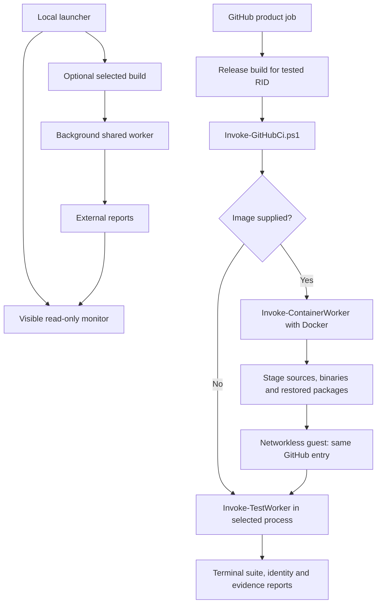
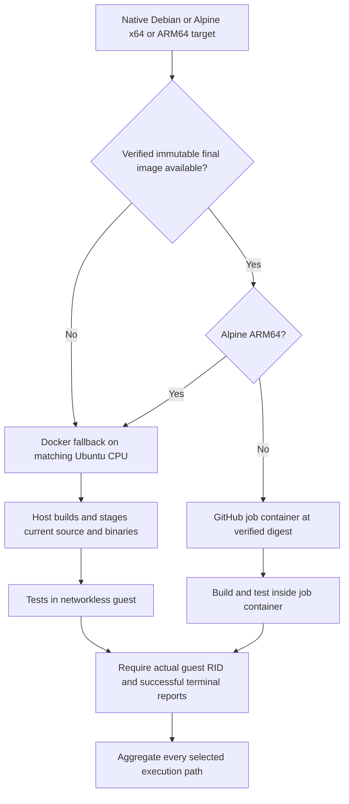
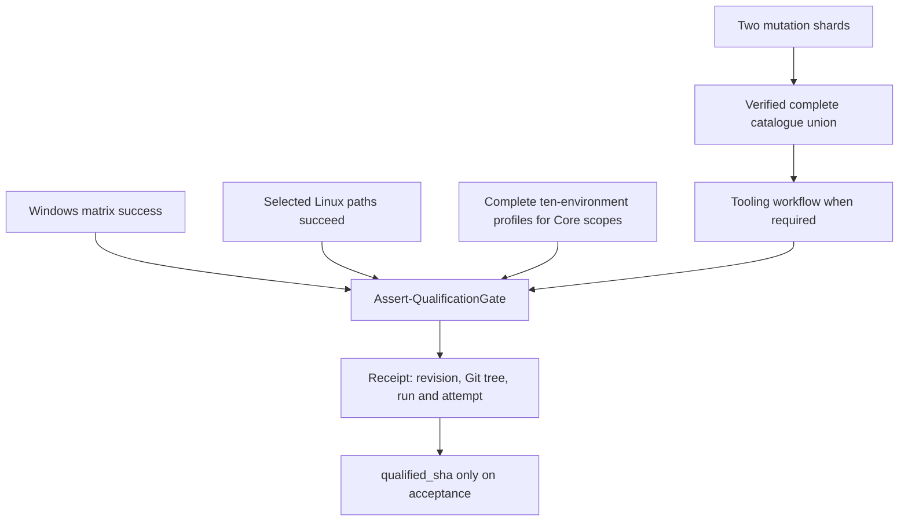
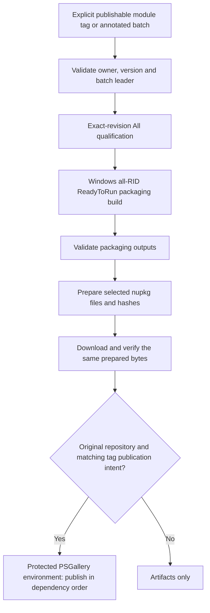

# CI execution model and local boundaries

[CI map and source dates](README.md) · [Qualification guide](../../README-qualification-when-where-how.md) · [Workflow contracts](github/README.md)

## Execution paths

One `companions-ci.yml` caller plans the complete diff. Companion paths select dependent suites; Core/shared/unknown changes require All and tooling. Reviewed tooling-only paths avoid product replay. Develop omits replay only with verified successful PR evidence for the identical Git tree, and still runs merged-source smoke and cache resolution. Missing proof falls back to All.

The shared `ci.yml` selects six native Windows host/mode rows and four Linux targets. Tooling runs once outside this product matrix. All executes complete Core before bounded independent companions on the same prepared image/build.

GitHub direct execution has no desktop monitor or extra local supervision process. Direct jobs use step/job deadlines; Docker fallback has an explicit guest deadline. `SkipBuild` reuses verified outputs and still executes tests. GitHub rejects partial/incomplete summaries and passes `SkipTty`; excluded terminal campaigns do not count as passed.

## Linux selection

[Select-GitHubCiMatrix](../scripts/Select-GitHubCiMatrix.md) saves selection atomically, creating missing parents. Its matrices are disjoint and cover four native targets. Selection failure/cancellation blocks execution; a skipped PR image producer does not implicitly skip tests.

Alpine ARM64 keeps JavaScript checkout/upload actions on Ubuntu and tests real musl ARM64 in Docker. This is native execution, without architecture emulation. Job containers retain networking for checkout/setup; only fallback guest tests are described as networkless. [GitHubCi](../scripts/GitHubCi.md) owns routing and aggregate-result policy; [Linux images](linux-images.md) owns cache preparation.

## Qualification and artifacts

Core evidence requires successful combined performance reporting. Git/Vagrant-only scopes expect profiling to be skipped. Required tooling includes functional, distribution, Core-independence and completed run-profile mutation work. The gate records TTY exclusion; it does not silently qualify native PTY campaigns.

Product jobs retain functional reports and integrity-checked performance bundles. Failure-only `Export-CiFailureDiagnostics` writes an independently bounded/redacted bundle. Tooling artifacts select reports/logs instead of nested fixture trees; failed functional fixtures have a separate seven-day diagnostic artifact. A cache-only dispatch runs producers but emits no qualification receipt.

## Gallery publication

Core packages embed six RIDs for CLR 10 and 11; Git packages contain their parser outputs and retain the Core dependency. Manifests declare package eligibility; tests are never public targets and Vagrant remains disabled. The packaging job rebuilds after source qualification, rather than assembling the final package from matrix binaries. Its build validation and package hashes remain distinct evidence.

Develop pushes, PRs, manual generated-preview preparation and image-cache publication do not publish Gallery modules. Publication requires current-run/current-attempt exact-source evidence and validates the tagged checkpoint, never mutable branch HEAD. See [release tags](github/script-release-tags.md) and [publication](github/script-publish-psgallery.md).

## Local execution and maintenance

[Invoke-WorkspaceCi](../scripts/Invoke-WorkspaceCi.md) and [Invoke-ContainerCi](../scripts/Invoke-ContainerCi.md) supervise local tests with the visible monitor and external temporary report roots. Container selection is explicit argument, checkout `.env`, then Podman-first discovery; [GitHub initialization](environment.md) selects Docker. Resolution starts no daemon. Full local campaigns are explicit operations.

[Invoke-LocalWorkflow](../scripts/Invoke-LocalWorkflow.md) wraps pinned wrkflw 0.8.0 with monitoring/deadline/exit reporting. That parser cannot consume the real expression-valued image matrices; replacing them for an emulator would test another definition. Hosted host identities and token permissions require actual GitHub execution. The separate self-hosted `qualification.yml` capability runner remains unimplemented and fails closed. Manual ReadyToRun A/A–A/B is informational and never a qualification dependency.

Every workflow has a reviewed source SHA-256 receipt, generated graph and job/script table. `Sync-GitHubWorkflowsReadme -Apply` regenerates structure but does not author or refresh reviewed source receipts. The eight-check [workspace registry](../scripts/Invoke-WorkspaceChecks.md) also checks case metadata, script docs/safety/contracts, resources and credits. It runs locally, during commit preparation and in the documentation workflow. These checks establish structural alignment, not a successful hosted matrix.

<!-- credits:begin -->
## Credits

This document is covered by the mandatory [CREDITS.md](../../CREDITS.md), which records the licenses of [Git](https://github.com/git/git/blob/master/COPYING), [Vagrant](https://github.com/hashicorp/vagrant/blob/main/LICENSE) and [Microsoft .NET/PowerShell](https://github.com/PowerShell/PowerShell/blob/master/LICENSE.txt).
<!-- credits:end -->
