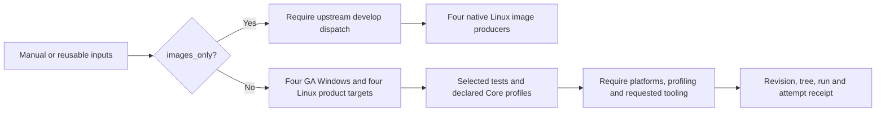

# ci.yml

<!-- workflow-source-sha256: 4321531AE1DC945B063E6ABA4B762C08C4E898E5525C407C9EEEBC737AD98936 -->

## Purpose

Tooling qualification consumes separate functional, mutation-execution and catalogue
completion outputs from the reusable tooling workflow. The gate also checks the
overall reusable result, preserving failures in setup, uploads and reporting.
Disabled tooling supplies explicit skipped statuses; missing enabled outputs fail
closed. Its decision receipt preserves the independent results after rejection.

Shared manual/reusable qualification. Four required GA Windows host/mode rows and four Linux glibc/musl architecture rows run the selected product suite. Core/All keeps mandatory per-environment import, controlled Git-status and PowerShell/CLR profiling evidence. Git/Vagrant-only selections do not claim Core qualification.

run_tooling defaults true for manual/release callers; PR planning may disable it for companion-only changes. The separate tooling-ci.yml workflow must succeed when required, and qualification receipts record its outcomes plus the exact Git tree. Failures, missing profiles and cancelled jobs block qualification.

Core requires only the base toolchain image. All runs Core completely before bounded independent companion workers consume the same image. Build-Workspace compiles only the selected dependency closure and publishes the tested RID. Full IL distributions and their three private Distribution.Tests checks run once in tooling-ci.yml. Public release packaging retains its separate all-RID ReadyToRun requirement.

Linux resolves verified final GHCR images before building parents. Missing images use Docker BuildKit mode=max intermediate caches via cache-ci-layers. The active-context builder uses the containerd image store so local parent images remain visible. Cache save follows image preparation and precedes tests. PRs never publish images. Native architecture, fingerprints, parent provenance and labels remain mandatory.

Linux job containers restore NuGet packages with the pinned restore-only cache action before builds and tests. A final explicit save uses its resolved `cache-primary-key`, after successful tests and report uploads and only without an exact cache hit. The project/package/build/SDK input hash is evaluated during restore, never during save or post-job cleanup: generated fixtures can change the checkout tree and make a later recursive hash fail. Cache paths and OS/architecture/dependency partitioning are preserved. The focused `CI scales by affected suites with verified merge reuse and intermediate caches` tooling case checks ordering, the frozen key, the success/cache-hit decisions and damaged workflow variants. Local contract checks do not reproduce GitHub's container post-job evaluator.

## Validation and limits

Production requires eight product targets. Explicit run_preview=true adds two Windows InProcess targets for a published next-version prerelease; the default false does not depend on Preview availability. RunProfiles functional/mutation campaigns moved out of the product matrix; profiling each environment remains independent. Local mocked/cache-boundary tests do not establish hosted cache transfer speed or ARM64 execution. See [scalable companion qualification](../scalable-companions.md).

## Triggers

Manual workflow_dispatch and reusable workflow_call. Suite, collect_performance, run_tooling and run_preview are explicit inputs. run_preview defaults false for both triggers.

Manual dispatch additionally exposes `images_only` (false by default). On the upstream `develop` ref, selecting it runs the existing native Linux image producer and its verified GHCR/BuildKit preparation without product tests, tooling mutation, performance aggregation or a qualification receipt. The shared context guard rejects forks, PR events and other refs. Existing trusted develop producers continue populating the same caches; PR fallback remains read-only for GHCR. This mode primes base-branch caches for later PRs instead of storing the only reusable layers under a PR merge ref. It never qualifies a package or emits `qualified_sha`.

## Scripts and effects

Uses the shared scripts/ entry points, validated source lock, selected builds and private artifacts described above. Network access is limited to pinned dependency preparation, verified image caches and explicit GitHub evidence reads. No module publication occurs here.

Native Linux image and fallback jobs initialize the checkout's Docker preset immediately after checkout, then prepare the checksum-pinned GA PowerShell host. The initial environment bootstrap uses the runner host; subsequent image preparation, builds and tests use the selected GA host. The existing GitHub CI orchestration regression enforces this order in both linux-images and linux-test-driver.

## Operational modes and acceptance

Core evidence requires the combined eight-environment production report, or ten when Preview is explicitly selected. Select-PowerShellCiMatrix derives the rows and expected report count from the host lock. GA is 7.7.0 / CLR 11; the announced 7.8.0-preview.1 is unavailable until published and verified. Alpine keeps the approved native 7.6.9-r0 / CLR 10 exception. `always()` retains failure-report assembly; cache-only mode and scopes without Core evidence skip it. A collect_performance opt-out cannot qualify Core. Windows rows use checksum-pinned hosts and one tested RID; tooling owns the complete IL distribution checks outside the matrix. The [CI map](../README.md) explains script roles and source-change dates.

The [tooling shard boundary](script-tooling-ci.md#shard-execution-boundary) accepts validated intermediate partitions while retaining Partial=true. Only complete aggregation satisfies required tooling. Configured graphs describe routing, not a successful hosted qualification.

<!-- workflow-generated:begin -->
## Jobs and dependencies

Generated from the workflow by Sync-GitHubWorkflowsReadme.ps1. Conditions can skip jobs; edges express declared needs.

~~~mermaid
flowchart TD
    event["Triggers: workflow_call, workflow_dispatch"]
    job_linux["linux"]
    job_linux_images["linux-images"]
    job_linux_matrix["linux-matrix"]
    job_linux_result["linux-result"]
    job_linux_selection["linux-selection"]
    job_linux_test_driver["linux-test-driver"]
    job_performance_results["performance-results"]
    job_qualification_gate["qualification-gate"]
    job_tooling["tooling"]
    job_windows["windows"]
    job_linux_selection --> job_linux
    job_linux_matrix --> job_linux_images
    event --> job_linux_matrix
    job_linux_selection --> job_linux_result
    job_linux --> job_linux_result
    job_linux_test_driver --> job_linux_result
    job_linux_matrix --> job_linux_selection
    job_linux_images --> job_linux_selection
    job_linux_selection --> job_linux_test_driver
    job_linux_matrix --> job_performance_results
    job_windows --> job_performance_results
    job_linux --> job_performance_results
    job_linux_test_driver --> job_performance_results
    job_linux_matrix --> job_qualification_gate
    job_windows --> job_qualification_gate
    job_linux_result --> job_qualification_gate
    job_performance_results --> job_qualification_gate
    job_tooling --> job_qualification_gate
    event --> job_tooling
    job_linux_matrix --> job_windows
~~~

| Job | Execution | Needs | Condition | Script entry points |
| --- | --- | --- | --- | --- |
| linux | runner ${{ matrix.runner }}; container ${{ matrix.image }} | linux-selection | ${{ !cancelled() && needs.linux-selection.result == 'success' && needs.linux-selection.outputs.has_container == 'true' }} | ./scripts/Build-Workspace.ps1, ./scripts/Export-CiFailureDiagnostics.ps1, ./scripts/Initialize-CiEnvironment.ps1, ./scripts/Initialize-Profilers.ps1, ./scripts/Initialize-Workspace.ps1, ./scripts/Invoke-GitHubCi.ps1, ./scripts/New-CoreEvidenceBundle.ps1, ./scripts/New-CorePerformanceReport.ps1 |
| linux-images | runner ${{ matrix.runner }} | linux-matrix | github.repository == 'FrenchExDev2/QuietCli.PoSh' && github.ref == 'refs/heads/develop' && (github.event_name == 'push' &#124;&#124; github.event_name == 'workflow_dispatch') | ./scripts/Initialize-CiEnvironment.ps1, ./scripts/New-CiSuiteImage.ps1 |
| linux-matrix | runner ubuntu-latest |  | default success condition | ./scripts/Initialize-CiCompanions.ps1, ./scripts/Initialize-CiEnvironment.ps1, ./scripts/lib/GitHubCi.psm1, ./scripts/Select-PowerShellCiMatrix.ps1 |
| linux-result | runner ubuntu-latest | linux-selection, linux, linux-test-driver | ${{ always() && !inputs.images_only }} | ./scripts/Initialize-CiEnvironment.ps1, ./scripts/lib/GitHubCi.psm1 |
| linux-selection | runner ubuntu-latest | linux-matrix, linux-images | ${{ always() && !cancelled() && !inputs.images_only && needs.linux-matrix.result == 'success' && (needs.linux-images.result == 'success' &#124;&#124; needs.linux-images.result == 'skipped') }} | ./scripts/Initialize-CiEnvironment.ps1, ./scripts/Select-GitHubCiMatrix.ps1 |
| linux-test-driver | runner ${{ matrix.runner }} | linux-selection | ${{ !cancelled() && needs.linux-selection.result == 'success' && needs.linux-selection.outputs.has_docker_container_runtime == 'true' }} | ./scripts/Build-Workspace.ps1, ./scripts/Export-CiFailureDiagnostics.ps1, ./scripts/Initialize-CiEnvironment.ps1, ./scripts/Initialize-Profilers.ps1, ./scripts/Initialize-Workspace.ps1, ./scripts/Invoke-GitHubCi.ps1, ./scripts/New-CiSuiteImage.ps1, ./scripts/New-CoreEvidenceBundle.ps1, ./scripts/New-CorePerformanceReport.ps1 |
| performance-results | runner ubuntu-latest | linux-matrix, windows, linux, linux-test-driver | ${{ always() && !inputs.images_only && inputs.collect_performance && needs.linux-matrix.outputs.has_core == 'true' }} | ./scripts/Initialize-CiEnvironment.ps1, ./scripts/New-CorePerformanceReport.ps1 |
| qualification-gate | runner ubuntu-latest | linux-matrix, windows, linux-result, performance-results, tooling | ${{ always() && !inputs.images_only }} | ./scripts/Assert-QualificationGate.ps1, ./scripts/Initialize-CiEnvironment.ps1 |
| tooling | reuses ./.github/workflows/tooling-ci.yml |  | inputs.run_tooling && !inputs.images_only |  |
| windows | runner ${{ matrix.image }} | linux-matrix | ${{ !inputs.images_only }} | ./scripts/Build-Workspace.ps1, ./scripts/Export-CiFailureDiagnostics.ps1, ./scripts/Initialize-CiCompanions.ps1, ./scripts/Initialize-CiEnvironment.ps1, ./scripts/Initialize-PowerShellHost.ps1, ./scripts/Initialize-Profilers.ps1, ./scripts/Initialize-Workspace.ps1, ./scripts/Invoke-GitHubCi.ps1, ./scripts/New-CoreEvidenceBundle.ps1, ./scripts/New-CorePerformanceReport.ps1 |

<!-- workflow-generated:end -->

<!-- credits:begin -->
## Credits

This document is covered by the mandatory [CREDITS.md](../../../CREDITS.md), which records the licenses of [Git](https://github.com/git/git/blob/master/COPYING), [Vagrant](https://github.com/hashicorp/vagrant/blob/main/LICENSE) and [Microsoft .NET/PowerShell](https://github.com/PowerShell/PowerShell/blob/master/LICENSE.txt).
<!-- credits:end -->
