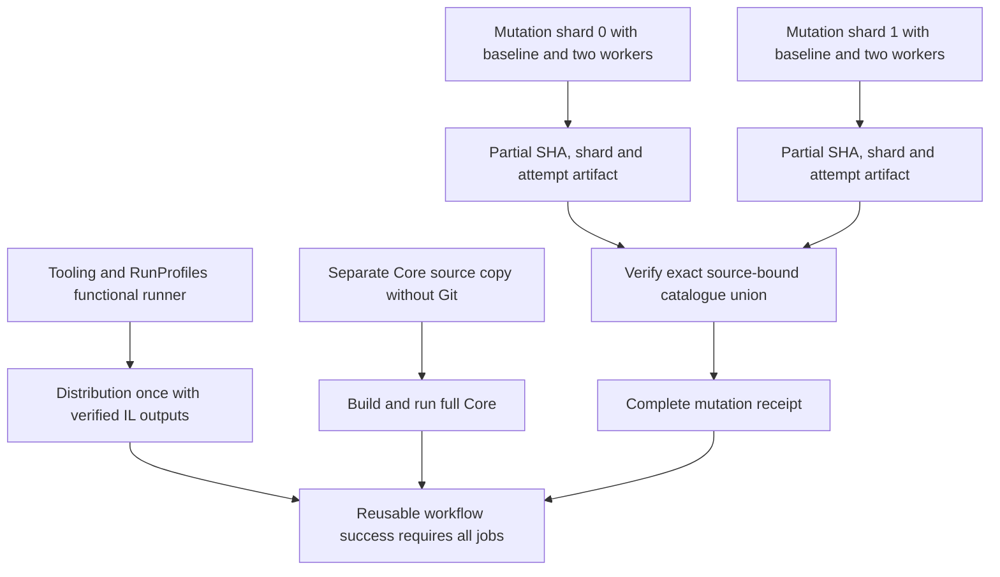

# tooling-ci.yml

<!-- workflow-source-sha256: F7F344ACD157D297FBDDB825B648C321BE33DAE5FFF2D04EEE1DDF219A0D9F71 -->

## Purpose

Reusable private repository-automation qualification, run once independently of the product matrix. Tooling.Tests owns its .psm1 catalogue and metadata; Core.Tests retains private assertion helpers. The complete functional RunProfiles suite follows tooling tests. The single complete tooling build supplies the independently declared Distribution.Tests catalogue. Test-CoreIndependence -Suite Distribution -SkipBuild verifies/copies Core/Core.Tests libraries to an owned checkout without Git, then runs every distribution case once, without another build. The mutation matrix declares two shards, each with a green baseline and at most two isolated process/sandbox pairs, accepting only Killed outcomes. Measurements and product profiling occur on separate runners.

A separate job builds and runs complete Core qualification in a fresh source copy without the real Git module. Git remains an executable fixture dependency. It uses a short temporary path to avoid Windows native-library path limits. Saved evidence records the isolated source/binary identity and generated scripted companion regression.

Mutation uses Ci.Process exclusively and performs no product build or import. Functional RunProfiles explicitly prepares both pinned profiler tools. New native build jobs reuse the common NuGet cache.

Run-profile mutation uses two independent matrix shards, each with two isolated workers and its own successful baseline. `QUIETCLI_MUTATION_SHARD_INDEX`/`QUIETCLI_MUTATION_SHARD_COUNT` configure only the mutation test launcher; local defaults still execute the entire catalogue. Each shard is partial evidence. A dependent completion job downloads only this SHA/attempt's artifacts and requires the exact union of the source-controlled catalogue, matching input hashes and fixed qualification settings. A missing, duplicate, stale, invalid or surviving result blocks the reusable workflow. Sharding changes scheduling, not the catalogue, seeds, iterations or acceptance criteria.

## Validation and limits

Failures in any job fail this reusable workflow and its calling gate. Artifact uploads require started test campaigns; skipped run-profile steps cannot create empty-artifact failures. Local partial tests do not establish the complete hosted catalogue or a measured speedup. This workflow never publishes packages.

Ordinary tooling and independence artifacts select top-level JSON reports, receipts and diagnostic logs, plus isolated case-worker reports. They exclude nested fixture workspaces, binaries and generated packages. Functional tooling failures additionally upload their existing fixture trees under a separate seven-day diagnostic artifact; those trees are never uploaded on success. Missing required report evidence still fails the ordinary artifact upload. Product/release package artifacts are unaffected.

## Triggers

Reusable workflow_call from CI or the tooling-only entry point; no independent publication trigger.

## Scripts and effects

Uses the shared scripts/ entry points, validated source lock, selected builds and private artifacts described above. Network access is limited to pinned dependency preparation, verified image caches and explicit GitHub evidence reads. No module publication occurs here.

## Mutation completion and artifact flow

The mutation campaign can run four workers across two runners. Its 92 definitions, seed 61207, 120 iterations and Killed-only acceptance remain unchanged. Ordinary tooling/independence reports retain fourteen days; failed functional fixture trees have a separate seven-day diagnostic artifact. Mutation download matches the current SHA/attempt and requires both shard artifacts. See [script responsibilities and dates](../README.md).

## Current integration gap

`Invoke-RunProfileQualification` marks each shard summary `Partial=true`. `Invoke-GitHubCi.ps1` rejects every Partial summary, including this declared RunProfilesMutation scope. Therefore the present matrix steps fail before `mutation-complete` can accept their reports. The strict completion validator is implemented, but the GitHub entry point still needs a narrowly validated shard-execution contract. Local full/sharded mutation tests do not establish that missing boundary. See [the script review](../../scripts/Invoke-GitHubCi.md#current-shard-integration-gap).

<!-- workflow-generated:begin -->
## Jobs and dependencies

Generated from the workflow by Sync-GitHubWorkflowsReadme.ps1. Conditions can skip jobs; edges express declared needs.

~~~mermaid
flowchart TD
    event["Triggers: workflow_call"]
    job_core_independence["core-independence"]
    job_mutation_complete["mutation-complete"]
    job_run_profiles_mutation["run-profiles-mutation"]
    job_tooling["tooling"]
    event --> job_core_independence
    job_run_profiles_mutation --> job_mutation_complete
    event --> job_run_profiles_mutation
    event --> job_tooling
~~~

| Job | Execution | Needs | Condition | Script entry points |
| --- | --- | --- | --- | --- |
| core-independence | runner windows-latest |  | default success condition | ./scripts/Initialize-CiEnvironment.ps1, ./scripts/Initialize-Workspace.ps1, ./scripts/Test-CoreIndependence.ps1 |
| mutation-complete | runner ubuntu-latest | run-profiles-mutation | ${{ always() && !cancelled() }} | ./scripts/Assert-RunProfileMutationShards.ps1 |
| run-profiles-mutation | runner windows-latest |  | default success condition | ./scripts/Initialize-CiEnvironment.ps1, ./scripts/Initialize-Workspace.ps1, ./scripts/Invoke-GitHubCi.ps1 |
| tooling | runner windows-latest |  | default success condition | ./scripts/Build-Workspace.ps1, ./scripts/Initialize-CiEnvironment.ps1, ./scripts/Initialize-Profilers.ps1, ./scripts/Initialize-Workspace.ps1, ./scripts/Invoke-GitHubCi.ps1, ./scripts/Test-CoreIndependence.ps1 |

<!-- workflow-generated:end -->

<!-- credits:begin -->
## Credits

This document is covered by the mandatory [CREDITS.md](../../../CREDITS.md), which records the licenses of [Git](https://github.com/git/git/blob/master/COPYING), [Vagrant](https://github.com/hashicorp/vagrant/blob/main/LICENSE) and [Microsoft .NET/PowerShell](https://github.com/PowerShell/PowerShell/blob/master/LICENSE.txt).
<!-- credits:end -->
