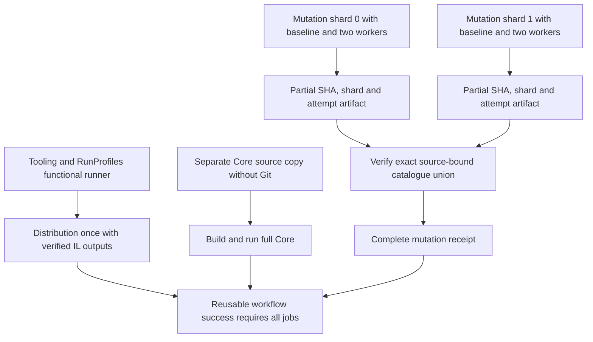

# tooling-ci.yml

<!-- workflow-source-sha256: E245A39F3385F7B647671B22590FE61FEF9CE6101A633277CC242477C95B41EB -->

## Purpose

Reusable private repository-automation qualification, run once independently of the product matrix. Tooling.Tests owns its .psm1 catalogue and metadata; Core.Tests retains private assertion helpers. The complete functional RunProfiles suite follows tooling tests. The single complete tooling build supplies the independently declared Distribution.Tests catalogue. Test-CoreIndependence -Suite Distribution -SkipBuild verifies/copies Core/Core.Tests libraries to an owned checkout without Git, then runs every distribution case once, without another build. The mutation matrix declares two shards, each with a green baseline and at most two isolated process/sandbox pairs, accepting only Killed outcomes. Measurements and product profiling occur on separate runners.

A separate job builds and runs complete Core qualification in a fresh source copy without the real Git module. Git remains an executable fixture dependency. It uses a short temporary path to avoid Windows native-library path limits. Saved evidence records the isolated source/binary identity and generated scripted companion regression.

The automation job's displayed name explicitly includes distribution independence. Its separately
identified `distribution_independence` step runs the complete Distribution catalogue in the owned
Git-free source copy. A passing Tooling catalogue followed by a failed distribution probe still
fails the job; the named step distinguishes those results without weakening qualification.

Mutation uses Ci.Process exclusively and performs no product build or import. Functional RunProfiles explicitly prepares both pinned profiler tools. New native build jobs reuse the common NuGet cache.

Run-profile mutation uses two independent matrix shards, each with two isolated workers and its own successful baseline. `QUIETCLI_MUTATION_SHARD_INDEX`/`QUIETCLI_MUTATION_SHARD_COUNT` configure only the mutation test launcher; local defaults still execute the entire catalogue. Each shard is partial evidence. A dependent completion job downloads only this SHA/attempt's artifacts and requires the exact union of the source-controlled catalogue, matching input hashes and fixed qualification settings. A missing, duplicate, stale, invalid or surviving result blocks the reusable workflow. Sharding changes scheduling, not the catalogue, seeds, iterations or acceptance criteria.

## Scope and selection

Three optional `workflow_call` inputs choose what runs. Their defaults run every campaign, so callers that pass no input, such as `ci.yml`, keep the full campaign.

| Input | Default | Values |
| --- | --- | --- |
| `scope` | `full` | `full` runs every job. `scripts` runs only the script tests and the script mutation targets. |
| `script_tests` | `all` | `all`, or a JSON array of test files relative to `test/scripts`. |
| `script_mutation_targets` | `all` | `all`, or a JSON array of target names from `test/scripts/mutation.targets.psd1`. |

`companions-ci.yml` passes `scope: scripts` when only `scripts/` or `test/scripts/` changed. It then passes the files and targets those changes reach, as computed by [ScriptsImpact](../../scripts/lib/ScriptsImpact.md). In that case `core-independence`, `tooling`, `run-profiles-mutation` and `mutation-complete` are skipped. A manual `Tooling` dispatch of `companions-ci.yml` runs them again.

The `script-selection` job always runs. It validates the inputs with `Resolve-QuietScriptsCiSelection` and expands `all` to the whole catalogue. Its outputs are:
- `tests`;
- `run_tests`;
- `requires_build`;
- `targets`, a JSON array;
- `run_mutation`.

An invalid scope, an unknown name, or a `full` scope with a partial selection fails this job, and therefore the workflow.

## Script tests and script mutation

The `script-tests` job runs [Invoke-ScriptsTests](../../scripts/Invoke-ScriptsTests.md) once on Windows and once on Linux, when `run_tests` is true. How it runs depends on the selection:
- With `all`, it runs every test with `-Headless -Coverage`. This is the only qualifying run with coverage.
- Otherwise it runs `-Headless -Path <selected files>`. That is a partial run, without coverage, because coverage is global.

Its tools come from [Initialize-TestTools](../../scripts/Initialize-TestTools.md), after the `cache-test-tools` action has restored the pinned archives. The archives are keyed by OS and the hash of `scripts/lib/RunToolCache.psm1`, and each SHA-256 is re-verified before extraction.

Some test files drive git through `quiet` and declare `#ScriptsImpact: RequiresBuild`, such as the [Start-QuietWorkBranch](../../scripts/Start-QuietWorkBranch.md) integration tests. When one of them is selected, the job first restores the workspace and builds the Git suite, which includes Core ([Build-Workspace](../../scripts/Build-Workspace.md) `-Suite Git`).

The job uploads the report, JUnit, coverage and log.

The `script-mutation` matrix has one job per selected target (`fromJson` of the `script-selection` targets), with `fail-fast: false`. It runs when `run_mutation` is true. Each job runs [Invoke-ScriptsMutation](../../scripts/Invoke-ScriptsMutation.md) `-Offline -PruneCache -Target <name>` and uploads an artifact named for the SHA, target and attempt.

Each shard also keeps its own incremental mutation cache in `.cache/script-mutation`:

- `actions/cache/restore` restores the newest cache of the same target (prefix `<os>-quietcli-script-mutation-<target>-`). A pull request can read develop's cache but saves only into its own scope.
- Outcomes are keyed by the engine, the target's sources, tests and declared `Inputs`, and the mutant itself, so a restored outcome is reused only when nothing its tests observe has changed.
- `-PruneCache` drops the documents no current mutant uses, once the campaign has keyed every target, so the cache does not grow with each run.
- `actions/cache/save` stores the cache under a key unique to the run and attempt, even when the campaign failed or timed out: every outcome already written stays valid for its key.

`script-mutation-complete` runs unless the workflow is cancelled or the selection succeeded with no target. A failed selection therefore still fails it.
1. It first requires the matrix itself to succeed (`ScriptMutationShardJobsRequired`).
2. It then downloads only this SHA and attempt's shard artifacts.
3. Finally, [Assert-ScriptMutationShards](../../scripts/Assert-ScriptMutationShards.md) `-Target <selected>` requires exactly the selected target set, each target at or above its break.

In the `scripts` scope, the result aggregates of the skipped full-only jobs read `skipped`. The caller relies on the reusable workflow's own result, which fails when any job fails.

## Validation and limits

An always-running result job observes the seven jobs: core-independence, tooling,
script-tests, the two mutation matrices and their two completion jobs. It exports
functional_result, mutation_result and completion_result through workflow_call.
Each result is the worst of its members:
- functional covers independence, tooling and script tests;
- mutation covers both mutation matrices;
- completion covers both completion jobs.

Mutation execution and exact catalogue verification remain distinct.
The job writes only closed result strings through Write-ToolingResults.ps1.
Unknown or absent prerequisite fields become failure. A missing result job/output
also blocks the caller, which separately requires overall workflow success.
Cancellation may prevent hosted output delivery; missing evidence never qualifies.

Failures in any job fail this reusable workflow and its calling gate. Artifact uploads require started test campaigns; skipped run-profile steps cannot create empty-artifact failures. Local partial tests do not establish the complete hosted catalogue or a measured speedup. This workflow never publishes packages.

Ordinary tooling and independence artifacts select top-level JSON reports, receipts and diagnostic logs, plus isolated case-worker reports. They exclude nested fixture workspaces, binaries and generated packages. Functional tooling failures additionally upload their existing fixture trees under a separate seven-day diagnostic artifact; those trees are never uploaded on success. Missing required report evidence still fails the ordinary artifact upload. Product/release package artifacts are unaffected.

Native orchestration and test/smoke steps select checksum-pinned GA PowerShell through the local setup-powershell action. Linux guest images retain their own reviewed lock (Debian 7.7.0; accepted Alpine 7.6.10-r0 exception). The setup changes only the job PATH; it does not install a machine-wide host or enable optional Preview.

## Triggers

Reusable workflow_call from CI or the tooling-only entry point; no independent publication trigger.

## Scripts and effects

Uses the shared scripts/ entry points, discovered manifests, selected source-bound builds and private artifacts described above. Git identifies committed internal sources; generated execution receipts retain actual source hashes and dirty state. Pinned external resources retain their dedicated locks. Network access is limited to pinned dependency preparation, verified image caches and explicit GitHub evidence reads. No module publication occurs here.

## Mutation completion and artifact flow

The mutation campaign can run four workers across two runners. Its 92 definitions, seed 61207, 120 iterations and Killed-only acceptance remain unchanged. Ordinary tooling/independence reports retain fourteen days; failed functional fixture trees have a separate seven-day diagnostic artifact. Mutation download matches the current SHA/attempt and requires both shard artifacts. See [script responsibilities and dates](../README.md).

## Shard execution boundary

The GitHub entry accepts only source-validated RunProfilesMutation partitions under explicit shard controls. Each summary and the entry result remain Partial=true; product partial/incomplete reports remain rejected. Bounded report reads, exact partition/source/SHA checks, green baselines, fixed settings and consistent successful counters precede intermediate acceptance. The completion job still requires both successful shard jobs and the exact complete union. See [the shared entry contract and regression](../../scripts/Invoke-GitHubCi.md#shard-execution-and-completion).
<!-- workflow-generated:begin -->

[Workflow source](../../../.github/workflows/tooling-ci.yml)

## Jobs and dependencies

Generated from the workflow by Sync-GitHubWorkflowsReadme.ps1. Conditions can skip jobs; edges express declared needs.

~~~mermaid
flowchart TD
    event["Triggers: workflow_call"]
    job_core_independence["core-independence"]
    job_mutation_complete["mutation-complete"]
    job_results["results"]
    job_run_profiles_mutation["run-profiles-mutation"]
    job_script_mutation["script-mutation"]
    job_script_mutation_complete["script-mutation-complete"]
    job_script_selection["script-selection"]
    job_script_tests["script-tests"]
    job_tooling["tooling"]
    event --> job_core_independence
    job_run_profiles_mutation --> job_mutation_complete
    job_core_independence --> job_results
    job_tooling --> job_results
    job_script_tests --> job_results
    job_run_profiles_mutation --> job_results
    job_script_mutation --> job_results
    job_mutation_complete --> job_results
    job_script_mutation_complete --> job_results
    event --> job_run_profiles_mutation
    job_script_selection --> job_script_mutation
    job_script_selection --> job_script_mutation_complete
    job_script_mutation --> job_script_mutation_complete
    event --> job_script_selection
    job_script_selection --> job_script_tests
    event --> job_tooling
~~~

| Job | Execution | Needs | Condition | Script entry points |
| --- | --- | --- | --- | --- |
| core-independence | runner windows-latest |  | <code>inputs.scope == 'full'</code> | [`./scripts/Initialize-CiEnvironment.ps1`](../../scripts/Initialize-CiEnvironment.md), [`./scripts/Initialize-Workspace.ps1`](../../scripts/Initialize-Workspace.md), [`./scripts/Test-CoreIndependence.ps1`](../../scripts/Test-CoreIndependence.md) |
| mutation-complete | runner ubuntu-latest | run-profiles-mutation | <code>&#36;{{ always() &#38;&#38; !cancelled() &#38;&#38; inputs.scope == 'full' }}</code> | [`./scripts/Assert-RunProfileMutationShards.ps1`](../../scripts/Assert-RunProfileMutationShards.md) |
| results | runner ubuntu-latest | core-independence, tooling, script-tests, run-profiles-mutation, script-mutation, mutation-complete, script-mutation-complete | <code>&#36;{{ always() }}</code> | [`./scripts/Write-ToolingResults.ps1`](../../scripts/Write-ToolingResults.md) |
| run-profiles-mutation | runner windows-latest |  | <code>inputs.scope == 'full'</code> | [`./scripts/Initialize-CiEnvironment.ps1`](../../scripts/Initialize-CiEnvironment.md), [`./scripts/Initialize-Workspace.ps1`](../../scripts/Initialize-Workspace.md), [`./scripts/Invoke-GitHubCi.ps1`](../../scripts/Invoke-GitHubCi.md) |
| script-mutation | runner ubuntu-latest | script-selection | <code>needs.script-selection.outputs.run&#95;mutation == 'true'</code> | [`./scripts/Initialize-CiEnvironment.ps1`](../../scripts/Initialize-CiEnvironment.md), [`./scripts/Initialize-TestTools.ps1`](../../scripts/Initialize-TestTools.md), [`./scripts/Invoke-ScriptsMutation.ps1`](../../scripts/Invoke-ScriptsMutation.md) |
| script-mutation-complete | runner ubuntu-latest | script-selection, script-mutation | <code>&#36;{{ always() &#38;&#38; !cancelled() &#38;&#38; needs.script-selection.outputs.run&#95;mutation != 'false' }}</code> | [`./scripts/Assert-ScriptMutationShards.ps1`](../../scripts/Assert-ScriptMutationShards.md) |
| script-selection | runner ubuntu-latest |  | default success condition | [`./scripts/lib/ScriptsImpact.psm1`](../../scripts/lib/ScriptsImpact.md) |
| script-tests | <code>runner &#36;{{ matrix.os }}</code> | script-selection | <code>needs.script-selection.outputs.run&#95;tests == 'true'</code> | [`./scripts/Initialize-CiEnvironment.ps1`](../../scripts/Initialize-CiEnvironment.md), [`./scripts/Initialize-TestTools.ps1`](../../scripts/Initialize-TestTools.md), [`./scripts/Initialize-Workspace.ps1`](../../scripts/Initialize-Workspace.md), [`./scripts/Build-Workspace.ps1`](../../scripts/Build-Workspace.md), [`./scripts/Invoke-ScriptsTests.ps1`](../../scripts/Invoke-ScriptsTests.md) |
| tooling | runner windows-latest |  | <code>inputs.scope == 'full'</code> | [`./scripts/Initialize-CiEnvironment.ps1`](../../scripts/Initialize-CiEnvironment.md), [`./scripts/Initialize-Workspace.ps1`](../../scripts/Initialize-Workspace.md), [`./scripts/Build-Workspace.ps1`](../../scripts/Build-Workspace.md), [`./scripts/Invoke-GitHubCi.ps1`](../../scripts/Invoke-GitHubCi.md), [`./scripts/Test-CoreIndependence.ps1`](../../scripts/Test-CoreIndependence.md), [`./scripts/Initialize-Profilers.ps1`](../../scripts/Initialize-Profilers.md) |

<!-- workflow-generated:end -->

<!-- credits:begin -->
## Credits

This document is covered by the mandatory [CREDITS.md](../../../CREDITS.md), which records the licenses of all softwares which have QuietCli companions
<!-- credits:end -->
