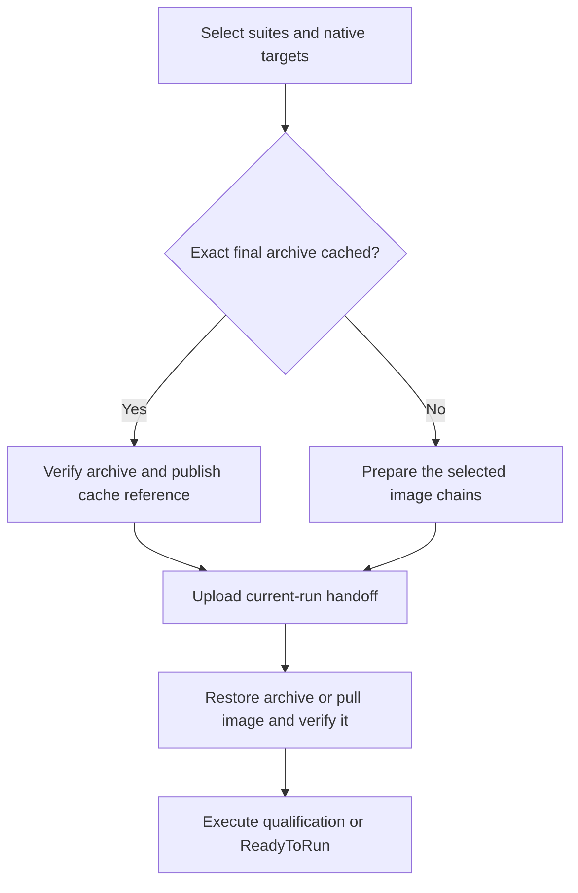

# Linux CI images

Four native targets use Ubuntu runners matching their CPU. Debian and Alpine are the operating systems of the test containers. [GitHub-hosted runners](https://docs.github.com/en/actions/reference/runners/github-hosted-runners)

| Container / RID | GitHub-hosted runner |
| --- | --- |
| Debian / `linux-x64` | `ubuntu-latest` |
| Alpine / `linux-musl-x64` | `ubuntu-latest` |
| Debian / `linux-arm64` | `ubuntu-24.04-arm` |
| Alpine / `linux-musl-arm64` | `ubuntu-24.04-arm` |

## Image production and handoff

`linux-images.yml` supplies one handoff per RID. A cached archive is keyed by the native RID and the exact set of recipe fingerprints. The producer verifies its SHA-256 and uploads only the receipt and cache reference. On an archive miss it reuses verified GHCR images or builds missing images, sharing verified parents. When every image came from GHCR it uploads only their digest receipt. A local build supplies `images.tar` as an artifact and allows an archive cache save. The intermediate BuildKit cache is saved after successful preparation if its exact key missed and its nonempty indexes changed.

GitHub starts the Linux consumers after successful preparation. Each consumer downloads the handoff, checks the run, revision and RID, then restores the exact Actions cache, reads the new archive or pulls the selected GHCR image. It verifies the archive SHA-256 or GHCR digest and checks the independently calculated recipe fingerprint, native architecture and source labels. It runs with `--network none` and `--pull=never`. Reruns can reuse a successful producer from the same run and revision. If the referenced cache was evicted, rerun preparation to obtain a current handoff. Image preparation alone does not qualify a target.

The archive retains a local transfer tag for each fingerprint. Docker image stores can assign different IDs to the same imported image. Consumers resolve the transfer tag, validate the loaded image and use their own daemon's immutable ID for execution.

Each recipe fingerprint is a SHA-256 over the sorted declared paths and their content hashes, the generated Containerfile hash and the parent fingerprint for overlays. The producer uses the resulting fingerprint as the GHCR tag and checks it against the image label, along with the source, Linux OS and target architecture. The registry reader resolves the immutable digest from an OCI manifest or the matching Linux platform in an OCI index. Trusted upstream `develop` runs publish only missing fingerprint tags. Sources, environment files and credentials stay outside the image archive. [CiImages](../scripts/lib/CiImages.md)

## Trusted cache-only preparation

In GitHub Actions, manually dispatch `ci.yml` on upstream `develop` with `images_only=true`. The shared context guard rejects forks, PR events and other refs. Only the existing four native image producers run; product tests, tooling, performance aggregation and qualification gates are skipped. Receipts prove image identity, not product qualification, and no `qualified_sha` is emitted.

This primes trusted base-branch caches for subsequent PRs. Normal develop qualification or verified-reuse image jobs can also populate missing entries. PRs never publish GHCR images. Cache preparation is independent of Gallery publication.

## Pins, tools and credentials

[global.json](../../global.json), [ci-images.lock.json](../../build/ci-images.lock.json) and module-owned image contracts contain exact SDK, runtime, PowerShell, archive hashes and base-image digests. Avoid inferring those versions from a prose copy. The tools stage verifies SDK archives; Debian uses checksum-pinned PowerShell archives. Alpine uses its locked signed package and a verified Microsoft musl runtime at `/opt/pwsh-runtime`, while the SDK remains separately available through `/usr/share/dotnet`.

Debian x64/ARM64 uses GA PowerShell 7.7.0 / CLR 11. Alpine x64/ARM64 explicitly retains native 7.6.10-r0 and CLR 10: both v3.24 and edge currently publish that APK, while Microsoft has no 7.7.0 musl ARM64 archive. This accepted exception is recorded in the image lock; it is not GA qualification. SDK, base-image and separate runtime pins stay independent. Recheck with Test-PowerShellReleaseAvailability.ps1; Update-PowerShellCiLock.ps1 requires -AllowAlpineVersionLag to preserve the exception.

Alpine additionally copies only PSResourceGet from the checksum-verified same-architecture Microsoft archive; it keeps its native musl PowerShell executable. Smoke checks require Compress-PSResource and create a real offline nupkg. Signed apt/apk dependencies are resolved during builds, so the resulting environment is not claimed to be bit-for-bit reproducible. A withdrawn pinned package requires a reviewed lock update.

GitHub selects Docker explicitly. Producers use an ephemeral `GITHUB_TOKEN` with package write permission only under trusted conditions; test jobs have read access. Private temporary Docker configuration/Podman authfiles receive login via UTF-8 stdin and are deleted on exit. Tokens are redacted from diagnostics and never passed as build arguments. A fork unable to read private GHCR entries can still build its own image. Package visibility is configured separately in GitHub.

Image receipts live under `artifacts/ci-images` in CI and identify fingerprint, architecture, image ID/digest and cache state. See [CiImages](../scripts/lib/CiImages.md) and [container diagnosis](../README-container-runtime-diagnosis.md).

## Separate terminal campaign

Ordinary GitHub product jobs pass `-SkipTty`; native terminal assertions/fuzzing/mutation are excluded. An explicitly requested `MUTATION_TESTING` image variant includes the GCC/Clang/compiler-rt dependencies for the separate local campaign. That variant has its own fingerprint and cannot be replaced by a runtime-only image.

The native campaign requires its full baseline/process assertions, at least 20,000 coverage-guided executions and all targeted mutants. Its container memory limit and musl sanitizer/RSS workaround remain documented in [native PTY and LLVM findings](../README-native-pty-and-llvm-fuzzing.md). These checks do not run implicitly when warming caches or qualifying the ordinary .NET matrix.

<!-- credits:begin -->
## Credits

This document is covered by the mandatory [CREDITS.md](../../CREDITS.md), which records the licenses of all softwares which have QuietCli companions
<!-- credits:end -->
