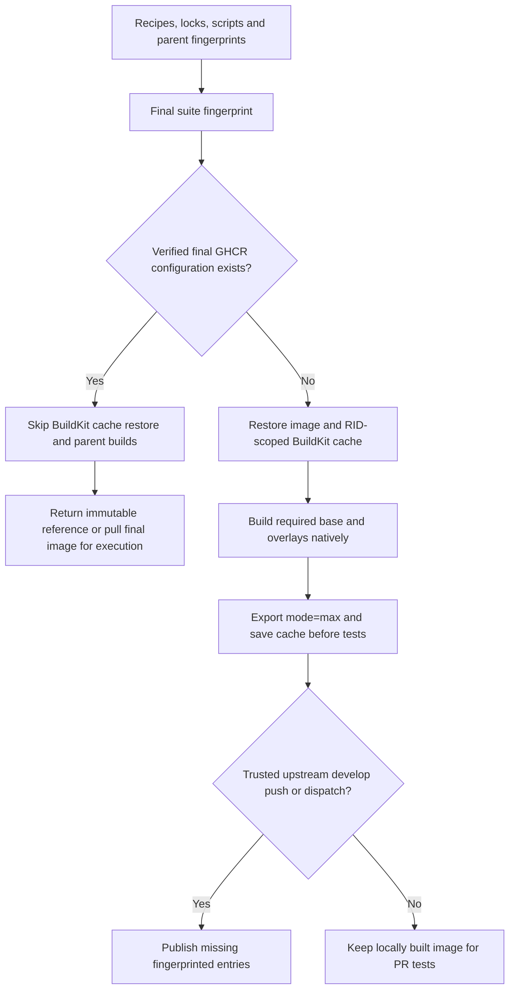

# Linux CI images

Four native targets use the Ubuntu runner matching their CPU. No local ARM machine or QEMU is required for GitHub execution.

| Guest / RID | Native runner | Test path |
| --- | --- | --- |
| Debian / `linux-x64` | `ubuntu-latest` | Verified job container or Docker fallback |
| Alpine / `linux-musl-x64` | `ubuntu-latest` | Verified job container or Docker fallback |
| Debian / `linux-arm64` | `ubuntu-24.04-arm` | Verified job container or Docker fallback |
| Alpine / `linux-musl-arm64` | `ubuntu-24.04-arm` | Docker fallback; JavaScript actions stay on Ubuntu |

Job containers build/test the checkout directly. Fallback builds on the native runner, stages source/binaries/restored packages, then tests with `--network none` and `--pull=never`. Both paths verify actual guest/engine identity. Image preparation alone does not qualify any target.

## Final images and intermediate caches

[New-CiSuiteImage](../scripts/New-CiSuiteImage.md) resolves YAML-declared base/overlay requirements. Core needs the base toolchain and its distro Git executable, independently of the Git companion. One producer matrix prepares the selected final image per RID, including missing parents in the same job.

Final-image identity includes rendered recipes, declared inputs, lock/script changes and parent provenance. Registry configuration and local inspection verify digests, Linux architecture, source and fingerprint labels. Execution uses an immutable digest/local image ID. Missing or inaccessible private cache entries may be built locally; unexpected registry/network errors remain explicit failures, without automatic retries.

The Docker-only intermediate path uses the active context's containerd image store, keeping freshly built parent images visible. The shared cache action sets `set-host: true` on Docker setup, exporting the owned daemon socket through `DOCKER_HOST`. Builds, authenticated pulls and pushes therefore keep the same daemon when registry authentication temporarily selects a private `DOCKER_CONFIG`; the temporary configuration does not contain the original current-context selection. Cache scopes separate image and RID and use fingerprint keys with an older-recipe fallback. Exports rotate owned caches to avoid obsolete blobs. A verified final hit needs neither intermediate transfer nor parent preparation. Sources, `.env` and credentials never enter toolchain images. Local Podman behavior is unchanged.

## Trusted cache-only preparation

In GitHub Actions, manually dispatch `ci.yml` on upstream `develop` with `images_only=true`. The shared context guard rejects forks, PR events and other refs. Only the existing four native image producers run; product tests, tooling, performance aggregation and qualification gates are skipped. Receipts prove image identity, not product qualification, and no `qualified_sha` is emitted.

This primes trusted base-branch caches for subsequent PRs. Normal develop qualification or verified-reuse image jobs can also populate missing entries. PRs never publish GHCR images. Cache preparation is independent of Gallery publication.

## Pins, tools and credentials

[global.json](../../global.json), [ci-images.lock.json](../../build/ci-images.lock.json) and module-owned image contracts contain exact SDK, runtime, PowerShell, archive hashes and base-image digests. Avoid inferring those versions from a prose copy. The tools stage verifies SDK archives; Debian uses checksum-pinned PowerShell archives. Alpine uses its locked signed package and a verified Microsoft musl runtime at `/opt/pwsh-runtime`, while the SDK remains separately available through `/usr/share/dotnet`.

Debian x64/ARM64 uses GA PowerShell 7.7.0 / CLR 11. Alpine x64/ARM64 explicitly retains native 7.6.9-r0 and CLR 10: both v3.24 and edge currently publish that APK, while Microsoft has no 7.7.0 musl ARM64 archive. This accepted exception is recorded in the image lock; it is not GA qualification. SDK, base-image and separate runtime pins stay independent. Recheck with Test-PowerShellReleaseAvailability.ps1; Update-PowerShellCiLock.ps1 requires -AllowAlpineVersionLag to preserve the exception.

Alpine additionally copies only PSResourceGet from the checksum-verified same-architecture Microsoft archive; it keeps its native musl PowerShell executable. Smoke checks require Compress-PSResource and create a real offline nupkg. Signed apt/apk dependencies are resolved during builds, so the resulting environment is not claimed to be bit-for-bit reproducible. A withdrawn pinned package requires a reviewed lock update.

GitHub selects Docker explicitly. Producers use an ephemeral `GITHUB_TOKEN` with package write permission only under trusted conditions; test jobs have read access. Private temporary Docker configuration/Podman authfiles receive login via UTF-8 stdin and are deleted on exit. Tokens are redacted from diagnostics and never passed as build arguments. A fork unable to read private GHCR entries can still build its own image. Package visibility is configured separately in GitHub.

Image receipts live under `artifacts/ci-images` in CI and identify fingerprint, architecture, image ID/digest and cache state. See [CiImages](../scripts/CiImages.md) and [container diagnosis](../README-container-runtime-diagnosis.md).

## Separate terminal campaign

Ordinary GitHub product jobs pass `-SkipTty`; native terminal assertions/fuzzing/mutation are excluded. An explicitly requested `MUTATION_TESTING` image variant includes the GCC/Clang/compiler-rt dependencies for the separate local campaign. That variant has its own fingerprint and cannot be replaced by a runtime-only image.

The native campaign requires its full baseline/process assertions, at least 20,000 coverage-guided executions and all targeted mutants. Its container memory limit and musl sanitizer/RSS workaround remain documented in [native PTY and LLVM findings](../README-native-pty-and-llvm-fuzzing.md). These checks do not run implicitly when warming caches or qualifying the ordinary .NET matrix.

<!-- credits:begin -->
## Credits

This document is covered by the mandatory [CREDITS.md](../../CREDITS.md), which records the licenses of [Git](https://github.com/git/git/blob/master/COPYING), [Vagrant](https://github.com/hashicorp/vagrant/blob/main/LICENSE) and [Microsoft .NET/PowerShell](https://github.com/PowerShell/PowerShell/blob/master/LICENSE.txt).
<!-- credits:end -->
