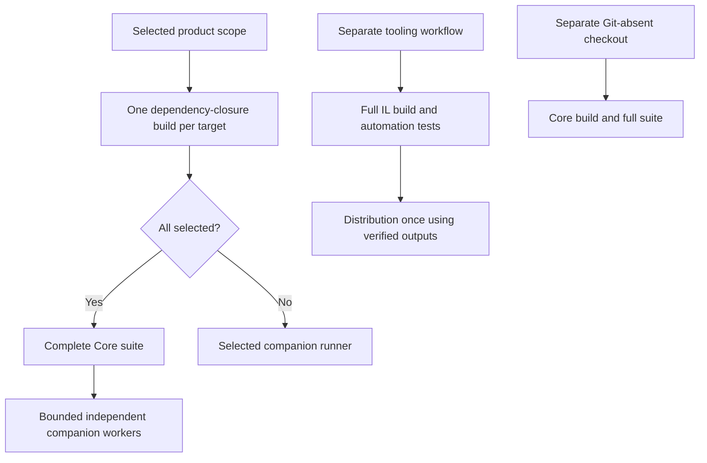
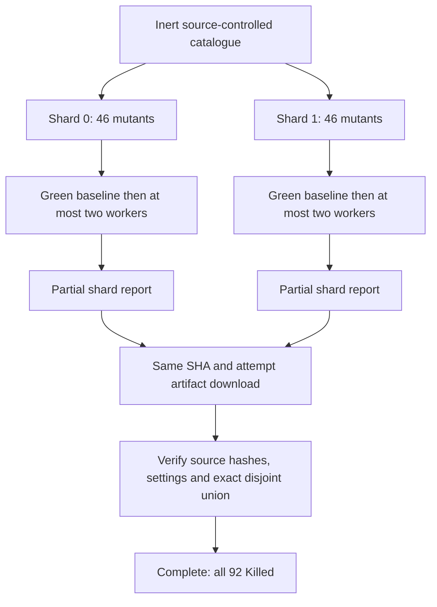

# Scalable companion qualification

[Source-change landmarks](README.md#source-change-landmarks) identify the changes through 12 November 2026. The design reduces repeated preparation while retaining declared suites, targets and acceptance criteria. Elapsed-time and cache-transfer gains require hosted measurements.

## Select only the required work

[New-CiImpactPlan](../scripts/New-CiImpactPlan.md) uses the complete no-rename diff and transitive `build/companions.yml` requirements. A companion-only change selects its dependent suites; Core/shared/unknown paths require All plus tooling. Several affected companions share one matrix. Reviewed run-profile command/store/definition paths select tooling only; shared profiler, encoding, report and build changes still require All. Mixed paths union requirements.

Core.Tests depends only on Core. Its scaffolding fixture generates a scripted Git-status companion; Git remains an executable tool without importing the real Git module. Tooling.Tests owns repository automation. Distribution.Tests owns the architecture, installed-package and packaged-Recall checks executed once in tooling. Existing FrenchExDev application modules are consumers; membership does not qualify their CLI semantics.

[Build-Workspace](../scripts/Build-Workspace.md) compiles the selected dependency closure once, rejects undeclared project references and publishes portable outputs with `--no-build`. Product rows publish their tested RID. Tooling prepares all required IL distributions once and reuses verified Core/Core.Tests outputs for Distribution in an owned Git-absent checkout. Release packaging retains its separate all-RID ReadyToRun build.

## Bound mutation concurrency

Tooling functional checks and mutation run on different runners from product measurements. The run-profile catalogue contains 92 mutants. Two matrix shards select entries by ordinal modulo two, with a green baseline and at most two isolated worker/sandbox pairs **per shard**. Thus this campaign can have four mutation workers across its two runners. Local defaults retain one full-catalogue campaign.

[Assert-RunProfileMutationShards](../scripts/Assert-RunProfileMutationShards.md) rejects missing/duplicate names, stale revisions, different inputs/settings, failed baselines and every outcome other than Killed. Shard success alone does not satisfy the tooling workflow. Fixed qualification settings remain seed 61207 and 120 iterations.

The [GitHub entry boundary](../scripts/Invoke-GitHubCi.md#shard-execution-and-completion) validates each partition and retains Partial=true. It rejects incomplete/filtered product runs and cannot replace the completion job. Source-bound local entry regressions use synthetic worker reports; actual hosted scheduling remains separate evidence.

Git's nine opt-in compiled mutation catalogues use independent processes, capped at two concurrent catalogues. Each owns a build tree, restores dependencies once, resets pristine sources for every mutant and forces compilation with `--no-incremental --no-restore` after its baseline restore. Each mutant executes the full assertion runner. Shared-repository cases and timing samples retain their ordered/exclusive barriers. See [classification and concurrency](../README-test-classification-and-concurrency.md).

## Reuse images and qualification evidence

Docker first probes the verified final GHCR fingerprint. A final-image hit avoids intermediate-cache transfer; a miss restores BuildKit `mode=max` cache by image/RID/fingerprint and prepares required parents in the same producer job. Cache save precedes tests. GitHub uses Docker; local resolution keeps explicit selection, checkout `.env`, then Podman-first discovery. See [Linux images](linux-images.md).

On develop, replay may be omitted only after verifying a successful originating PR workflow attempt and an identical Git tree. Missing, expired, legacy or mismatched proof falls back to All. Reuse still requires source integrity/Core integration smoke and image resolution. Cache-only manual dispatch emits no qualification receipt. Develop never publishes Gallery modules.

## Artifacts and acceptance

Ordinary tooling/independence artifacts contain reports, receipts and diagnostic logs, including isolated case reports. They exclude nested workspaces, binaries and packages. A failed functional tooling run additionally uploads its existing fixture trees in a separate seven-day artifact. Mutation artifacts carry the SHA, shard and attempt; the completion job downloads only the current set.

Core qualification still requires per-environment PowerShell/CLR evidence and a successful combined report. The manual ReadyToRun A/A–A/B workflow remains informational. Configure **QuietCli required CI**, documentation checks and branch restrictions separately in repository rules; workflow files do not modify those settings. Release/publication requires its own exact-revision, current-run evidence.

<!-- credits:begin -->
## Credits

This document is covered by the mandatory [CREDITS.md](../../CREDITS.md), which records the licenses of [Git](https://github.com/git/git/blob/master/COPYING), [Vagrant](https://github.com/hashicorp/vagrant/blob/main/LICENSE) and [Microsoft .NET/PowerShell](https://github.com/PowerShell/PowerShell/blob/master/LICENSE.txt).
<!-- credits:end -->
