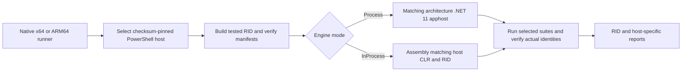

# Windows x64 and ARM64 CI

The shared [ci.yml](../../.github/workflows/ci.yml) runs the selected product scope in **six native Windows combinations**. Each row builds Release ReadyToRun for its tested RID and executes tests. Setup or build success alone does not qualify the row.

| Runner / RID | PowerShell host | Engine hosting / build |
| --- | --- | --- |
| `windows-latest` / `win-x64` | Stable, CLR 10 | Process, .NET 11 |
| `windows-latest` / `win-x64` | Stable, CLR 10 | InProcess, .NET 10 |
| `windows-latest` / `win-x64` | Preview, CLR 11 | InProcess, .NET 11 |
| `windows-11-arm` / `win-arm64` | Stable, CLR 10 | Process, .NET 11 |
| `windows-11-arm` / `win-arm64` | Stable, CLR 10 | InProcess, .NET 10 |
| `windows-11-arm` / `win-arm64` | Preview, CLR 11 | InProcess, .NET 11 |

Exact host versions and archive SHA-256 values come from [powershell-hosts.lock.json](../../build/powershell-hosts.lock.json); the SDK comes from [global.json](../../global.json). These jobs use GitHub-hosted machines, not Windows containers or local ARM emulation. Reports retain the actual runner image version.



## Architecture checks

[Build-Workspace](../scripts/Build-Workspace.md) prepares portable `lib/inprocess` (.NET 10) and `lib/engine` (.NET 11), plus requested RID slots. Matrix calls restrict distribution publication to their tested RID; release packaging separately prepares all six RIDs. Binary manifests bind source, hashes, target architecture and ReadyToRun settings.

Windows PE checks require `0x8664` for x64 and `0xAA64` for ARM64 where applicable. The isolated apphost needs the pinned .NET 11 runtime of the same architecture; the integrated build must match the selected PowerShell CLR. These are framework-dependent distributions, not NativeAOT binaries.

`-ExpectedRuntimeIdentifier win-arm64` requires the actual selected host/engine identity. An emulated x64 process is not ARM64 evidence. Reports retain OS/process architectures, host/engine runtimes and PIDs, RID, binary hashes and source identities. Native resources, including SQLite, must match that RID.

## Local and hosted limits

On an actual prepared Windows ARM64 host, the local launcher can build and run a selected suite with its visible monitor:

```powershell
./scripts/Invoke-WorkspaceCi.ps1 -Suite Core -ExpectedRuntimeIdentifier win-arm64
```

A Windows x64 workstation cannot establish this result. Investigate ARM64 failures through the individual hosted job's setup/build/test logs and artifacts. GitHub passes `-SkipTty` in every product row; terminal campaigns are excluded on both architectures. Run-profile tooling runs separately on Windows x64 and cannot replace an ARM64 row.

See [qualification and evidence](../../README-qualification-when-where-how.md) and the [source-change landmarks](README.md#source-change-landmarks).

<!-- credits:begin -->
## Credits

This document is covered by the mandatory [CREDITS.md](../../CREDITS.md), which records the licenses of [Git](https://github.com/git/git/blob/master/COPYING), [Vagrant](https://github.com/hashicorp/vagrant/blob/main/LICENSE) and [Microsoft .NET/PowerShell](https://github.com/PowerShell/PowerShell/blob/master/LICENSE.txt).
<!-- credits:end -->
