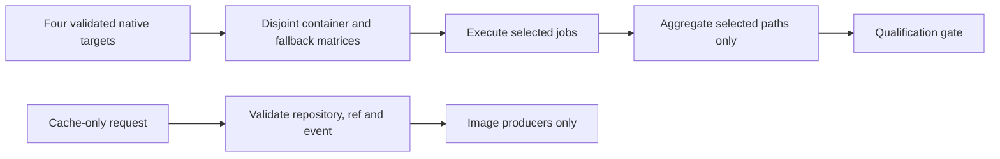

# GitHubCi.ps1

## Purpose and usage

Pure policy helpers shared by Linux matrix selection, aggregate gates and companion tests. Dot-sourcing declares functions; no product import, native process, network or publication occurs.

| Function | Contract |
| --- | --- |
| Get-GitHubCiWindowsMatrix | Four locked GA rows by default; explicit Preview opt-in requires a newer published host on both architectures and adds two rows. Returns the corresponding eight/ten-report requirement. |
| Get-GitHubCiExecutionMatrix | Exactly four unique Linux targets, correct native runners and verified immutable source-owned GHCR references. Available compatible images use job containers; misses use Docker fallback. Alpine ARM64 always uses fallback. |
| Assert-GitHubCiLinuxResults | Selection must succeed and every selected path must succeed. Only an unselected path may be skipped. |
| Assert-GitHubCiImagePreparationContext | images_only is accepted exclusively for workflow_dispatch on upstream refs/heads/develop; normal qualification retains existing event contexts. |

Alpine job containers set DOTNET_ROOT to the locked Microsoft musl runtime at `/opt/pwsh-runtime`; Debian keeps `/usr/share/dotnet`. Alpine ARM64 checkout/upload actions stay on Ubuntu while tests run in the real musl guest. Cache-only mode has no qualified revision receipt or publication eligibility for modules.

## Critical review and verdict

`scripts/GitHubCi.ps1:1` centralizes policy without transport effects. Tests enumerate cache combinations, shuffled/invalid targets, references and terminal states, use targeted policy mutants, and cover 96 image-preparation contexts. This validates orchestration decisions, not hosted ARM execution or cache-transfer speed. See [Linux routing](../ci/execution-model.md#linux-selection).

<!-- script-contract:begin -->
## Execution contract

Purpose: Partitions all four native Linux targets between verified GitHub containers and Docker fallback.

Boundary: **Library**. Preview API: **Library**. Guarded functions: 0.

See [the complete review](preview-support.md) for orchestration guards, delegated effects and static-analysis limits.
<!-- script-contract:end -->

<!-- credits:begin -->
## Credits

This document is covered by the mandatory [CREDITS.md](../../CREDITS.md), which records the licenses of [Git](https://github.com/git/git/blob/master/COPYING), [Vagrant](https://github.com/hashicorp/vagrant/blob/main/LICENSE) and [Microsoft .NET/PowerShell](https://github.com/PowerShell/PowerShell/blob/master/LICENSE.txt).
<!-- credits:end -->
