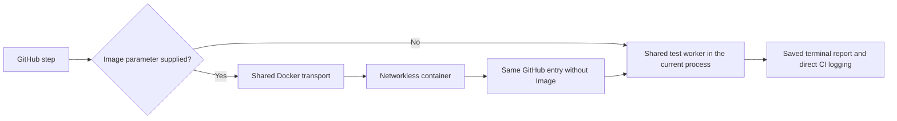

# Invoke-GitHubCi.ps1

Ordinary companion and All invocations validate the complete case catalogue and inert manifest scheduling declarations before build/test effects. The same plan and bounded isolated batches are consumed by the owning runner on runners, job containers and Docker fallback. Each case child reuses the built checkout/image and receives one internal slot, private configuration/database/reports and the selected host/RID/TTY expectations. No extra image build/pull is introduced. See [classification and concurrency](../README-test-classification-and-concurrency.md).

GitHub-only entry point for the existing companion suites. It requires `GITHUB_ACTIONS=true` and
executes `Invoke-TestWorker.ps1` directly in the current PowerShell process, whether the job runs on
a native Windows runner or inside a Linux job container. It starts no desktop monitor or local
supervision process. Existing test/native fixtures may still create their own required processes.

Standard WhatIf/Confirm support guards the build/test orchestration before any artifact directory,
build, profiling preparation or container starts. WhatIf still requires the GitHub context and a valid
suite; AutomationContracts.Tests.ps1 verifies no-write preview with a synthetic GitHub context.

```powershell
./scripts/Invoke-GitHubCi.ps1 -Suite Core -SkipBuild -SkipTty -ExpectedRuntimeIdentifier linux-x64
```

Optional `-Image <verified-local-ID> -Platform debian|alpine` selects Docker fallback. It uses the
shared container transport with `docker`, stages the checked-out sources/binaries and invokes this
same GitHub entry inside the networkless container. It never builds/publishes an image or calls the
local desktop launcher. `-TimeoutSeconds` bounds this fallback guest; GitHub step/job timeouts bound
direct execution.



`-WorkspaceRoot` defaults to the repository containing the script. `-RunDirectory` defaults to a
new directory under `artifacts/tests`. `-ExpectedRuntimeIdentifier` validates the selected host and
engine. `-SkipTty` explicitly excludes terminal campaigns. `-Platform` is required with `-Image`.
The fallback `-TimeoutSeconds` default is 1800 seconds; it does not override GitHub's job deadline.
`-MaxConcurrency` accepts `1..32`, defaults to `min(4, processor count)`, and is forwarded through both direct and fallback-container execution to bound parallel-safe internal test campaigns.

`-Profiler`, prepared profiler paths, `-RunDirectory`, `-SkipBuild` and the dynamic `-Suite` contract
retain the shared worker semantics. Reports remain under `artifacts/tests` or the explicitly selected
run directory. Failure prints the terminal state and bounded failed cases before returning an error.
The prepared profiler paths are supplied as `-ProfilerModulePath` and `-ClrProfilerPath`; this entry
does not install those tools implicitly. `-SkipBuild` is passed after the workflow's explicit
`Build-Workspace.ps1 -Configuration Release -ReadyToRun -ReadyToRunRuntimeIdentifier <tested-rid>` step.
Without `-SkipBuild`, this GitHub-only entry also builds Release ReadyToRun for the expected RID
(or the actual host RID when omitted). The package job separately precompiles all release RIDs.

Local development uses `Invoke-WorkspaceCi.ps1` or `Invoke-ContainerCi.ps1`. The companion
`Invoke-GitHubCiSmoke.ps1` supplies the normal local monitoring window while testing the GitHub entry
inside an existing Docker toolchain image; it does not claim hosted Windows/ARM qualification.

<!-- credits:begin -->
## Credits

This document is covered by the mandatory [CREDITS.md](../../CREDITS.md), which records the licenses of [Git](https://github.com/git/git/blob/master/COPYING), [Vagrant](https://github.com/hashicorp/vagrant/blob/main/LICENSE) and [Microsoft .NET/PowerShell](https://github.com/PowerShell/PowerShell/blob/master/LICENSE.txt).
<!-- credits:end -->

<!-- script-contract:begin -->
## Execution contract

Purpose: GitHub-only test entry point; executes directly in the selected runner or job container.

Boundary: **Executable**. Preview API: **ShouldProcess**. Guarded functions: 0.

See [the complete review](preview-support.md) for orchestration guards, delegated effects and static-analysis limits.
<!-- script-contract:end -->
