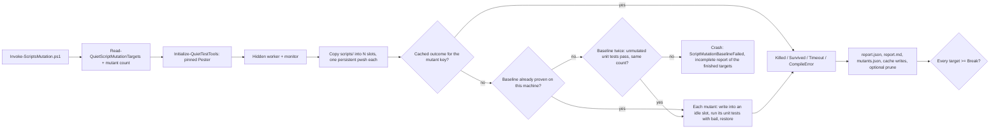

# Invoke-ScriptsMutation.ps1

## Purpose and usage

Stryker-style mutation testing of the `scripts/lib` libraries listed in `test/scripts/mutation.targets.psd1`. For each target, the engine generates mutants of the named functions, such as `-eq` replaced by `-ne` or a removed `throw`. It then runs the target's unit tests once per mutant, on persistent `pwsh` workers that each own an isolated copy of `scripts/`. Outcomes are cached by content, so a second run reruns only the mutants whose observable inputs changed. A mutant that no test detects survives. The score is the share of detected mutants, and a target below its `Break` fails the run.

```powershell
./scripts/Initialize-TestTools.ps1                          # pinned Pester, once
./scripts/Invoke-ScriptsMutation.ps1                        # every target, visible monitor
./scripts/Invoke-ScriptsMutation.ps1 -Target ScriptsTests   # one target (a CI shard)
./scripts/Invoke-ScriptsMutation.ps1 -Headless -Offline -PruneCache -Target X  # CI shard
./scripts/Invoke-ScriptsMutation.ps1 -NoCache               # cold campaign, every mutant runs
```

| Options | Behavior |
| --- | --- |
| `Target` | Target names. An unknown name fails with `ScriptMutationTargetUnknown`. All targets when omitted. |
| `ThrottleLimit` | Persistent slot workers, each with its own copy of `scripts/`. Default: half the processors, range 1–32. |
| `RecycleAfter` | Jobs after which a slot worker is replaced by a fresh process. Default 200, range 1–100000. |
| `Seed` | Test seed shared by the baseline and every mutant run, so property and fuzz tests see the same cases each time. It is generated when omitted and recorded in the report. |
| `Headless` | No monitor (CI). A visible monitor requires Windows. |
| `RunDirectory`, `TimeoutSeconds` | New report directory (an existing one is rejected with `TestRunDirectoryExists`). Whole-campaign deadline, default 3600 s, range 60–86400. |
| `WorkspaceRoot`, `ScriptsRoot`, `TestsRoot`, `TargetsPath` | Roots and targets file. `ScriptsRoot` is copied, never modified. The pinned tools and the report root come from `WorkspaceRoot`. |
| `Offline` | Requires the pinned tools to be cached already. |
| `CacheDirectory` | Incremental cache root. Default: `<WorkspaceRoot>/.cache/script-mutation` (ignored by Git). |
| `NoCache` | Neither reads nor writes the cache: every mutant runs. |
| `PruneCache` | After a complete campaign, deletes every cache document this run did not key. Documents of targets left out by `Target` are deleted too, so prune a cache dedicated to the selected targets (one per CI shard). Rejected with `NoCache` (`ScriptMutationCacheOptionsConflict`). |

Targets file:

```powershell
@{ Targets = @(
    @{ Name = 'ScriptsTests'; Module = 'lib/ScriptsTests.psm1'; Functions = @('Get-QuietScriptsTestPlan', '...')
       UnitTestFiles = @('unit/lib/ScriptsTests.Tests.ps1'); Break = 80 }
) }
```

`Module` must be `lib/<name>.psm1`. `UnitTestFiles` must exist under `unit/`. `Break` is an integer from 0 to 100. The optional `Inputs` lists globs, relative to the repository, of the files outside `scripts/` and `test/scripts/` that the unit tests read (`*` within a segment, `**` across segments). It must be a non-empty list without duplicates, `.`, `..` or absolute paths. Any other key, a duplicate name or a function that is not defined exactly once fails before the run starts (`ScriptMutationTargetsInvalid: <reason>`, `ScriptMutationFunctionMissing`).

Mutators are listed in [ScriptMutators.psm1](lib/ScriptMutators.md):

| Mutator | Mutation |
| --- | --- |
| EqualityOperator | `-eq`/`-ne` swapped. `-lt`, `-le`, `-gt` and `-ge` become their boundary and negated forms. The `c`/`i` prefix is kept. |
| LogicalOperator | `-and` and `-or` swapped. |
| Regex | `-match` and `-notmatch` swapped. |
| BooleanLiteral | `$true` and `$false` swapped. A `!` or `-not` negation is removed. |
| ConditionalExpression | An `if`, `elseif` or ternary condition becomes `$true` or `$false`. A loop condition becomes the value that stops the loop. |
| StringLiteral | A quoted string becomes `''`, and an empty one becomes a marker. Bare words and hashtable keys are kept. |
| ArrayDeclaration | `@(...)` becomes `@()`. |
| BlockStatement | A non-empty block becomes `{}`. `throw`, `continue` and `break` are removed. `return <value>` becomes `return`. |
| MethodExpression | `StartsWith`/`EndsWith`, `ToUpper*`/`ToLower*` and `Min`/`Max` swapped. A standalone `.Add(...)` statement is removed. |

Nodes inside attributes (`[ValidateSet(...)]`, `[Parameter(...)]`, type constraints) are never mutated.



Classification:
- **Killed.** A failing test, a crash or a worker error.
- **Survived.** A complete passing run, even one where every test was skipped.
- **Timeout.** The per-mutant deadline, `max(60, 3 × baseline + 30)` seconds, was reached. A timeout counts as detected.
- **CompileError.** The mutated source does not parse. The mutant is not run and does not count.

The score is (killed + timeout) / (killed + timeout + survived). A target without valid mutants scores 100.

## Dependencies and side effects

Delegates to [Invoke-ScriptsMutation.psm1](lib/Invoke-ScriptsMutation.md), which uses [ScriptMutation.psm1](lib/ScriptMutation.md), [ScriptMutationCache.psm1](lib/ScriptMutationCache.md), [ScriptMutationSlot.psm1](lib/ScriptMutationSlot.md), [ScriptsWorker.psm1](lib/ScriptsWorker.md) and [RunToolCache.psm1](lib/RunToolCache.md).

Side effects:
- prepares or downloads the pinned Pester into `.cache/test-tools`;
- creates the run directory under the `scripts-mutation` report root, with `request.json`, `status.json`, `summary.json`, `report.json`, `report.md`, `mutants.json` and the worker logs (`logs/` keeps the stderr of a slot that crashed or was killed);
- copies `scripts/` once per slot under `<run>/slots`, and deletes the copies at the end;
- starts the hidden worker, the visible monitor unless `-Headless` is set, and `ThrottleLimit` hidden slot workers, restarted after a crash or timeout and recycled after `RecycleAfter` jobs;
- unless `-NoCache` is set, reads and writes `<CacheDirectory>/<xx>/<key>.json`, and with `-PruneCache` deletes the documents this campaign did not key.

`-WhatIf` returns before any validation output, tool preparation, directory or process. Nothing is staged, committed or published.

## Critical review and verdict

- **Isolation.** A mutant is written only into a slot copy. The engine, the test runner and the test helpers always load from the trusted repository. `QUIETCLI_SCRIPTS_ROOT` points the tests at the slot, so only the library under test is mutated.
- **Unit tests only.** Integration tests start child processes from the trusted scripts tree, so they cannot see the mutant. A target's `UnitTestFiles` must therefore assert its behavior directly.
- **Baseline first.** Without a passing unmutated run, every mutant would look killed. The campaign stops with `ScriptMutationBaselineFailed` instead.
- **Partial report.** A campaign that stops (failed baseline, slot state leak, corrupted slot) still writes `report.json`, `report.md` and `mutants.json`. The report scores only the targets it finished, is `Incomplete` and never `Passed`, and its `Crash` names the target it stopped in, the error and the targets never run. [Assert-ScriptMutationShards](Assert-ScriptMutationShards.md) rejects it as `ScriptMutationShardIncomplete`. A baseline runs only when a target has a mutant to run. A passing baseline is cached with its test count and duration, which sets the mutant timeout. Its key adds the machine identity (host name and processor count, hashed) to the engine and target fingerprints. A later campaign on the same machine, with the same sources and tests, reuses it (`Progress: Baseline <target> reused`). A cache restored on another machine, such as a CI runner, never matches, so the baseline runs there again. Nothing about it is committed.
- **Equivalent mutants.** Some mutants cannot change behavior, for example `-ge` instead of `-gt` on a value that can never equal the boundary. Investigate every survivor. Add the missing assertion, or declare the equivalence in the target's `Equivalent` list of `mutation.targets.psd1`. Each entry is `{Function, Mutator, Original, Replacement, Reason}`, plus an optional `Platform` (`Windows`, `Linux` or `MacOS`) for a mutant that is only equivalent there, such as `$IsWindows` forced to its own value. An entry matches by exact text inside its function, so it covers every identical mutant of that function. A declared mutant is not run and is reported as `Equivalent`, outside the score. An entry that matches no mutant fails the campaign, so a declaration cannot outlive its code. Never lower `Break`.
- **Persistent workers.** Pester is imported once per slot. Before every job the slot resets environment variables, globals, the location and the modules under test; the second baseline run proves that reset for each target. A worker damaged by a run is detected (`Corrupted`) and the mutant replayed on a fresh one.
- **Bail.** A mutant run stops at its first failing test: one failure is enough to kill it.
- **Incremental cache.** A key covers the engine, the target's source closure, its tests and support files, its `Inputs` and the mutant itself (see [ScriptMutationCache.psm1](lib/ScriptMutationCache.md)). Only `Killed` and `Survived` outcomes and passing baselines are cached. A unit test that reads a repository file must declare it in `Inputs`, otherwise an edit of that file would not invalidate the cache.

Tests: `test/scripts/unit/lib/ScriptMutationCache.Tests.ps1` and `ScriptMutationSlot.Tests.ps1` (see their docs), `test/scripts/unit/lib/ScriptMutators.Tests.ps1` (each mutator, attribute exclusion, a property that every mutant of a generated program is exact and parses) and `test/scripts/unit/lib/ScriptMutation.Tests.ps1` (mutant ids and order, application, classification, timeout, score property, targets validation and fuzzing, report and Markdown). `test/scripts/integration/entrypoints/Invoke-ScriptsMutation.Tests.ps1` runs the real entry point on a fixture library. A strong test kills every mutant, a weak test leaves the expected survivors, and a failing baseline between two targets stops the campaign with an incomplete report of the first one. A second run reuses every outcome, `-NoCache` reruns everything, an edit of the mutated function invalidates its mutants, and `-PruneCache` keeps exactly the documents still keyed. Invalid targets are rejected before any directory exists, and `-WhatIf` writes nothing.

<!-- script-contract:begin -->
## Execution contract

Purpose: Stryker-style mutation testing of scripts/lib targets: each mutant runs the target's unit tests in an isolated scripts copy on a persistent slot worker, reusing cached outcomes.

Boundary: **Executable**. Preview API: **ShouldProcess**. Guarded functions: 0.

See [the complete review](preview-support.md) for orchestration guards, delegated effects and static-analysis limits.
<!-- script-contract:end -->

<!-- credits:begin -->
## Credits

This document is covered by the mandatory [CREDITS.md](../../CREDITS.md), which records the licenses of [Git](https://github.com/git/git/blob/master/COPYING), [Vagrant](https://github.com/hashicorp/vagrant/blob/main/LICENSE) and [Microsoft .NET/PowerShell](https://github.com/PowerShell/PowerShell/blob/master/LICENSE.txt).
<!-- credits:end -->
