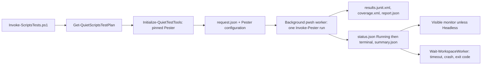

# Invoke-ScriptsTests.ps1

<!-- script-source:begin -->
Source file: [`Invoke-ScriptsTests.ps1`](../../scripts/Invoke-ScriptsTests.ps1)
<!-- script-source:end -->

## Purpose and usage

Runs the Pester 6 unit and integration tests of `./scripts` that live under [`test/scripts`](../../test/scripts/README.md). The tests target the libraries in `scripts/lib` and their exported functions. Entry points are exercised as real child processes in `integration/`. The run happens in a supervised background worker. A visible read-only [monitor](Watch-Tests.md) opens locally. CI passes `-Headless`.

```powershell
./scripts/Initialize-TestTools.ps1                       # once: pinned Pester 6.2.0 + PSScriptAnalyzer 1.25.0
./scripts/Invoke-ScriptsTests.ps1                        # unit + integration, visible monitor
./scripts/Invoke-ScriptsTests.ps1 -Kind Unit -Coverage   # unit only, enforce coverage.targets.psd1
./scripts/Invoke-ScriptsTests.ps1 -Path unit/lib/CiImpact.Tests.ps1 -Seed 61207   # replay a counterexample (partial run)
./scripts/Invoke-ScriptsTests.ps1 -Headless -Coverage    # CI
```

| Options | Behavior |
| --- | --- |
| `Kind` | `Unit` (`test/scripts/unit`), `Integration` (`test/scripts/integration`) or `All` (default). |
| `Path` | Files or directories inside `TestsRoot`, relative or absolute. Empty values, control characters, `..`, paths outside the root, links and non-`*.Tests.ps1` files are rejected with `ScriptsTestPathInvalid`. An empty selection fails with `ScriptsTestSelectionEmpty`. Any selector makes the run partial. |
| `FullNameFilter`, `Tag`, `ExcludeTag` | Pester filters. Non-blank values make the run partial. |
| `Seed` | Exported as `QUIETCLI_TEST_SEED` for property and fuzz tests. It is generated when omitted and recorded in `report.json` and `worker.stdout.log`. |
| `Coverage` | JaCoCo line coverage of the targets in `test/scripts/coverage.targets.psd1`. A result below `Threshold` fails the run. |
| `Headless` | No monitor (CI). A visible monitor requires Windows. |
| `RunDirectory`, `TimeoutSeconds` | New report directory (an existing one is rejected with `TestRunDirectoryExists`). Worker deadline, default 1800 s, range 1–7200. |
| `WorkspaceRoot`, `TestsRoot`, `ScriptsRoot` | Roots. `ScriptsRoot` is exported as `QUIETCLI_SCRIPTS_ROOT`; tests import libraries from it, so [mutation testing](Invoke-ScriptsMutation.md) can substitute a mutated copy. |
| `Offline` | Requires the pinned tools to be cached already. |



## Dependencies and side effects

Delegates to [Invoke-ScriptsTests.psm1](lib/Invoke-ScriptsTests.md), which uses [ScriptsTests.psm1](lib/ScriptsTests.md), [RunToolCache.psm1](lib/RunToolCache.md), [ReportPaths.psm1](lib/ReportPaths.md) and `Wait-WorkspaceWorker` from [Common.psm1](lib/Common.md). Pester is imported only from its pinned path and its version is checked to be 6.2.0. A different global Pester, such as Windows PowerShell's 3.4.0, is never used.

Side effects:
- prepares or downloads the pinned tools into `.cache/test-tools` (ignored by Git);
- creates the run directory, which by default lives under the `scripts-tests` [report root](lib/ReportPaths.md);
- starts a hidden worker and, locally, a monitor window.

`-WhatIf` returns before any tool preparation, directory, file or process. Nothing is committed or published.

The script succeeds only for `Success`. `Failed`, `Crash` and `Timeout` throw with the report path, and `pwsh -File` exits with 1. A filtered run that succeeds still has `report.json.Partial=true`. It is development evidence, not qualification.

## Critical review and verdict

The worker runs Pester **once** over every selected file. That produces one JUnit file and one coverage report. Live progress comes from Pester's Detailed output in `worker.stdout.log`, which the launcher and the monitor tail. `status.json` moves from `Running` to exactly one terminal state, with counts, and never updates between files. Coverage only measures code executed in the worker process. Code exercised by child processes in `integration/` (for example this launcher) is not counted, so the targets list libraries. Self-tests: `test/scripts/unit/lib/ScriptsTests.Tests.ps1` (plan, fuzzed selectors, configuration accepted by Pester, report invariant, status transitions) and `test/scripts/integration/entrypoints/Invoke-ScriptsTests.Tests.ps1` (real child process: exit codes, report/JUnit/status consistency, seed propagation, WhatIf, invalid selector, existing directory, timeout).

<!-- script-contract:begin -->
## Execution contract

Purpose: Runs the Pester 6 unit and integration tests of ./scripts (test/scripts) in a supervised worker with a monitor.

Boundary: **Executable**. Preview API: **ShouldProcess**. Guarded functions: 0.

See [the complete review](preview-support.md) for orchestration guards, delegated effects and static-analysis limits.
<!-- script-contract:end -->

<!-- credits:begin -->
## Credits

This document is covered by the mandatory [CREDITS.md](../../CREDITS.md), which records the licenses of all softwares which have QuietCli companions
<!-- credits:end -->
