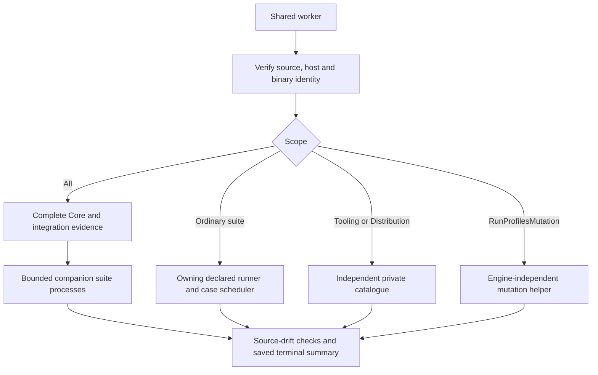

# Invoke-TestWorker.ps1

## Purpose and entry points

Executes the selected test scope, verifies identities and always saves progress/terminal reports. Local Invoke-WorkspaceCi starts it in a background process with a visible monitor; Invoke-GitHubCi calls it directly in the selected runner/job-container PowerShell. GitHub Docker fallback invokes that same entry inside the guest. This worker starts no desktop monitor itself.

Suite is dynamically discovered, default All. WorkspaceRoot and RunDirectory are mandatory. Normal callers use the documented launchers, which own build/monitor/deadline behavior. ExpectedRuntimeIdentifier, SkipTty, profiling paths, Case/StopOnFirstFailure and MaxConcurrency preserve their shared contracts. Case filters/stops remain partial/incomplete evidence; GitHub qualification rejects them.

## Catalogue and scheduling

Owning .psm1/manifest declarations supply cases, classification and execution policy for Core, Git, Vagrant, Tooling and Distribution. The worker imports Core.Tests explicitly with DisableNameChecking before consumers whose RequiredModules need it, then imports the owning runner. This avoids repeated verb warnings without globally suppressing other warnings.

All requires complete successful Core and integration evidence before at most two independent companion suite workers share the prepared checkout/image. WorkerBudget divides the caller's concurrency across admitted suites; their own manifest caps still apply. Core timing finishes before fan-out. Ordered/Exclusive barriers and adjacent IsolatedProcess batches remain the owner's responsibility.

Internal CaseWorker requires one ordinary declared suite, an exact case filter, one internal slot and no profiler. It cannot recursively launch All/tooling fan-out. Each child has private configuration, SQLite, Recall root and reports. A parent can accept its exact requested partial child, then aggregate a complete catalogue; this does not waive product qualification completeness.

## Focused tooling and evidence

Tooling and Distribution load independent catalogues outside product All. Distribution reuses the complete tooling build for its three cases. RunProfilesMutation builds/imports no product engine and skips engine cleanup as well; its concurrency is capped at two. Shard controls are forwarded as a validated index/count pair, retaining Partial on intermediate summaries. The current [GitHub entry-point mismatch](Invoke-GitHubCi.md#current-shard-integration-gap) blocks this declared shard path.

DotNet delegates to its selected readiness/provisioning/layout/locks scope without a product engine. Other focused suites keep their own helper contracts. Profiler supports Core/All/Integration and runs an instrumented pass separately from ordinary timing samples.

## Dependencies, effects and review

Uses Common, WorkspaceProjects, TestConfiguration, the owning test modules and shared scheduling helpers. It can initialize private test configuration, import product modules as subjects, start owned children and mutate temporary fixtures through tests. It prefers a matching already-installed private SDK and restores process PATH/DOTNET_ROOT afterward. WhatIf returns before execution effects.

`scripts/Invoke-TestWorker.ps1:67` saves initial source identity; finalization verifies source drift and actual engine RID, saves summary/status even on failure, and stops the engine for product scopes. Failed Core assertions remain the primary diagnostic before integration evidence is asserted. GitHub prints classified case names/states and actual cumulative counters. Reports include source identities, runtime/architecture and explicit exclusions; a terminal Success alone does not imply complete qualification. Cleanup exceptions from Stop-QuietEngine are currently swallowed, a remaining diagnostic limitation.

## .NET tooling review

The DotNet branch in scripts/Invoke-TestWorker.ps1 dispatches Invoke-DotNetQualification before importing the product module. Its initial/final source identities omit binaries, and terminal handling does not query the engine. Offline fixtures retain independent property/fuzz/mutation counts and source hashes in dotnet-summary.json. The existing shared terminal report and crash handling remain authoritative.

<!-- script-contract:begin -->
## Execution contract

Purpose: Background worker for the companion suites; always persists a terminal report.

Boundary: **Executable**. Preview API: **ShouldProcess**. Guarded functions: 0.

See [the complete review](preview-support.md) for orchestration guards, delegated effects and static-analysis limits.
<!-- script-contract:end -->

<!-- credits:begin -->
## Credits

This document is covered by the mandatory [CREDITS.md](../../CREDITS.md), which records the licenses of [Git](https://github.com/git/git/blob/master/COPYING), [Vagrant](https://github.com/hashicorp/vagrant/blob/main/LICENSE) and [Microsoft .NET/PowerShell](https://github.com/PowerShell/PowerShell/blob/master/LICENSE.txt).
<!-- credits:end -->
