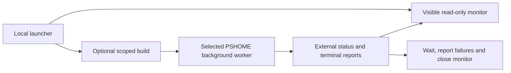

# Invoke-WorkspaceCi.ps1

## Purpose and usage

Local build/test supervisor with a background worker and visible read-only monitor. GitHub product jobs use [Invoke-GitHubCi](Invoke-GitHubCi.md) directly, without this desktop launcher. Both share the same worker and owning test runners.

```powershell
./scripts/Invoke-WorkspaceCi.ps1 -Suite Core -SkipBuild
# Focused development evidence, explicitly partial.
./scripts/Invoke-WorkspaceCi.ps1 -Suite Tooling -SkipBuild -Case 'CI *'
```

`Suite` is discovered through WorkspaceProjects; All is the default. `SkipBuild` reuses prepared binaries. Without it, Build-Workspace builds the selected dependency closure, except DotNet and RunProfilesMutation, which do not request a product build. Ordinary companion selections validate metadata/scheduling before orchestration effects.

| Options | Behavior |
| --- | --- |
| `WorkspaceRoot`, `RunDirectory` | Select source and a new report directory; existing explicit run directories are rejected. |
| `ExpectedRuntimeIdentifier` | Requires actual worker/engine identity. |
| `Case`, `StopOnFirstFailure` | Development filtering/stopping; reports remain partial/incomplete. |
| `MaxConcurrency` | 1–32, default min(4, CPU count); owning manifest caps and ordered/exclusive barriers also apply. |
| `TimeoutSeconds` | Worker deadline, default 1800 seconds, range 1–7200. |
| `Profiler`, profiler paths | Separate Core/All/Integration instrumented pass; missing tools are prepared in the private profiler cache. |
| `SkipTty` | Explicitly excludes native terminal campaigns. |
| `Headless` | CI-only supervision without a desktop monitor; not the normal local invocation. |
| `RepositoryConfig` | Required for RealStatus. |



## Dependencies and side effects

Uses Common, WorkspaceProjects, Build-Workspace, Invoke-TestWorker, Watch-Tests and shared waiting/diagnostic helpers. Starts child PowerShell processes; writes progress, summaries and worker/monitor logs under the external [report root](lib/ReportPaths.md), or an explicit RunDirectory. WhatIf returns before build, profiler preparation, worker/report creation or monitor launch. Nothing is committed or published.

The monitor tails existing diagnostics and closes after a saved terminal report. Failure prints bounded failed cases and throws with the report path. A filtered successful run is development evidence, not full qualification.

## Critical review and verdict

`scripts/Invoke-WorkspaceCi.ps1:1` is local supervision, not the current workflow's direct test entry point. On a non-Windows host without Headless, the present implementation rejects visible monitoring after creating its worker; use the documented Windows host launcher. This known ordering limitation remains. Headless use does not establish hosted matrix coverage. The shared test/monitor implementation avoids a second CI assertion stack; targeted launcher regressions live in the companion tests rather than requiring Pester.


## .NET tooling review

The DotNet host suite accepts DotNetSuite Readiness|Provisioning|Layout|Locks|All and always skips product compilation. It still uses the shared worker, visible monitor, owned timeout and external report root. This focused automation scope is not Core/All release qualification; scripts/Invoke-WorkspaceCi.ps1 passes the selected DotNetSuite to its worker explicitly.

<!-- script-contract:begin -->
## Execution contract

Purpose: Runs companion suites with a dedicated local monitor; CI uses the same saved state.

Boundary: **Executable**. Preview API: **ShouldProcess**. Guarded functions: 0.

See [the complete review](preview-support.md) for orchestration guards, delegated effects and static-analysis limits.
<!-- script-contract:end -->

<!-- credits:begin -->
## Credits

This document is covered by the mandatory [CREDITS.md](../../CREDITS.md), which records the licenses of [Git](https://github.com/git/git/blob/master/COPYING), [Vagrant](https://github.com/hashicorp/vagrant/blob/main/LICENSE) and [Microsoft .NET/PowerShell](https://github.com/PowerShell/PowerShell/blob/master/LICENSE.txt).
<!-- credits:end -->
