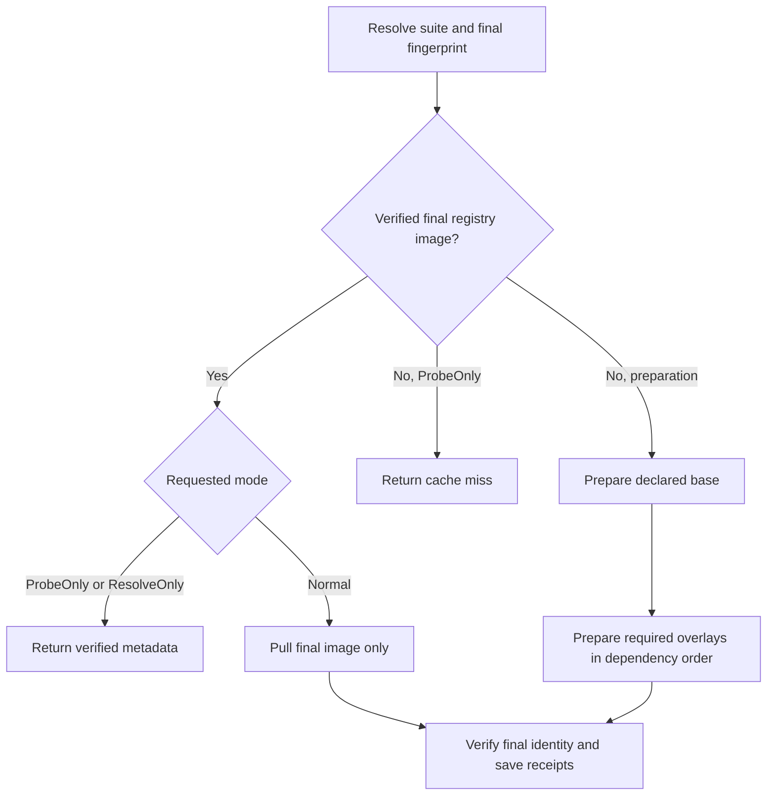

# New-CiSuiteImage.ps1

## Purpose and usage

Resolves the base and overlays declared by `build/companions.yml` for Suite (default All) and a native Linux RuntimeIdentifier. It delegates to [CiCompanions](lib/CiCompanions.md) and [CiImages](CiImages.md). Core needs only the base toolchain, including its Git executable; it does not require the Git companion overlay. Vagrant fixture tests declare no Vagrant executable layer.

```powershell
./scripts/New-CiSuiteImage.ps1 -Suite Core -RuntimeIdentifier linux-arm64 -PlanOnly
./scripts/New-CiSuiteImage.ps1 -Suite All -RuntimeIdentifier linux-x64 -RegistryCache -ContainerRuntime docker -WhatIf
```

| Mode | Registry / daemon effects | Result |
| --- | --- | --- |
| PlanOnly | Offline; no native/credential access | Final plan and fingerprint; the YAML reader may prepare its pinned parser resource. |
| ProbeOnly with RegistryCache | Registry configuration lookup, no pull/build/daemon | Final CacheHit and fingerprint; PublishCache is rejected. |
| ResolveOnly with RegistryCache | Verify metadata; build only on miss | Existing immutable reference without pulling layers, or newly prepared image. |
| Normal RegistryCache | Pull verified final hit first; build required parents on miss | Verified local final image. |

WhatIf returns before configuration/resource preparation. ContainerRuntime follows the shared explicit/dotenv/Podman-first policy; GitHub uses Docker. PublishCache remains upstream-develop-only. No publication is allowed from PRs.



## Dependencies, side effects and review

`scripts/New-CiSuiteImage.ps1:24` guards real preparation before importing the catalogue helper. Builds/pulls/tags, optional trusted publication and receipts belong to the delegated implementation. A metadata-only reference is not a local image ID; test execution resolves/pulls it separately. A final hit avoids unused parent and BuildKit-cache downloads. Local plan/cache adapter tests cover these boundaries; hosted transfers and native ARM execution require run evidence.

<!-- script-contract:begin -->
## Execution contract

Purpose: Resolves or builds the image layers declared for a companion test suite.

Boundary: **Executable**. Preview API: **ShouldProcess**. Guarded functions: 0.

See [the complete review](preview-support.md) for orchestration guards, delegated effects and static-analysis limits.
<!-- script-contract:end -->

<!-- credits:begin -->
## Credits

This document is covered by the mandatory [CREDITS.md](../../CREDITS.md), which records the licenses of [Git](https://github.com/git/git/blob/master/COPYING), [Vagrant](https://github.com/hashicorp/vagrant/blob/main/LICENSE) and [Microsoft .NET/PowerShell](https://github.com/PowerShell/PowerShell/blob/master/LICENSE.txt).
<!-- credits:end -->
