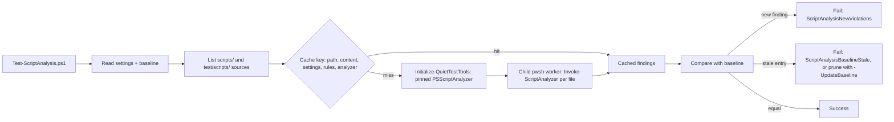

# Test-ScriptAnalysis.ps1

## Purpose and usage

Blocking PSScriptAnalyzer check of every `.ps1` and `.psm1` under `scripts/` and `test/scripts/`. It is registered as `ScriptAnalyzer` in [Invoke-WorkspaceChecks](Invoke-WorkspaceChecks.md), so it runs in Commit-Workspace and in `scripts-docs-check.yml`. Legacy findings are frozen in a baseline that can only shrink. Any finding outside it fails the check. A workspace without `test/scripts/` and without `src/` (an isolated commit fixture) is not applicable: the check returns `{Check, Applicable=$false}` and reads nothing else. A workspace with `src/` must ship `test/scripts/`, otherwise the check fails with `ScriptsTestsRootMissing: test/scripts`, so deleting the test tree never turns it off.

```powershell
./scripts/Test-ScriptAnalysis.ps1                    # analyze the working tree (warm cache: about a second)
./scripts/Test-ScriptAnalysis.ps1 -UpdateBaseline    # after fixing legacy findings: prune stale entries
./scripts/Invoke-WorkspaceChecks.ps1 -Check ScriptAnalyzer
```

| Options | Behavior |
| --- | --- |
| `WorkspaceRoot` | Working tree or exported snapshot to analyze. Settings, custom rules and baseline are read from it. |
| `CacheDirectory` | Per-file analysis cache. Defaults to `.cache/script-analysis` of the repository that owns this script, never of the analyzed snapshot. |
| `UpdateBaseline` | Writes the baseline without its stale entries. It never adds an entry: new findings still fail. |
| `Offline` | Requires the pinned PSScriptAnalyzer to be cached already (`Initialize-TestTools.ps1`). |
| `TimeoutSeconds` | Analyzer worker deadline, default 900 s, range 1–7200. |

Files read from `test/scripts/`:

| File | Content |
| --- | --- |
| `ScriptAnalyzerSettings.psd1` | `Severity` (Error, Warning), `ExcludeRules`, `TestExcludeRules` (Pester containers only) and `ExclusionReasons`. Every excluded rule needs a reason of at least 20 characters, and no other key is accepted. |
| `analyzer/QuietCliRules.psm1` | Repository rules: `QuietJoinPath` (RAC-PS-004), `QuietEntryPointFunction` (no function in `scripts/*.ps1`, RAC-PS-003) and `QuietImportErrorAction` (`Import-Module ... -ErrorAction Stop`). `-DisableNameChecking` is already enforced by [ScriptLayout](Test-ScriptLayout.md) and ShouldProcess by [ScriptShouldProcess](Test-ScriptShouldProcess.md), so neither is repeated here. |
| `ScriptAnalyzer.baseline.json` | Legacy findings keyed by rule, path, enclosing function and SHA-256 of the flagged text, with a count. Line numbers are not part of the key, so moving code does not invalidate it. |

Exclusions and their reasons:

| Rule | Scope | Reason |
| --- | --- | --- |
| `PSAvoidUsingWriteHost` | all | `Progress:`, `Summary:` and `[report]` lines are the host protocol read by monitors and CI logs. |
| `PSUseSingularNouns` | all | Plural nouns are part of the published API; renaming breaks callers. |
| `PSUseBOMForUnicodeEncodedFile` | all | Sources are UTF-8 without BOM, enforced by the PowerShellSources check. |
| `PSUseShouldProcessForStateChangingFunctions` | all | ShouldProcess is enforced at the entry-point boundary (RAC-PS-001). |
| `PSUseDeclaredVarsMoreThanAssignments` | `*.Tests.ps1` | Pester shares `BeforeAll` variables with `It` blocks through scopes the analyzer cannot follow. |
| `PSReviewUnusedParameter` | `*.Tests.ps1` | Property generators and doubles accept the parameters of their contract even when a case ignores them. |



## Dependencies and side effects

Delegates to [Test-ScriptAnalysis.psm1](lib/Test-ScriptAnalysis.md), which uses [ScriptAnalysis.psm1](lib/ScriptAnalysis.md) and [RunToolCache.psm1](lib/RunToolCache.md).

Side effects:
- on a cache miss, prepares or downloads the pinned PSScriptAnalyzer into `.cache/test-tools`;
- writes one JSON document per analyzed file under the cache directory, and the worker request and logs while it runs;
- starts a hidden child `pwsh`, so the pinned analyzer never meets another loaded copy (for example the one of the VS Code extension);
- with `-UpdateBaseline` and stale entries, rewrites `ScriptAnalyzer.baseline.json`.

`-WhatIf` returns before any read, tool preparation, cache write or process. Nothing is staged, committed or published.

## Critical review and verdict

- **Shrink-only baseline.** `-UpdateBaseline` lowers counts and removes entries, and never adds one, so the only way past a new finding is to fix it or to exclude the rule with a reviewed reason in the settings.
- **Cache.** The key covers the relative path (one rule depends on the location), the file bytes, the settings, the rules module and the analyzer version. Any change to these re-analyzes the affected files. A cold run over the whole repository takes about 70 s; a warm run takes about a second.
- **Snapshot safety.** Settings, rules and baseline come from the analyzed tree, so a staged change to them is what gets checked. The tool and cache locations come from the trusted repository.
- **Limits.** PSScriptAnalyzer is static. It cannot see Pester scopes or dynamic invocations, which is why the two test-only exclusions exist.

Tests: `test/scripts/unit/lib/ScriptAnalysis.Tests.ps1` (baseline properties, fuzzed baseline documents, settings validation, keys, file listing, custom rules) and `test/scripts/integration/entrypoints/Test-ScriptAnalysis.Tests.ps1` (real child process on fixture workspaces: clean pass and cache reuse, new violation, stale entry and prune, shrink-only update, test-only exclusions, invalid baseline, WhatIf, not-applicable flat fixture and fail-closed grouped workspace).

<!-- script-contract:begin -->
## Execution contract

Purpose: Blocking PSScriptAnalyzer check of scripts/ and test/scripts/ against the pinned analyzer, the repository rules and a shrink-only baseline.

Boundary: **Executable**. Preview API: **ShouldProcess**. Guarded functions: 0.

See [the complete review](preview-support.md) for orchestration guards, delegated effects and static-analysis limits.
<!-- script-contract:end -->

<!-- credits:begin -->
## Credits

This document is covered by the mandatory [CREDITS.md](../../CREDITS.md), which records the licenses of [Git](https://github.com/git/git/blob/master/COPYING), [Vagrant](https://github.com/hashicorp/vagrant/blob/main/LICENSE) and [Microsoft .NET/PowerShell](https://github.com/PowerShell/PowerShell/blob/master/LICENSE.txt).
<!-- credits:end -->
