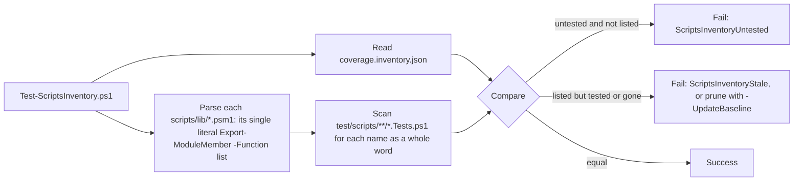

# Test-ScriptsInventory.ps1

<!-- script-source:begin -->
Source file: [`Test-ScriptsInventory.ps1`](../../scripts/Test-ScriptsInventory.ps1)
<!-- script-source:end -->

## Purpose and usage

Blocking ratchet over the script test platform. Every function exported by a `scripts/lib/*.psm1` module must be named by at least one `test/scripts/**/*.Tests.ps1` file. The exceptions are the legacy exports listed in `test/scripts/coverage.inventory.json`, and that list can only shrink. The check is registered as `ScriptsInventory` in [Invoke-WorkspaceChecks](Invoke-WorkspaceChecks.md), so it runs in Commit-Workspace and in `scripts-docs-check.yml`. `test/scripts/unit/quality/Inventory.Tests.ps1` asserts the same rule inside [Invoke-ScriptsTests](Invoke-ScriptsTests.md). A workspace without `test/scripts/` and without `src/` (an isolated commit fixture) is not applicable: the check returns `{Check, Applicable=$false}` and reads nothing else. A workspace with `src/` must ship `test/scripts/`, otherwise the check fails with `ScriptsTestsRootMissing: test/scripts`, so deleting the test tree never turns it off.

```powershell
./scripts/Test-ScriptsInventory.ps1                   # fail on a new untested export or a stale entry
./scripts/Test-ScriptsInventory.ps1 -UpdateBaseline   # after testing a legacy export: prune it from the list
./scripts/Invoke-WorkspaceChecks.ps1 -Check ScriptsInventory
```

| Options | Behavior |
| --- | --- |
| `WorkspaceRoot` | Workspace whose `scripts/lib`, `test/scripts` and inventory are read. Defaults to the parent of this scripts directory. |
| `UpdateBaseline` | Rewrites the inventory without its stale entries (exports now tested, or no longer exported). It never adds an entry, so a new untested export still fails. |

`coverage.inventory.json` holds `{"SchemaVersion": 1, "Untested": [...]}`. Each key has the form `lib/<File>.psm1::<Function>`. The keys are sorted and unique, and any other shape is rejected.



## Dependencies and side effects

Delegates to [Test-ScriptsInventory.psm1](lib/Test-ScriptsInventory.md), which uses [ScriptsInventory.psm1](lib/ScriptsInventory.md) and [WorkspaceJson.psm1](lib/WorkspaceJson.md).

The check reads files and starts no process. The only write happens with `-UpdateBaseline` when entries are stale: the inventory is rewritten atomically. `-WhatIf` returns before any read. Nothing is staged, committed or published.

## Critical review and verdict

- **What "tested" means.** An export counts as tested when its name appears in a test file as a whole command word: case-insensitive, and not part of a longer `Verb-Noun` or variable name. This is a cheap, deterministic proxy. It does not prove that the test asserts anything about the export. That proof comes from line coverage (`coverage.targets.psd1`) and mutation (`mutation.targets.psd1`). The quality test also requires that no library listed as a coverage target keeps an inventory entry.
- **Dynamic dispatch.** A function called only through a computed name (for example `& ('Find-QuietScriptMutant'+$name)`) is not seen. Its test must name it explicitly, as `ScriptMutators.Tests.ps1` does.
- **Effect wrappers.** Worker and orchestration functions (`Invoke-QuietScript*`, `*Worker`) that are exercised end to end by integration tests through their entry point stay in the legacy list until a test names them.
- **Strict exports.** A library whose Export-ModuleMember is missing, duplicated, uses a variable or a wildcard, or does not parse fails with `ScriptsInventoryExportsInvalid: <lib>`. The inventory therefore never silently skips a module.

Tests: `test/scripts/unit/lib/ScriptsInventory.Tests.ps1` covers:
- export discovery properties and rejection cases;
- fuzzed modules;
- whole-word reference matching, checked against an independent token oracle;
- baseline round-trip, rejection and fuzzing;
- the comparison property, which never grows the list.

`test/scripts/unit/lib/Test-ScriptsInventory.Tests.ps1` covers:
- pass, new, stale and prune;
- never adding an entry;
- no write when nothing is stale;
- a missing baseline;
- the not-applicable flat fixture and the fail-closed grouped workspace.

`test/scripts/unit/quality/Inventory.Tests.ps1` runs the rule on the repository.

<!-- script-contract:begin -->
## Execution contract

Purpose: Blocking ratchet: every export of scripts/lib must be referenced by a script test, except the shrink-only legacy list in test/scripts/coverage.inventory.json.

Boundary: **Executable**. Preview API: **ShouldProcess**. Guarded functions: 0.

See [the complete review](preview-support.md) for orchestration guards, delegated effects and static-analysis limits.
<!-- script-contract:end -->

<!-- credits:begin -->
## Credits

This document is covered by the mandatory [CREDITS.md](../../CREDITS.md), which records the licenses of [Git](https://github.com/git/git/blob/master/COPYING), [Vagrant](https://github.com/hashicorp/vagrant/blob/main/LICENSE) and [Microsoft .NET/PowerShell](https://github.com/PowerShell/PowerShell/blob/master/LICENSE.txt).
<!-- credits:end -->
