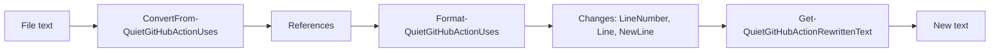

# GitHubActionReferences.psm1

<!-- script-source:begin -->
Source file: [`lib/GitHubActionReferences.psm1`](../../../scripts/lib/GitHubActionReferences.psm1)
<!-- script-source:end -->

## Purpose and usage

The reading and writing of `uses:` references for [Update-GitHubActions.ps1](../Update-GitHubActions.md). It has no knowledge of releases or policy. Import is inert. Only `Get-QuietGitHubActionFiles` touches the file system, and it only lists files.

| Export | Contract |
| --- | --- |
| `Get-QuietGitHubActionFiles` | Returns `{RelativePath, FullPath}` for `.github/workflows/*.yml` or `.yaml` (not recursive, as GitHub reads them) and `.github/actions/**/action.yml` or `.yaml`, in ordinal order on every host. A reparse point throws `GitHubActionFileLinked`: the update never writes through a link. |
| `ConvertFrom-QuietGitHubActionUses` | Parses every `uses:` line of a text (optionally `- `, quoted, with a `# comment`). It returns `{Path, LineNumber, Line, Prefix, Quote, Value, Comment, Kind, Owner, Repository, SubPath, Ref, RefKind, Action}`. `Kind` is `Local` (`./`, `../`), `Docker` (`docker://`) or `Remote` (`owner/repo[/path]@ref`). A remote value that does not match GitHub's naming rules, or that has a `.`/`..` repository, throws `GitHubActionReferenceInvalid: <path>:<line> <value>`. LF and CRLF are numbered alike and `Line` never holds the CR. |
| `Get-QuietGitHubActionRefKind` | `Sha` (40 lowercase hex digits), `Version` (`v1`, `v1.2`, `v1.2.3`) or `Other` (a branch, `v4-beta`, `V4`, …). |
| `Format-QuietGitHubActionUses` | Renders a remote reference with a new ref and comment, keeping its prefix, quote and sub path. A blank comment is dropped. A local or docker reference, or a ref or comment holding a line break, throws `GitHubActionReferenceInvalid`. |
| `Get-QuietGitHubActionRewrittenText` | Replaces whole lines by number and keeps every other byte, line endings included. Each change carries the line it expects: a line that changed since parsing (`GitHubActionSourceChanged`), a duplicated line (`GitHubActionChangeDuplicated`) or a replacement with a line break (`GitHubActionReferenceInvalid`) is refused. |

## Dependencies and side effects

None beyond directory listing and file attribute reads in `Get-QuietGitHubActionFiles`.

## Critical review and verdict

This is a line-oriented regex parser, not YAML. That covers the block-style `uses:` keys the repository's workflows use. It ignores flow mappings and would read a `uses:` line inside a block scalar as a reference. The strict remote grammar makes such a line fail loudly instead of being rewritten silently. Rendering is checked by a round-trip property, so a parsed line always renders back byte for byte. Verdict: adequate for this repository's workflows. Replace it with a YAML reader only if flow-style steps appear.

## Tests

- [`unit/lib/GitHubActionReferences.Tests.ps1`](../../../test/scripts/unit/lib/GitHubActionReferences.Tests.ps1) covers:
  - tabulated ref kinds, quotes, ignored lines and malformed references;
  - LF/CRLF numbering, render refusals and rewrite refusals;
  - file listing and ordering;
  - a generated round-trip property (parse then render returns the line);
  - a fuzz test that only allows the typed error;
  - a rewrite-locality property: exactly the selected lines change, endings kept.
- Mutation target `GitHubActionReferences`, `Break` 80.

<!-- script-contract:begin -->
## Execution contract

Purpose: Lists the workflow and composite action YAML files of a checkout, in ordinal order of their relative path.

Boundary: **Library**. Preview API: **Library**. Guarded functions: 0.

See [the complete review](../preview-support.md) for orchestration guards, delegated effects and static-analysis limits.
<!-- script-contract:end -->

<!-- credits:begin -->
## Credits

This document is covered by the mandatory [CREDITS.md](../../../CREDITS.md), which records the licenses of all softwares which have QuietCli companions
<!-- credits:end -->
