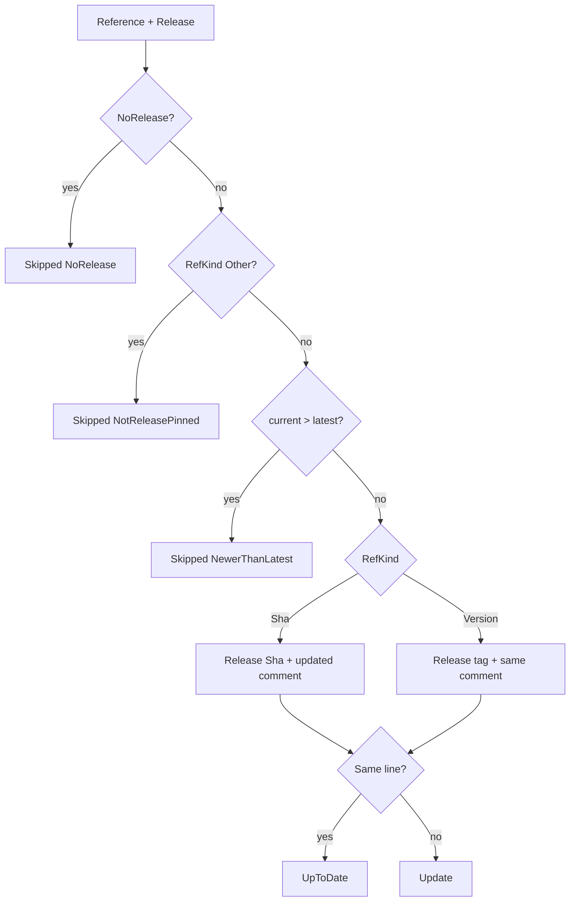

# GitHubActionUpdates.psm1

<!-- script-source:begin -->
Source file: [`lib/GitHubActionUpdates.psm1`](../../../scripts/lib/GitHubActionUpdates.psm1)
<!-- script-source:end -->

## Purpose and usage

The update policy of [Update-GitHubActions.ps1](../Update-GitHubActions.md): given a parsed reference and the latest release of its action, it decides the new line. It also moves a workflow document's source receipt. Every export is pure. Import loads [GitHubActionReferences.psm1](GitHubActionReferences.md) for rendering.

| Export | Contract |
| --- | --- |
| `ConvertTo-QuietGitHubActionVersion` | `v4`, `v4.3`, `4.3.0` → `[version]` with three parts (missing ones `0`). Anything else (`v4-beta`, `V4`, four parts, spaces) → `$null`. |
| `Get-QuietGitHubActionComment` | The comment of a commit pin after an update. A leading version is replaced by the tag and the rest is kept (`v4, reviewed` → `v7.0.1, reviewed`). A comment without a leading version is kept after the tag (`reviewed` → `v7.0.1, reviewed`). An empty comment becomes the tag. The function is idempotent. |
| `Get-QuietGitHubActionCurrentVersion` | The version a reference is on: its `Version` ref, else the leading version of its comment, else `$null`. |
| `Get-QuietGitHubActionUpdate` | Returns `{Reference, Release, Status, Reason, Ref, Comment, NewLine}`. A `Sha` ref moves to the release commit with an updated comment. A `Version` ref moves to the release tag and keeps its comment. `UpToDate` means the rendered line equals the current one. `Skipped` has a reason: `NoRelease`, `NotReleasePinned` (a branch or other ref, left to its owner) or `NewerThanLatest` (never downgrades, for example from a prerelease). A non-remote reference, or a release of another action, throws. |
| `Get-QuietGitHubActionWorkflowDocumentPath` | `.github/workflows/<name>.yml` or `.yaml` → `docs/ci/github/script-<name>.md`, the RAC-WF-001 document. Any other path → `$null`. |
| `Get-QuietGitHubActionReceiptText` | Replaces the single `<!-- workflow-source-sha256: … -->` receipt equal to the previous file hash with the new hash, and nothing else. Hashes must be uppercase (`GitHubActionReceiptHashInvalid`). A missing, duplicated or stale receipt throws `GitHubActionReceiptNotCurrent`. |

## Dependencies and side effects

None beyond the import of `GitHubActionReferences.psm1`. Nothing is read or written.

## Critical review and verdict

- **The pinned version comes from the comment.** For a commit pin, the current version is read from its comment. A stale or wrong comment can therefore make the update look like a no-op or block it with `NewerThanLatest`. The comment is the only version a reader sees next to a commit, and the convergence property keeps it in step after every update.
- **Non-version tags are not ordered.** A release tag that is not a version (`release-2024_01`) cannot be ordered, so it always counts as newer.
- **Duplicated naming rule.** The document path rule duplicates `WorkflowDocumentation.psm1`. That duplication is accepted to keep this module free of imports, and `Test-GitHubWorkflowDocs.ps1` remains the authority.

Verdict: sound, conservative policy.

## Tests

- [`unit/lib/GitHubActionUpdates.Tests.ps1`](../../../test/scripts/unit/lib/GitHubActionUpdates.Tests.ps1) covers:
  - version parsing, with a numeric-order property;
  - comment rewriting, with an idempotence property;
  - every update decision and refusal, plus a convergence property: an updated line is up to date on the next run;
  - document paths, receipt moves and hash validation.
- Mutation target `GitHubActionUpdates`, `Break` 80.

<!-- script-contract:begin -->
## Execution contract

Purpose: Reads a release tag such as v4, v4.3 or 4.3.0 as a [version] with missing parts set to 0, or returns null.

Boundary: **Library**. Preview API: **Library**. Guarded functions: 0.

See [the complete review](../preview-support.md) for orchestration guards, delegated effects and static-analysis limits.
<!-- script-contract:end -->

<!-- credits:begin -->
## Credits

This document is covered by the mandatory [CREDITS.md](../../../CREDITS.md), which records the licenses of all softwares which have QuietCli companions
<!-- credits:end -->
