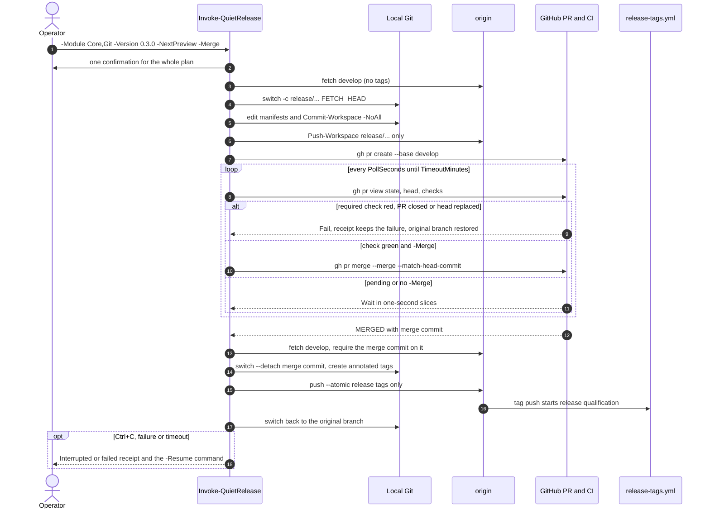

# Invoke-QuietRelease.psm1

Implements [Invoke-QuietRelease.ps1](../Invoke-QuietRelease.md). Exports only `Invoke-QuietScriptInvokeQuietRelease`. Imported without name checking; import defines the command without running the operation.

## Purpose and usage

Wires [ReleaseFlow](ReleaseFlow.md) to the checkout's real tools and asks for one confirmation covering the whole flow:

- Git: an exact-argument `quiet -FilePath git` callback with bounded metadata (50 000 lines, 4 MiB, first value at most 4 KiB). A native failure is reported without retry.
- Commit: refuses any changed path other than the selected manifests, stages them, then runs `Commit-Workspace.ps1 -NoAll`.
- Branch push: accepts only `release/*` branches and delegates to `Push-Workspace.ps1`, which also posts the RAC-PR-001 checkpoint comment once the pull request exists.
- GitHub: `Invoke-QuietPullRequestTool` (60-second timeout, 256 KiB of metadata) for `gh pr list/create/view/merge`.

The repository is resolved from the remote URL (`github.com` HTTPS or SSH forms only). The local Core/Git modules must be the checkout's own; another loaded copy fails with `ReleaseFlowUnexpectedModulePath`. Core is imported into the global scope before Git, also under `-WhatIf`, because Git's handler registration resolves Core commands there.

## Dependencies and effects

Effects are those of the flow: one `release/*` branch locally and on the remote, one commit, one pull request, at most one merge request, the release tags, and ignored receipts under `artifacts/releases/<id>/`. Credentials are neither read from `.env` nor changed. WhatIf skips confirmation and delegates to the flow's local-only provisional plan.

## Review and validation

The facade wiring is covered by the workspace contracts (thin entry point, ShouldProcess, documentation). Its behavior is tested through ReleaseFlow with injected callbacks against an owned repository and a scripted GitHub double. The real `gh` integration is checked by operator use, not by the offline suite.

<!-- credits:begin -->
## Credits

This document is covered by the mandatory [CREDITS.md](../../../CREDITS.md), which records the licenses of [Git](https://github.com/git/git/blob/master/COPYING), [Vagrant](https://github.com/hashicorp/vagrant/blob/main/LICENSE) and [Microsoft .NET/PowerShell](https://github.com/PowerShell/PowerShell/blob/master/LICENSE.txt).
<!-- credits:end -->

<!-- script-contract:begin -->
## Execution contract

Purpose: Releases modules end to end: version commit on a release/* branch, pull request, required CI, merge commit, then tags.

Boundary: **Library**. Preview API: **Library**. Guarded functions: 1.

See [the complete review](../preview-support.md) for orchestration guards, delegated effects and static-analysis limits.
<!-- script-contract:end -->

<!-- grouped-layout-review:begin -->
## Grouped workspace contract

Reviewed source: scripts/lib/Invoke-QuietRelease.psm1:1. Module identities are resolved through the catalogue while physical source/test paths live below src/<group>/. Dependencies remain explicit and imports do not execute business operations.

Build-Workspace supports verified reuse and explicit affected Project paths. New-CiImpactPlan emits separate build/full/smoke selections and reason chains. Cache presence never replaces source, payload, configuration and target verification. The global release check name and publication requirements remain unchanged.

See the [layout and selective-CI contract](
../../README-companion-layout-and-ci.md
).
<!-- grouped-layout-review:end -->
