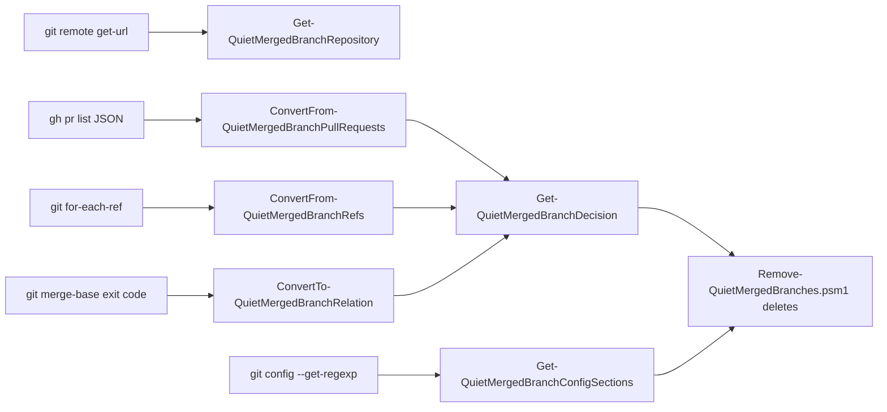

# MergedBranches.psm1

<!-- script-source:begin -->
Source file: [`lib/MergedBranches.psm1`](../../../scripts/lib/MergedBranches.psm1)
<!-- script-source:end -->

## Purpose and usage

The merged branch policy of [Remove-QuietMergedBranches.ps1](../Remove-QuietMergedBranches.md), kept separate from its Git and GitHub effects so every rule is unit tested without a process. Import is inert and no export reads or writes anything.

| Export | Contract |
| --- | --- |
| `Get-QuietMergedBranchRepository` | Returns `owner/repository` for an `https://github.com/`, `git@github.com:` or `ssh://git@github.com/` URL, with or without `.git` and a trailing slash, and nothing for any other URL. The host is compared case-insensitively. |
| `ConvertFrom-QuietMergedBranchRefs` | Parses `git for-each-ref --format=%(refname)%09%(objectname)%09%(worktreepath) refs/heads/` into `{Name, Tip, WorktreePath}`. LF or CRLF, lowercase SHA-1 or SHA-256 ids. Any other line, or a branch listed twice, throws `MergedBranchRefsInvalid`. |
| `ConvertFrom-QuietMergedBranchPullRequests` | Parses `gh pr list --json number,headRefName,headRefOid,baseRefName,mergedAt,isCrossRepository` and returns an ordinal dictionary from head branch to `{Number, HeadRefName, HeadRefOid, MergedAt}`. It keeps pull requests that were merged into the base and do not come from a fork. When a head was merged several times, the highest number wins. A non-array, a missing or mistyped field, or a number listed twice throws `MergedBranchPullRequestsInvalid`. |
| `ConvertTo-QuietMergedBranchRelation` | `Same` when tip and head are equal, otherwise the exit code of `git merge-base --is-ancestor <tip> <head>`: 0 `Contained`, 1 `Diverged`, anything else `Unknown`. |
| `Get-QuietMergedBranchDecision` | Returns `{Branch, Tip, Action, Reason, PullRequest}`. The first matching rule wins: `CheckedOut`, `Protected` (base and protected names, case-insensitive), `MergedPullRequest` (Delete, relation `Same` or `Contained`), `AheadOfPullRequest`, `PullRequestHeadUnknown`, `ContainedInBase` (Delete, only with `-IncludeContainedInBase`) or `ContainedInBaseOnly`, then `NoMergedPullRequest`. Every rule except the two Delete ones keeps the branch. |
| `Get-QuietMergedBranchConfigSections` | Returns, sorted ordinally and without duplicates, the branch names owning a `branch.<name>.<variable>` key in `git config --name-only --get-regexp` output. The section is case-insensitive, the name is kept as written, and the variable is the part after the last dot. |

## Dependencies and side effects

None: no import, no process, no file access.

## Critical review and verdict

Deletion needs positive evidence: a merged pull request whose head contains the tip, or the tip in the base with an explicit switch. An omitted or unknown relation keeps the branch. The pull request JSON is validated strictly instead of being read leniently, so a change in the `gh` output format stops the run rather than deleting by default. Fork pull requests are ignored because a fork's `feature/x` is not the local `feature/x`. The ref parser accepts any name `for-each-ref` prints without whitespace; Git forbids whitespace in ref names anyway.

## Tests

- [`unit/lib/MergedBranches.Tests.ps1`](../../../test/scripts/unit/lib/MergedBranches.Tests.ps1) (80 tests):
  - tabulated URLs, ref lines, pull request lists, relations, decisions and config keys;
  - a fuzz test of the JSON parser that only allows the typed error;
  - properties: ref output round-trips, the highest merged number wins in any order, and no branch with commits outside its pull request, protected or checked out is ever deleted.
- [`integration/entrypoints/Remove-QuietMergedBranches.Tests.ps1`](../../../test/scripts/integration/entrypoints/Remove-QuietMergedBranches.Tests.ps1) runs the entry point on fixture repositories.
- Mutation target `MergedBranches`, `Break` 80, score 100 % with one documented equivalent mutant.

<!-- script-contract:begin -->
## Execution contract

Purpose: Returns the owner/repository of a github.com remote URL, or $null for any other URL.

Boundary: **Library**. Preview API: **Library**. Guarded functions: 0.

See [the complete review](../preview-support.md) for orchestration guards, delegated effects and static-analysis limits.
<!-- script-contract:end -->

<!-- credits:begin -->
## Credits

This document is covered by the mandatory [CREDITS.md](../../../CREDITS.md), which records the licenses of all softwares which have QuietCli companions
<!-- credits:end -->
