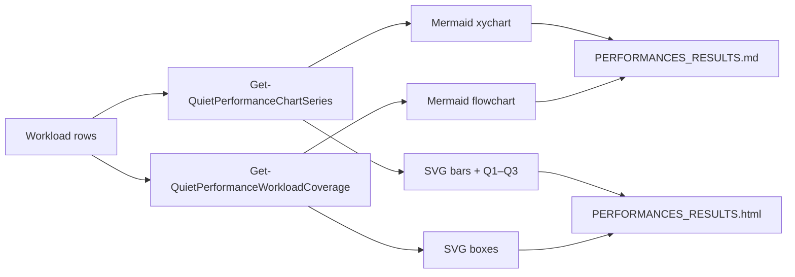

# PerformanceCharts.psm1

<!-- script-source:begin -->
Source file: [`lib/PerformanceCharts.psm1`](../../../scripts/lib/PerformanceCharts.psm1)
<!-- script-source:end -->

## Purpose and usage

This module draws the charts of [New-CorePerformanceReport.ps1](../New-CorePerformanceReport.md). Each chart is rendered twice from the same numbers:

- as a **Mermaid** block for `PERFORMANCES_RESULTS.md`, which GitHub and VS Code display;
- as an **inline SVG** for `PERFORMANCES_RESULTS.html`, which needs no script and no network under its `default-src 'none'` content-security policy.

Two kinds of chart are drawn:

- **Coverage overview:** one box per workload in two lanes, uninstrumented and profiled. Each box shows its observations, environments and series. A workload without observations is a dashed box. `ImportFirstCall` is marked *not profiled*, because the collectors attach after import.
- **Workload charts:** one horizontal bar chart per workload, measure and variant, with one bar per environment. The bar is the median, and the number at its tip is the median with its N. In SVG, a thin line spans Q1–Q3, and hovering over a row shows a tooltip with median, Q1–Q3, Min–Max, N and p95 (flagged `(max)` when it is the maximum). A caption under each chart repeats these values and lists the environments without an observation.

| Export | Contract |
| --- | --- |
| `ConvertTo-QuietChartText` | Keeps `A–Z a–z 0–9`, space and `._=,:/+()-·–×`, and replaces any other character with `_`. Shortens text to a maximum length with `…`. Empty text becomes `-`. A hostile label cannot leave a Mermaid string. |
| `ConvertTo-QuietChartXml` | Escapes XML after replacing control characters with spaces. |
| `Format-QuietChartNumber` | Formats numbers in the invariant culture: a comma-decimal locale never changes a value or the Mermaid syntax. |
| `Get-QuietPerformanceChartSeries` | Builds charts keyed by workload, measure and variant in first-seen order, with `Bars` and `Missing` environments. A chart with no bar is dropped. |
| `Get-QuietPerformanceChartTitle` / `Get-QuietPerformanceChartCaption` | Title `W · M[ · V] (median ms)`. Caption text such as `h1: 4.00 ms, Q1–Q3 2.00–6.00, N=7, p95 7.00 (max); no observation: h2`. |
| `ConvertTo-QuietPerformanceMermaidChart` | `xychart-beta horizontal`, data labels on, with an axis from 0 to 110 % of the largest median, rounded up. |
| `ConvertTo-QuietPerformanceSvgChart` | Well-formed SVG, 760 px wide. Bars are scaled to the largest median, with a minimum width of 1 px and a 4 px rounded data end. Each row is a `qc-row` group with a `<title>` tooltip and a hit area. |
| `Get-QuietPerformanceWorkloadCoverage` | Returns `{Workload, Instrumented, Hosts, Observations, Measures}` for both lanes, in catalog order. |
| `ConvertTo-QuietPerformanceMermaidOverview` / `ConvertTo-QuietPerformanceSvgOverview` | Draw the coverage overview described above. |

Every function returns LF-only text. Colors come from `qc-*` CSS classes that the report defines for light and dark schemes, so no color is written into the SVG.

## Dependencies and side effects

None. The module imports nothing: it consumes the rows of [PerformanceWorkloads.psm1](PerformanceWorkloads.md), whose `Statistics` come from [PerformanceStatistics.psm1](PerformanceStatistics.md), as plain objects. Nothing is read or written, and the module has no top-level state.

## Critical review and verdict

- **Bars side by side are not a ranking.** The report says so above the charts and repeats the runtime note. The bars only make the tables faster to scan.
- **Mermaid rendering is unverified.** `xychart-beta` is still a beta diagram, and `showDataLabel` depends on the Mermaid version of the viewer. A viewer without it shows bars without numbers; the caption and the tables keep every value.
- **No log scale.** Within one chart, all bars measure the same work in different environments, so a linear scale fits. Different measures never share a chart.
- **Sanitized labels lose characters.** For example, `7.7.0-preview.5` is kept, but brackets become `_`. The tables keep the exact, escaped labels.

Verdict: readable charts with numbers, safe under the strict policy. The tables remain the source of truth.

## Tests

- [`unit/lib/PerformanceCharts.Tests.ps1`](../../../test/scripts/unit/lib/PerformanceCharts.Tests.ps1) covers:
  - label sanitizing, with a fuzz on the output charset and length;
  - series order, missing environments and captions;
  - the Mermaid syntax, LF-only output, and invariant numbers under `fr-FR`;
  - well-formed SVG with no active content, plus hostile-label fuzzes for Mermaid and SVG;
  - bar scaling, including a whisker wider than every bar and an all-zero sample;
  - coverage counts, workloads absent from the catalog, the Mermaid overview and the SVG overview;
  - golden renderings, reviewed by hand, of one Mermaid chart, one SVG chart, both overviews and a caption. They pin every coordinate, so a geometry change must update them on purpose.
- Mutation target `PerformanceCharts`, `Break` 80.

<!-- script-contract:begin -->
## Execution contract

Purpose: Reduces untrusted metadata to a conservative character set that is safe inside Mermaid quoted strings.

Boundary: **Library**. Preview API: **Library**. Guarded functions: 0.

See [the complete review](../preview-support.md) for orchestration guards, delegated effects and static-analysis limits.
<!-- script-contract:end -->

## Diagnostic coverage labels

The instrumented overview lane is labelled Diagnostics and profiling because phase-timer rows and line-profiler rows are separate methods within it. Each series retains its measure and variant; the lane is a coverage overview, never a total duration or additive cost partition. Golden Markdown and SVG fixtures cover this label.

<!-- credits:begin -->
## Credits

This document is covered by the mandatory [CREDITS.md](../../../CREDITS.md), which records the licenses of all softwares which have QuietCli companions
<!-- credits:end -->
