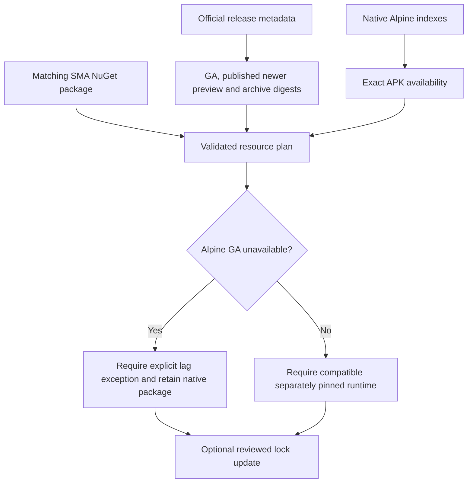

# PowerShellReleases.psm1

## Purpose and exports

Engine-independent PowerShell release/resource verification and lock planning. Import only declares functions and strict mode.

| Function | Responsibility |
| --- | --- |
| Get-QuietPowerShellReleaseResources | Resolve Microsoft GA, newer published preview or pending next tag; probe native archives and matching SMA NuGet package; inspect both Alpine architectures. |
| Get-QuietAlpinePowerShellPackage | Parse bounded native APKINDEX metadata and probe the exact package URL. |
| New-QuietPowerShellResourcePlan | Pure validation and proposed host/image documents, with explicit Alpine-lag authorization. |
| Update-QuietPowerShellCiLock | Guard the audit/update, support PlanOnly and create backups/atomic per-file writes. |

## Dependencies and effects

Bounded HTTPS on official GitHub/raw GitHub, NuGet and Alpine hosts; .NET JSON/hash/gzip/tar APIs; no native command, product module or daemon. HTTP errors remain failures/unknown availability, without retries. Archive existence and digests are metadata evidence; preparation independently hashes downloaded bytes. Alpine package signatures are enforced by apk during actual image construction, not by this inventory parser.

WhatIf on orchestration returns before HTTP/import/writes; PlanOnly queries but writes nothing. Only PowerShell fields and the explicit exception change in image locks; SDK, OS digest and Alpine runtime pins are preserved. Atomicity is per destination file. Compile-time package references and workflow documentation are separate reviewed source changes.

## Critical review and verdict

`scripts/lib/PowerShellReleases.psm1:1` separates transport, native package inventory, pure policy and writes. Offline tests cover malformed evidence, independent matrix cross-products, preserved pins, explicit lag, no-effect previews and guard mutants. Live inventory confirms resource availability; local GA execution and hosted cross-platform qualification remain separate evidence. No absent preview hash or musl ARM64 archive is fabricated.

<!-- script-contract:begin -->
## Execution contract

Purpose: Provide PowerShellReleases automation.

Boundary: **Library**. Preview API: **Library**. Guarded functions: 2.

See [the complete review](../preview-support.md) for orchestration guards, delegated effects and static-analysis limits.
<!-- script-contract:end -->

<!-- credits:begin -->
## Credits

This document is covered by the mandatory [CREDITS.md](../../../CREDITS.md), which records the licenses of [Git](https://github.com/git/git/blob/master/COPYING), [Vagrant](https://github.com/hashicorp/vagrant/blob/main/LICENSE) and [Microsoft .NET/PowerShell](https://github.com/PowerShell/PowerShell/blob/master/LICENSE.txt).
<!-- credits:end -->
