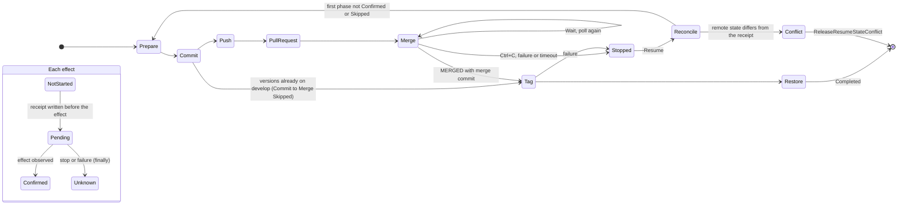

# ReleaseFlow.psm1

Resumable release phases behind [Invoke-QuietRelease](../Invoke-QuietRelease.md). All effects go through injected callbacks (Git, commit, branch push, GitHub CLI), so the same code runs against the real tools and against owned test doubles.

## Purpose and usage

- `Invoke-QuietReleaseFlow` runs the phases `Prepare, Commit, Push, PullRequest, Merge, Tag, Restore`. Start parameters mirror [ReleaseTags](ReleaseTags.md) selection (`-Module`, `-Version`, `-Preview`, `-NextPreview`) plus `-Merge`, `-PollSeconds`, `-TimeoutMinutes`, `-RequiredCheck`, `-Remote`, `-DeliveryBranch` and `-Repository`. `-Resume <receipt>` reuses the recorded request; `-Merge` may be added on resume.
- `Get-QuietReleaseCheckState` reduces `statusCheckRollup` to Success, Failure or Pending for the exact required check. A missing check is Pending, never green. Other checks are ignored.
- `Get-QuietReleasePullRequestDecision` is the pure decision: CLOSED or a head other than the release commit fails; MERGED with a merge commit tags; a red required check fails; a green check merges only with `-Merge`; everything else waits.
- `Wait-QuietReleaseInterval` waits in one-second slices so a stop is observed within about a second.
- `Read-QuietReleaseFlowState` / `Write-QuietReleaseFlowState` validate and atomically replace (temporary file and move) `artifacts/releases/<id>/release-flow.json`.

Prepare refuses an existing local or remote release branch and branches from the fetched delivery tip, never from the local delivery branch. Commit recomputes the selection with remote tags. When the delivery branch already carries the selected versions, Commit to Merge are Skipped and the observed tip is tagged. Merge uses `gh pr merge --merge --match-head-commit`; it never uses `--admin` or `--auto`. Tag requires the merge commit on the fetched delivery branch, refuses tags created by someone else since the commit (`ReleaseVersionsDivergedSinceCommit`), then creates and atomically pushes only the selected tags.

## Receipt, interruption and resume

Each effect is written `Pending` before it starts and `Confirmed` after it is observed. Ctrl+C raises a pipeline stop: `catch` does not run, `finally` does. The `finally` block turns `Pending` into `Unknown`, sets `Interrupted` (or keeps `Failure`), writes the receipt, restores the original branch when no Git effect is in flight and prints the `-Resume` command through the host. A hard kill leaves `Pending`, which resume treats like `Unknown`.

Resume refuses an invalid or completed receipt, another workspace and a dirty checkout, then reconciles each `Pending`/`Unknown` phase against reality before acting:

| Phase | Observation | Outcome |
|---|---|---|
| Prepare | local release branch | absent: NotStarted; at base: Confirmed; elsewhere: conflict |
| Commit | branch tip and its parent, manifests | at base: NotStarted; one commit on base with the recorded versions: Confirmed |
| Push | `ls-remote --heads` | absent: NotStarted; release commit: Confirmed |
| PullRequest | `gh pr list --head` | none: NotStarted; one: Confirmed; several: conflict |
| Merge | none | NotStarted: the loop observes the pull request before any merge, so an accepted merge is not repeated |
| Tag | peeled remote tags | none: NotStarted; all on the merge commit: Confirmed; partial: conflict |

## Review and validation

The CI optimization case runs `ReleaseFlow.Tests.ps1` against an owned repository, a private bare remote and a scripted GitHub double that creates real merge commits and enforces the required check. It covers WhatIf without effects, the nominal merge with tags on the merge commit, a red check, a replaced head, a closed pull request, a manual merge after a timeout and resume, tags created by someone else, already merged versions, and tampered receipts. Stops run in a dedicated runspace (`PowerShell.Stop()`, the Ctrl+C path): during polling, and after GitHub accepted a merge without answering, followed by a hard-kill receipt. A 512-case seeded property checks the decision against an independent oracle. Four mutants are killed: no green-check guard, no head guard, no receipt write in `finally`, and a single long wait (stop latency).

<!-- credits:begin -->
## Credits

This document is covered by the mandatory [CREDITS.md](../../../CREDITS.md), which records the licenses of [Git](https://github.com/git/git/blob/master/COPYING), [Vagrant](https://github.com/hashicorp/vagrant/blob/main/LICENSE) and [Microsoft .NET/PowerShell](https://github.com/PowerShell/PowerShell/blob/master/LICENSE.txt).
<!-- credits:end -->

<!-- script-contract:begin -->
## Execution contract

Purpose: Reduces a pull request status rollup to Success, Failure or Pending for one exact required check name.

Boundary: **Library**. Preview API: **Library**. Guarded functions: 1.

See [the complete review](../preview-support.md) for orchestration guards, delegated effects and static-analysis limits.
<!-- script-contract:end -->
