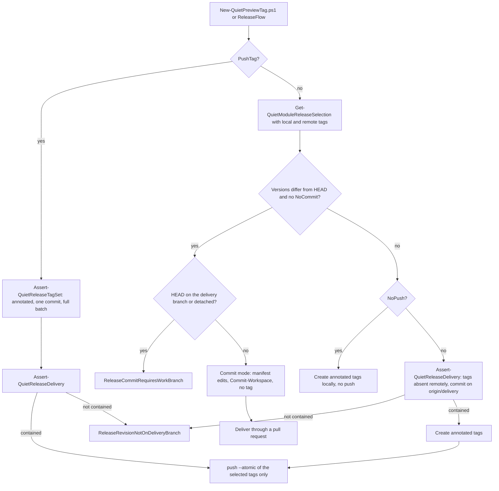

# ReleaseTags.psm1

<!-- script-source:begin -->
Source file: [`lib/ReleaseTags.psm1`](../../../scripts/lib/ReleaseTags.psm1)
<!-- script-source:end -->

Every operator-created module tag annotation carries the same bounded `QuietCli-Release-Batch` JSON (schema, exact commit and selected tag names). The tag workflow validates every member and elects one dependency-ordered leader. A Core/Git operation therefore runs one release qualification and one packaging build, publishing Core before Git. It retains independent module versions/tags; a separate PR validation is not reused as release evidence. Legacy/manual tags without batch metadata still trigger standalone release qualification.

## Purpose and usage

Shared release planning and orchestration behind [New-QuietPreviewTag](../New-QuietPreviewTag.md).

- `Get-QuietNextPreviewNumber` accepts a package name, numeric base version and local/remote tag records. It matches the complete escaped `<package>/v<base>-preview<N>` expression and computes the numeric maximum plus one. Other modules, versions, timestamps, malformed suffixes and peeled refs do not change the counter; overflow fails.
- `Get-QuietModuleReleaseSelection` computes the per-package versions, tags and manifest edits from already observed tag names. It reads manifests only, without Git or network access, and enforces the version, preview, collision and NoCommit rules. `Invoke-QuietModuleRelease` and [ReleaseFlow](ReleaseFlow.md) share it, so the facade can plan before switching branches.
- `Get-QuietReleaseManifestText` returns a literal AST-based ModuleVersion/Prerelease edit, preserving GUIDs, dependency declarations, unrelated text and UTF-8/LF.
- `Invoke-QuietModuleRelease` discovers selected business packages, validates local and remote collisions and confirms a concrete plan. In Commit mode (versions differ from HEAD, no NoCommit) it commits the version edits through the checked commit callback on a work branch and creates no tag; the delivery branch is refused. In Tag mode it checks delivery, creates annotated tags and atomically pushes exactly those tags unless NoPush. It never pushes a branch.
- `Assert-QuietReleaseTagSet` reads local refs only: every selected tag exists, is annotated, designates one shared commit, and its `QuietCli-Release-Batch` members equal the selected set.
- `Assert-QuietReleaseDelivery` rejects selected tags already present remotely, fetches the remote delivery branch without tags and requires the release commit to be contained in it.
- `Push-QuietReleaseTags` combines both checks (only the local one under WhatIf) before an atomic push of existing local tags.

## Effects and boundaries

The Git callback uses the operator's local QuietCli facade with bounded metadata. The commit callback reuses Commit-Workspace; no branch-push callback exists, because the protected delivery branch only receives pull requests. These callbacks are injectable for owned-repository integration tests; they are not public operator parameters.

`-WhatIf` reads local metadata only and writes no manifest, index, commit, tag or receipt. Its next-preview estimate is provisional with `RemoteChecked=false`. Every real invocation, including `-NoPush`, reads the configured remote's tag refs before changes. A failed remote read fails the operation. No existing local or remote tag is replaced; no force or automatic retry is used. A competing push can still reject the atomic tag push.

`-NoCommit` requires a clean checkout whose selected versions already match HEAD. `-NoPush` skips the delivery check and the tag push but still checks remote tags and creates local tags. After local tag creation, a repeated invocation for that identity refuses the existing tag; inspect the receipt and explicitly handle existing refs rather than forcing a retry.

Version edits are committed together; independently selected packages may receive different preview numbers. An ignored artifacts/releases/<id>/release.json records the mode, commits, created tags, the delivery check and completed pushes. TagPushState distinguishes NotRequested, Pending, Confirmed and Unknown. A client failure after an attempted push does not prove the server rejected it; inspect remote refs before any recovery. Failures retain owned changes/tags.

## Review and validation

The CI optimization case exercises seeded numeric preview properties, metadata-driven discovery, real disposable commits, annotated tags, pushes to a private local bare repository, local/remote collisions, NoCommit, NoPush and no-write preview, delivery-branch refusals for commits and unmerged tags, PushTag batch validation and deferred delivery, and a killed delivery-guard mutant. No public Gallery publication is a test. Import declares functions only and performs no business action.

<!-- script-contract:begin -->
## Execution contract

Purpose: Computes the next numeric preview from exact package/version tag names, independently of lexical ordering.

Boundary: **Library**. Preview API: **Library**. Guarded functions: 2.

See [the complete review](../preview-support.md) for orchestration guards, delegated effects and static-analysis limits.
<!-- script-contract:end -->

<!-- credits:begin -->
## Credits

This document is covered by the mandatory [CREDITS.md](../../../CREDITS.md), which records the licenses of all softwares which have QuietCli companions
<!-- credits:end -->
