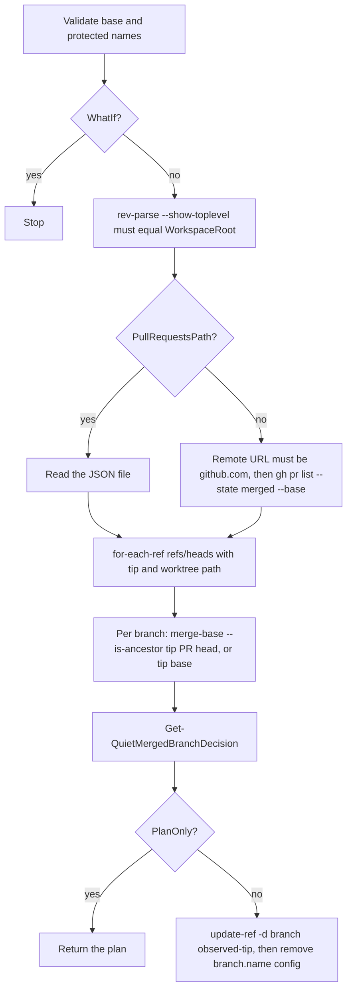

# Remove-QuietMergedBranches.psm1

Implements [Remove-QuietMergedBranches.ps1](../Remove-QuietMergedBranches.md). Exports only "Invoke-QuietScriptRemoveQuietMergedBranches". Imported without name checking; import defines the command without running the operation.

## Purpose and usage

Deletes the local branches whose pull request GitHub merged into the delivery branch, and lists every branch it keeps with the reason.

```powershell
./scripts/Remove-QuietMergedBranches.ps1 -PlanOnly
./scripts/Remove-QuietMergedBranches.ps1 -WhatIf
./scripts/Remove-QuietMergedBranches.ps1
./scripts/Remove-QuietMergedBranches.ps1 -IncludeContainedInBase
./scripts/Remove-QuietMergedBranches.ps1 -PullRequestsPath merged.json -PlanOnly
```

| Option | Role |
| --- | --- |
| `-BaseBranch` | Branch the pull requests were merged into, `develop` by default. A work or release branch (`feature/x`, `release/x`) is refused. The base is never deleted. |
| `-Remote` | Remote whose github.com URL names the repository, `origin` by default. `<Remote>/<BaseBranch>` tells which branches are already in the base. Nothing is fetched. |
| `-Repository` | Expected `owner/repository`; the remote must point to it. It defaults to the remote's own repository. |
| `-PullRequestsPath` | JSON saved from `gh pr list --state merged --json number,headRefName,headRefOid,baseRefName,mergedAt,isCrossRepository`, read instead of calling `gh`. The remote is then not checked. |
| `-Limit` | Maximum number of merged pull requests requested from `gh`, 1000 by default. Reaching it prints `MergedBranchLimitReached`. |
| `-Protected` | Other names never deleted, `develop`, `main` and `master` by default, compared case-insensitively. |
| `-IncludeContainedInBase` | Also deletes branches without a merged pull request whose tip is in `<Remote>/<BaseBranch>`. |
| `-PlanOnly` | Reads everything and returns the decisions without deleting. |
| `-WorkspaceRoot` | Checkout to clean, this one by default. It must be the top of a checkout, not a subdirectory. |

The result is `{BaseBranch, Repository, Source, PlanOnly, MergedPullRequests, Deleted, Planned, Kept, Branches}`. Each entry of `Branches` is `{Branch, Tip, Action, Reason, PullRequest, State}`, with State one of `Deleted`, `Planned` or `Kept`. The reasons are those of [MergedBranches.psm1](MergedBranches.md).

## Dependencies and side effects

Uses `Ci.Process.psm1` to run `git` and `gh` with an exact argument vector, a 120-second timeout and an 8 MB output cap. No built product module is needed. [WorkBranch.psm1](WorkBranch.md) validates the base. [MergedBranches.psm1](MergedBranches.md) holds every parsing and decision rule. WhatIf returns after the validation of the base and the protected names, before any Git, GitHub or file access.



- **Merged.** The latest merged pull request of a branch name decides: it must come from the repository itself, not a fork, and its head must equal or contain the local tip. A squash or rebase merge leaves the pull request head intact on GitHub, so this works whatever merge method was used. The head is looked up in the local object database, without a fetch.
- **Kept.** A checked-out branch (in any worktree), the base and protected names, a branch with commits its pull request never had, a branch whose pull request head is not available locally, and a branch without a merged pull request.
- **Deletion.** `git update-ref -d refs/heads/<name> <observed tip>` refuses to delete a branch that moved since it was read. The `branch.<name>` config section (upstream, merge) is then removed if it exists. Each deletion prints the restoring `git branch <name> <oid>`, and the reflog of HEAD still holds the commits.
- **Never done.** No fetch, no push, no remote branch deletion, no tag, stash, worktree or working-tree change.

## Critical review and verdict

The pull request list is a snapshot: a branch that GitHub merges while the script runs is simply kept until the next run. The compare-and-delete stops a branch that moved after it was read, but no test races a concurrent writer; the guarantee is Git's. A branch name reused after its pull request was merged is judged by its highest-numbered merged pull request: new commits keep it (`AheadOfPullRequest`), and a new branch started on the old head would be deleted, but it holds no commit of its own. `PullRequestHeadUnknown` occurs when the head was never fetched locally; it errs on the side of keeping. Without `-IncludeContainedInBase` a missing `<Remote>/<BaseBranch>` is tolerated, because the base then only explains a kept branch. With it, the run is refused. The 1000 default limit only matters to repositories with that many merged pull requests; the warning names the option.

## Tests

[`integration/entrypoints/Remove-QuietMergedBranches.Tests.ps1`](../../../test/scripts/integration/entrypoints/Remove-QuietMergedBranches.Tests.ps1) runs the entry point in a child `pwsh` on a fixture: a bare origin and a work clone with a merged branch, a branch behind its pull request head, an ahead branch, an unknown head, a pull request into another base, a fork pull request, an unmerged branch, a protected branch, the current branch, a branch checked out in another worktree and a branch contained in the base. It has 10 tests:

- only the merged and behind branches are deleted, with their config sections; every other branch keeps its tip;
- `-IncludeContainedInBase` also deletes the branch contained in the base;
- `-PlanOnly` returns each expected reason and deletes nothing;
- WhatIf reads nothing and changes nothing;
- each refusal (work branch as base, missing or malformed pull request file, non-GitHub remote, subdirectory, missing base with `-IncludeContainedInBase`) leaves every branch unchanged.

<!-- credits:begin -->
## Credits

This document is covered by the mandatory [CREDITS.md](../../../CREDITS.md), which records the licenses of [Git](https://github.com/git/git/blob/master/COPYING), [Vagrant](https://github.com/hashicorp/vagrant/blob/main/LICENSE) and [Microsoft .NET/PowerShell](https://github.com/PowerShell/PowerShell/blob/master/LICENSE.txt).
<!-- credits:end -->

<!-- script-contract:begin -->
## Execution contract

Purpose: Deletes the local branches whose pull request was merged into develop on GitHub, and lists the branches it keeps.

Boundary: **Library**. Preview API: **Library**. Guarded functions: 1.

See [the complete review](../preview-support.md) for orchestration guards, delegated effects and static-analysis limits.
<!-- script-contract:end -->
