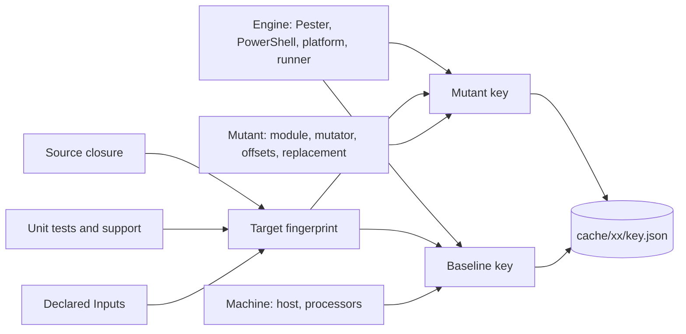

# ScriptMutationCache.psm1

<!-- script-source:begin -->
Source file: [`lib/ScriptMutationCache.psm1`](../../../scripts/lib/ScriptMutationCache.psm1)
<!-- script-source:end -->

## Purpose and usage

Content-addressed outcome cache of [Invoke-ScriptsMutation.ps1](../Invoke-ScriptsMutation.md). A mutant's outcome is reused only when nothing its target's tests can observe has changed. Import is inert. Only the `Write-` and `Remove-` exports write, and only under the cache directory.

| Export | Contract |
| --- | --- |
| `Get-QuietScriptMutationSha256` | Lowercase hex SHA-256 of a UTF-8 string. |
| `Get-QuietScriptMutationTestFingerprint` | Hashes the test side of a target: its unit test files, plus every file of the tests root outside `unit/` and `integration/` (support modules, analyzer rules, settings). The bookkeeping files `README.md`, `mutation.targets.psd1`, `coverage.inventory.json` and `ScriptAnalyzer.baseline.json` are left out. An edit, addition, removal or rename of a covered file changes it. |
| `Get-QuietScriptMutationSourceFingerprint` | Hashes the scripts side: the module, plus the closure of scripts files reachable from it, from its unit tests and from `support/`. The scan follows every `<name>.psm1` or `<name>.ps1` that ends a quoted literal (with or without a path before it), and every `Import-QuietTestLibrary` name, resolved under `lib/` and the scripts root, transitively. |
| `Get-QuietScriptMutationSourceFiles` | The file list behind the source fingerprint, as full paths in ordinal order. An empty `-Module` starts from the test files and `support/` alone, and the test list may be empty. [ScriptsImpact.psm1](ScriptsImpact.md) uses it to find the tests a script change reaches. |
| `Get-QuietScriptMutationInputsFingerprint` | Hashes the repository files named by the target's `Inputs` globs. `*` matches within a segment and `**` across segments. Each pattern walks only the directory before its first wildcard. A pattern without a match still contributes its text, so the first matching file changes the fingerprint. |
| `Get-QuietScriptMutationInputFiles` | The full paths those `Inputs` globs match, skipping links. |
| `Get-QuietScriptMutationTreeFiles` | Every file below a directory, skipping linked directories; nothing for a missing directory. |
| `Get-QuietScriptMutationTargetFingerprint` | Combines the three fingerprints above for one target. A target without `Inputs` and one with an empty list give different results. |
| `Get-QuietScriptMutantCacheKeys` | Dictionary from mutant id to its 64-hex key. A key hashes the cache schema, the engine fingerprint (Pester, PowerShell, platform), the target fingerprint and the mutant itself (module, mutator, offsets, replacement). |
| `Get-QuietScriptMutantCachePath` | `<Directory>/<first two key characters>/<key>.json`. `ScriptMutationCacheKeyInvalid` for anything other than 64 lowercase hex digits. |
| `Read-QuietScriptMutantCache` | `{Status, Seconds, Seed}` of a key, or `$null` on a miss. A document that does not parse, or carries another schema, key or status, is a miss and is overwritten by the next run. |
| `Write-QuietScriptMutantCache` | Records `Killed` or `Survived` and returns `$true`. `Timeout` depends on machine load and `CompileError` is recomputed for free, so neither is stored (`$false`). |
| `Get-QuietScriptMutationBaselineKey` | 64-hex key of a target's baseline. It hashes the baseline kind, its schema, the engine fingerprint, the target fingerprint and a machine identity (`-Machine`, the engine passes the host name and processor count). A baseline duration only holds on the machine that measured it, so a cache restored elsewhere never reuses it. |
| `Read-QuietScriptMutationBaseline` | `{Passed, Seconds, Focus}` of a baseline key, or nothing on a miss. `Focus` lists the functions whose focused split was proven with the baseline, empty when the document has none; a `Focus` that is not a list of non-blank names is a miss. A document that does not parse, or carries another schema, kind or key, a passed count that is not a plain integer of at least 1, or a duration that is not finite and non-negative, is a miss. |
| `Write-QuietScriptMutationBaseline` | Records `{Kind = 'Baseline', Passed, Seconds, Focus}` (seconds rounded to 0.1, `-Focus` empty by default) and returns `$true`. A baseline without a passed test, or with a negative or non-finite duration, is never stored (`$false`). |
| `Remove-QuietScriptMutantCacheUnused` | Deletes the `<two hex>/<64 hex>.json` documents whose key is not in `-Keys`, removes the shard directories left empty, and returns the count. Any other file and every link is left alone. A missing directory returns 0. |

The private helpers are mutation targets too:

- `Get-QuietScriptMutationFilesDigest`: relative paths plus file SHA-256, in ordinal order.
- `Get-QuietScriptMutationTreeFiles`: a link-free walk.
- `Read-QuietScriptMutationCacheDocument`: the JSON object of a document, read as strict UTF-8, or nothing.
- `Get-QuietScriptMutationCacheValue`: one property of a document, or nothing.

## Dependencies and side effects

Imports WorkspaceJson for the documents. It reads the scripts root, the tests root and the `Inputs` files, and writes only under the cache directory (`<workspace>/.cache/script-mutation` by default, ignored by Git). In CI each shard restores and saves its own copy (see [tooling-ci.yml](../../ci/github/script-tooling-ci.md)).

## Critical review and verdict

Over-inclusion only costs reuse; a missed dependency makes the cache wrong. Two inputs cannot be seen by the scan: a library name built at run time, and a repository file a unit test reads without declaring it in `Inputs`. The first is avoided by importing libraries by literal file name. The second is why `test/scripts/README.md` asks for `Inputs` on every target whose unit tests read the real repository.

Tests: `test/scripts/unit/lib/ScriptMutationCache.Tests.ps1`, on a fixture repository with an import cycle, path-qualified references, entry scripts, support files and repository inputs. It covers:
- every edit that must change a fingerprint, and every one that must not;
- removal and rename, regex escaping and order independence of `Inputs`;
- key stability and sensitivity;
- unreadable or mismatched documents;
- baseline keys, the baseline round trip with and without proven focused functions, its boundaries (one test, zero seconds), the values it refuses to write, and every malformed baseline document, including a malformed `Focus`;
- pruning: exact keep set, idempotence, a missing directory and unrelated files.

The library is itself a mutation target.

<!-- script-contract:begin -->
## Execution contract

Purpose: Lowercase hex SHA-256 of a UTF-8 string.

Boundary: **Library**. Preview API: **Library**. Guarded functions: 0.

See [the complete review](../preview-support.md) for orchestration guards, delegated effects and static-analysis limits.
<!-- script-contract:end -->

<!-- credits:begin -->
## Credits

This document is covered by the mandatory [CREDITS.md](../../../CREDITS.md), which records the licenses of all softwares which have QuietCli companions
<!-- credits:end -->
