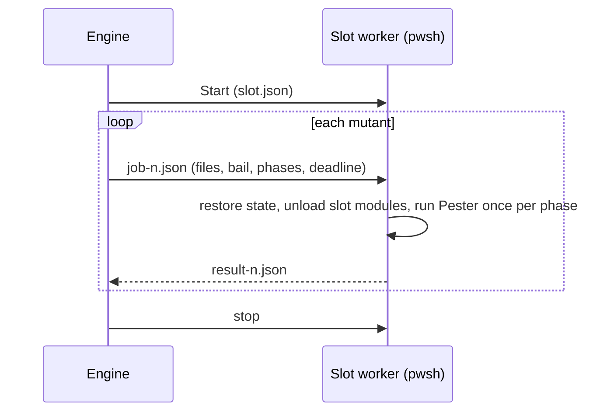

# ScriptMutationSlot.psm1

<!-- script-source:begin -->
Source file: [`lib/ScriptMutationSlot.psm1`](../../../scripts/lib/ScriptMutationSlot.psm1)
<!-- script-source:end -->

## Purpose and usage

Persistent test workers of [Invoke-ScriptsMutation.ps1](../Invoke-ScriptsMutation.md). Each slot is one hidden `pwsh` that imports the pinned Pester once and then runs every job it is handed. That replaces one process per mutant. The parent and the worker talk only through files in the slot's control directory.

| Export | Contract |
| --- | --- |
| `Start-QuietScriptsMutationSlot` | Starts a worker over a slot copy of the scripts root and returns its handle. It exports `QUIETCLI_SCRIPTS_ROOT`, `QUIETCLI_WORKSPACE_ROOT` and `QUIETCLI_TEST_SEED`. `ScriptMutationSlotDirectoryExists` when the control directory already exists. |
| `Submit-QuietScriptsMutationJob` | Writes `job-<n>.json` for an idle, live slot and records the deadline. `-Bail` stops the run at its first failed test (`Run.SkipRemainingOnFailure = Run`). `-Phases` lists Pester `FullName` filters run one after the other; blank patterns are dropped. Errors: `ScriptMutationSlotDead`, `ScriptMutationSlotBusy` and `ScriptMutationSlotPhaseEmpty` (a phase with no pattern left would run every test). |
| `Receive-QuietScriptsMutationJob` | `{State, Passed, Failed, Seconds, TimedOut, Error}` of the current job, or `$null` while it runs. A saved result wins. A worker that exited without a result, or left an unreadable or mismatched one, yields `Crash`. A job past its deadline has its process tree killed and yields `Timeout`. In both cases the slot is dead and must be restarted. `ScriptMutationSlotIdle` without a job. |
| `Wait-QuietScriptsMutationJob` | Polls `Receive-` until an outcome exists. |
| `Stop-QuietScriptsMutationSlot` | Asks the worker to exit, kills it after a grace period, and marks the handle dead. |
| `Get-QuietScriptsMutationSlotState` | Captures environment variables, global variable names and the location. |
| `Restore-QuietScriptsMutationSlotState` | Restores a captured state: removes added environment variables and restores changed ones, and removes created globals unless constant or read-only. It also unloads every module imported from under the given roots, so nested imports are reloaded from the slot sources. Returns the number of modules removed. |
| `Invoke-QuietScriptsMutationSlotJob` | Worker side of one job: restores the state, runs Pester on the job's files and saves the result. Without phases the files run once unfiltered. With phases, each runs in order in the same state, as the blocks of one run would. `Passed` and `Failed` add up over the phases run, the state is `Failed` when any phase fails, and a phase that selects no test fails. With bail, a failing phase is the last one run. When the worker no longer holds exactly the pinned Pester, it returns `Corrupted` without running anything. `-PesterModules` replaces `Get-Module Pester` for that check. The tests pass it instead of mocking, because `Mock -ModuleName ScriptMutationSlot` is ambiguous inside a slot that already loaded the trusted copy of this module. |
| `Test-QuietScriptsMutationSlotPester` | True when exactly one Pester module is loaded and it is the pinned 6.2.0. Shared by the job check and the worker start, which throws `ScriptsTestPesterVersionMismatch`. |
| `Test-QuietScriptsMutationSlotParent` | True while the recorded parent still runs: the process exists, has not exited, and started within one second of the recorded start time. On Linux, .NET recomputes a process start time from the boot time in each process, with a few milliseconds of drift, so an exact comparison would stop every worker after its first job. |
| `Invoke-QuietScriptsMutationSlotWorker` | Worker body. It runs the jobs in order until a stop request, or until its parent process exits (`Test-QuietScriptsMutationSlotParent`). |

## Dependencies and side effects

Imports ScriptsTests (pinned Pester configuration) and WorkspaceJson. It starts hidden `pwsh` processes and writes only in each slot's control directory and run logs. A dead slot is restarted by the engine with a new control directory.

## Critical review and verdict

Reusing a process is only sound if every run starts from the same state. Environment variables, globals, the location and the modules under test are reset before each job. A run that unloads or replaces Pester makes the next job `Corrupted`: the engine replays that mutant once on a fresh slot, and raises the error if it happens again, instead of blaming the mutant. State outside these, such as static .NET fields or loaded assemblies, is not reset; a library under mutation that kept state there would leak it from one run to the next.

Tests:

- `test/scripts/unit/lib/ScriptMutationSlot.Tests.ps1` (39 tests): the job protocol and its rejections, including an empty phase, crash, timeout and corruption outcomes, the pinned-Pester check (none, another version, two copies), stop and kill, state restore and module unloading by root (a sibling sharing the prefix is not under the root);
- `test/scripts/integration/lib/ScriptMutationSlot.Tests.ps1` (9 tests): real workers running several jobs in one process, reloading an edited library, bail, phases that add up, bail across phases, a phase that selects nothing, a crash that keeps the worker serving, corruption after Pester is unloaded, a deadline kill and a clean stop.

The library is itself a mutation target.

<!-- script-contract:begin -->
## Execution contract

Purpose: Captures the process state a test run may change: environment variables, global variable names and location.

Boundary: **Library**. Preview API: **Library**. Guarded functions: 0.

See [the complete review](../preview-support.md) for orchestration guards, delegated effects and static-analysis limits.
<!-- script-contract:end -->

<!-- credits:begin -->
## Credits

This document is covered by the mandatory [CREDITS.md](../../../CREDITS.md), which records the licenses of all softwares which have QuietCli companions
<!-- credits:end -->
