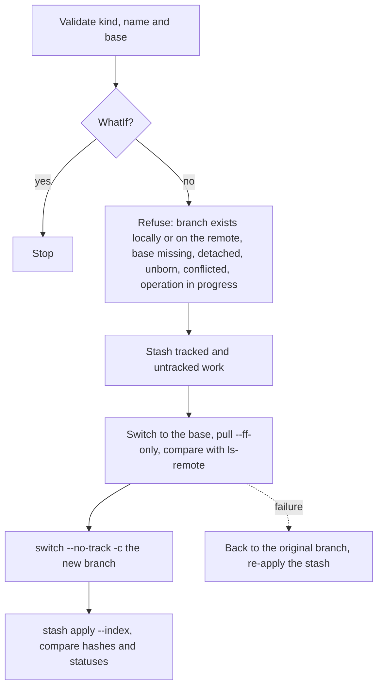

# Start-QuietWorkBranch.psm1

<!-- script-source:begin -->
Source file: [`lib/Start-QuietWorkBranch.psm1`](../../../scripts/lib/Start-QuietWorkBranch.psm1)
<!-- script-source:end -->

Implements [Start-QuietWorkBranch.ps1](../Start-QuietWorkBranch.md). Exports only "Invoke-QuietScriptStartQuietWorkBranch". Imported without name checking; import defines the command without running the operation.

# Start-QuietWorkBranch.ps1

## Purpose and usage

Starts a new work branch from the freshly pulled delivery branch and moves pending work onto it.

```powershell
./scripts/Start-QuietWorkBranch.ps1 -Kind feature -Name script-tests -WhatIf
./scripts/Start-QuietWorkBranch.ps1 -Kind fix -Name tag-administration
./scripts/Start-QuietWorkBranch.ps1 -Branch chore/bump-pester
./scripts/Start-QuietWorkBranch.ps1 -Kind doc -Name multi-version
```

| Option | Role |
| --- | --- |
| `-Branch` | Whole new branch, `<kind>/<name>`. |
| `-Kind`, `-Name` | The same, in two parts. The kind is `fix`, `feature`, `chore`, `companion` or `doc`. |
| `-BaseBranch` | Delivery branch to start from, `develop` by default. A work or release branch (`doc/x`, `release/x`) is refused. |
| `-Remote` | Remote of the base, `origin` by default. Tags are never fetched. |
| `-WorkspaceRoot` | Checkout to operate on, this one by default. |
| `-ShelfName` | Message of the retained stash. A name is generated when it is missing. |

The name, kind and base are validated by [WorkBranch.psm1](WorkBranch.md) before anything else, WhatIf included. Git then checks both names with `check-ref-format --branch`. There is no `release` kind: releases are tags, created with their transient `release/*` branch by `Invoke-QuietRelease.ps1`.

## Dependencies and side effects

Uses the checkout's built Core/Git modules and the `quiet` facade for every native operation. WhatIf returns after the name and base checks and before product-module imports, filesystem reads, Git calls or network access.



- **Refusals first.** Every refusal happens before the stash, so a refused run leaves the checkout exactly as it was. This covers a branch that exists locally or on the remote, a missing base on either side, a detached, unborn or conflicted checkout, and an in-progress merge, rebase, cherry-pick, revert, am or bisect.
- **Shelving.** Pending tracked and untracked files are stashed together.
- **Base.** The local base is switched to and pulled with `--ff-only --no-tags`. Its commit must then equal the remote head.
- **New branch.** It starts from that commit, never from the branch that was current, and does not track the base.
- **Restore.** The stash is applied by id with `--index`, which preserves staging, and it is retained as a backup. The restored hashes and statuses are compared path by path with the initial work.
- **Failure before the branch exists.** If the pull cannot fast-forward, for example, the original branch is checked out again and the stash re-applied. The error says so, and names the stash when that recovery fails too.
- **Never done.** The script does not commit, push, open a PR, reset an existing branch or create tags.

## Critical review and verdict

Native failures are not retried. The remote-base comparison is an observation, not a lock against later remote changes. Submodule worktree changes are not shelved recursively. The final comparison intentionally fails when an automatic merge changes the shelved work; the retained stash holds the original. A failure after the branch is created (the restore) is not rolled back, because switching away would lose the partly applied work; the error names the retained stash.

## Tests

[`integration/entrypoints/Start-QuietWorkBranch.Tests.ps1`](../../../test/scripts/integration/entrypoints/Start-QuietWorkBranch.Tests.ps1) runs the entry point in a child `pwsh` on fixture repositories (a bare origin, a clone that moves develop, a work clone).

- the branch starts from the pulled remote develop even when started from another work branch, without that branch's commits and without tracking;
- staged, unstaged and untracked work is restored and the stash retained;
- a clean checkout is not shelved;
- both parameter forms create the requested `doc/*` branch, and `-WhatIf` previews it without effects;
- each refusal (kind, name, work branch as base, local or remote branch, missing base, detached) leaves branch, HEAD, status, files, stashes and branches unchanged;
- a merge in progress is refused;
- WhatIf changes nothing but still validates the name;
- a diverged develop puts the work back on the original branch;
- every name the policy accepts is accepted by `git check-ref-format`.

<!-- script-contract:begin -->
## Execution contract

Purpose: Shelves pending work, fast-forwards the base branch and restores the shelf on a new work branch.

Boundary: **Library**. Preview API: **Library**. Guarded functions: 1.

See [the complete review](../preview-support.md) for orchestration guards, delegated effects and static-analysis limits.
<!-- script-contract:end -->

## Fresh-session product loading

Core is bound to process-global scope before importing Git, because Git registration resolves Core commands there. Both modules must come from this checkout; a conflicting loaded path requires a fresh session. No profile is changed and imports do not rebuild binaries. The Tooling layout regression previews Commit-Workspace in a clean, profile-disabled child and rejects missing-registration or skipped-sniffer warnings.

Command binding temporarily disables preview/confirmation only while importing inert product definitions, then restores both preferences before business operations. This lets the read-only sniffer bind the exported quiet alias during preview without weakening lock, staging, commit or branch guards.

<!-- grouped-layout-review:begin -->
## Grouped workspace contract

Reviewed source: scripts/lib/Start-QuietWorkBranch.psm1:1. Module identities are resolved through the catalogue while physical source/test paths live below src/<group>/. Dependencies remain explicit and imports do not execute business operations.

Build-Workspace supports verified reuse and explicit affected Project paths. New-CiImpactPlan emits separate build/full/smoke selections and reason chains. Cache presence never replaces source, payload, configuration and target verification. The global release check name and publication requirements remain unchanged.

See the [layout and selective-CI contract](
../../README-companion-layout-and-ci.md
).
<!-- grouped-layout-review:end -->

<!-- credits:begin -->
## Credits

This document is covered by the mandatory [CREDITS.md](../../../CREDITS.md), which records the licenses of all softwares which have QuietCli companions
<!-- credits:end -->
