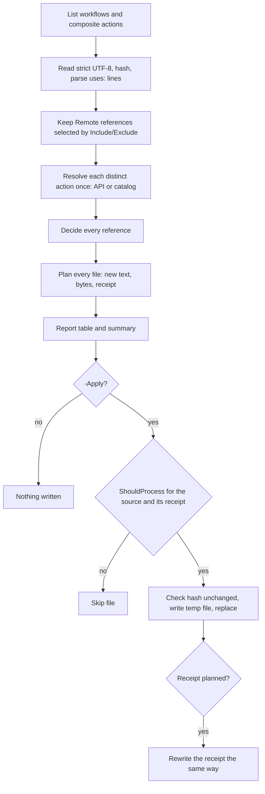

# Update-GitHubActions.psm1

<!-- script-source:begin -->
Source file: [`lib/Update-GitHubActions.psm1`](../../../scripts/lib/Update-GitHubActions.psm1)
<!-- script-source:end -->

## Purpose and usage

Implements [Update-GitHubActions.ps1](../Update-GitHubActions.md). Exports only `Invoke-QuietScriptUpdateGitHubActions`. Import defines the command without running the operation.

It is the orchestration layer of four modules. Each of the other three has one responsibility and no effect beyond the one it is named for:

| Module | Role |
| --- | --- |
| [GitHubActionReferences.psm1](GitHubActionReferences.md) | Finds the workflow files, parses `uses:` lines, renders and rewrites them. Pure apart from listing files. |
| [GitHubActionReleases.psm1](GitHubActionReleases.md) | Resolves the latest release of an action to `{Tag, Sha}`, from the GitHub REST API or from a reviewed JSON catalog. Swapping the source changes nothing else. |
| [GitHubActionUpdates.psm1](GitHubActionUpdates.md) | Decides each reference (update, up to date, skipped) and moves a workflow document receipt. Pure. |
| `Update-GitHubActions.psm1` | Reads, plans, reports and, with `-Apply`, writes through `ShouldProcess`. |

| Option | Role |
| --- | --- |
| `-Apply` | Writes the updates. Without it the run only reports and says so. |
| `-WhatIf`, `-Confirm` | With `-Apply`: preview, or ask, per changed file and per receipt. |
| `-Include`, `-Exclude` | Wildcards over `owner/repository`. Exclude wins. Default: every action. |
| `-ReleaseCatalogPath` | JSON catalog `{"owner/repository": {"Tag": "v1.2.3", "Sha": "<40 hex>"}}`, or `null` for a repository without release, used instead of the API. Every selected action must be in it. |
| `-RefreshWorkflowReceipts` | Also moves the `workflow-source-sha256` receipt of each written workflow's document (RAC-WF-001) to the new file hash, only when it recorded the old one. |
| `-WorkspaceRoot` | Checkout to read and update, this one by default. |

The report is a table with one row per distinct reference (action with sub path, from, to, status, reason, count), then a summary line:

```text
Summary: 106 reference(s) in 23 file(s); 106 to update in 16 file(s), 0 up to date, 0 skipped.
```

The result object is `{Check='GitHubActions', Files, References, Updates, UpToDate, Skipped, PlannedFiles, WrittenFiles, RefreshedReceipts, Applied, Rows}`.



## Dependencies and side effects

- **Reads** the listed files, the catalog and, with `-RefreshWorkflowReceipts`, the workflow documents.
- **Network:** without a catalog, read-only HTTPS GETs to `api.github.com` go out on every run, `-WhatIf` and report-only runs included, because the preview has to show what would change. Each distinct action needs one call for its latest release, one for its tag ref and one per annotated tag object. `GH_TOKEN`, else `GITHUB_TOKEN`, is sent as a bearer token and never printed.
- **Writes** require `-Apply` and a confirmed `ShouldProcess` decision. Each changed workflow or action and its optional receipt share that decision. The script checks the receipt against its planned hash before writing the workflow. It replaces each file by moving a temporary sibling over the target after checking the current hash. UTF-8 BOMs and line endings are preserved. An I/O failure can interrupt the batch between file replacements.
- **All-or-nothing planning:** every release is resolved and every new text and receipt is computed before the first write. An unknown release (`GitHubActionReleaseUnknown`), an invalid reference (`GitHubActionReferenceInvalid`), a file that is not UTF-8 (`GitHubActionFileNotUtf8`), a linked file (`GitHubActionFileLinked`) or a stale receipt (`GitHubActionReceiptNotCurrent`) stops the run with nothing written.

## Update scope

- The latest GitHub release can cross a major version. Review the upstream changes and the matching workflow documentation before refreshing its receipt. Run [Test-GitHubWorkflowDocs.ps1](../Test-GitHubWorkflowDocs.md) to check the hashes and generated workflow descriptions.
- A version reference such as `@v4` moves to the exact release tag, for example `@v7.0.2`. Commit references keep a full SHA.
- The [reference scanner](GitHubActionReferences.md) handles single-line `uses:` keys and skips YAML block scalar contents.
- `-Apply -RefreshWorkflowReceipts -WhatIf` lists the workflow and its current receipt together without writing either file.

## Tests

- [`unit/lib/Update-GitHubActions.Tests.ps1`](../../../test/scripts/unit/lib/Update-GitHubActions.Tests.ps1) runs the orchestrator in-process against a catalog. It covers:
  - report-only and `-WhatIf` runs with no write;
  - apply with and without receipts, and a workflow without a document;
  - BOM and CRLF preservation, filters, convergence and the empty checkout;
  - refusals for invalid UTF-8, stale receipts and concurrent edits to the workflow or receipt.
- [`integration/entrypoints/Update-GitHubActions.Tests.ps1`](../../../test/scripts/integration/entrypoints/Update-GitHubActions.Tests.ps1) covers report-only runs, receipt previews, byte-for-byte apply using `-Appy`, block scalar preservation, repeat runs with no pending updates, stale receipts, an unknown release and filters.
- Mutation target `UpdateGitHubActions` checks the source hash guard with `Break` 100.

<!-- script-contract:begin -->
## Execution contract

Purpose: Reads one text file as strict UTF-8 and returns {FullPath, Text, Bom, Sha256}, Sha256 being that of its bytes.

Boundary: **Library**. Preview API: **Library**. Guarded functions: 1.

See [the complete review](../preview-support.md) for orchestration guards, delegated effects and static-analysis limits.
<!-- script-contract:end -->

<!-- credits:begin -->
## Credits

This document is covered by the mandatory [CREDITS.md](../../../CREDITS.md), which records the licenses of all softwares which have QuietCli companions
<!-- credits:end -->
