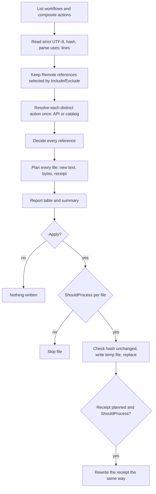

# Update-GitHubActions.psm1

## Purpose and usage

Implements [Update-GitHubActions.ps1](../Update-GitHubActions.md). Exports only `Invoke-QuietScriptUpdateGitHubActions`. Import defines the command without running the operation.

It is the orchestration layer of four modules. Each of the other three has one responsibility and no effect beyond the one it is named for:

| Module | Role |
| --- | --- |
| [GitHubActionReferences.psm1](GitHubActionReferences.md) | Finds the workflow files, parses `uses:` lines, renders and rewrites them. Pure apart from listing files. |
| [GitHubActionReleases.psm1](GitHubActionReleases.md) | Resolves the latest release of an action to `{Tag, Sha}`, from the GitHub REST API or from a reviewed JSON catalog. Swapping the source changes nothing else. |
| [GitHubActionUpdates.psm1](GitHubActionUpdates.md) | Decides each reference (update, up to date, skipped) and moves a workflow document receipt. Pure. |
| `Update-GitHubActions.psm1` | Reads, plans, reports and, with `-Apply`, writes through `ShouldProcess`. |

| Option | Role |
| --- | --- |
| `-Apply` | Writes the updates. Without it the run only reports and says so. |
| `-WhatIf`, `-Confirm` | With `-Apply`: preview, or ask, per changed file and per receipt. |
| `-Include`, `-Exclude` | Wildcards over `owner/repository`. Exclude wins. Default: every action. |
| `-ReleaseCatalogPath` | JSON catalog `{"owner/repository": {"Tag": "v1.2.3", "Sha": "<40 hex>"}}`, or `null` for a repository without release, used instead of the API. Every selected action must be in it. |
| `-RefreshWorkflowReceipts` | Also moves the `workflow-source-sha256` receipt of each written workflow's document (RAC-WF-001) to the new file hash, only when it recorded the old one. |
| `-WorkspaceRoot` | Checkout to read and update, this one by default. |

The report is a table with one row per distinct reference (action with sub path, from, to, status, reason, count), then a summary line:

```text
Summary: 106 reference(s) in 23 file(s); 106 to update in 16 file(s), 0 up to date, 0 skipped.
```

The result object is `{Check='GitHubActions', Files, References, Updates, UpToDate, Skipped, PlannedFiles, WrittenFiles, RefreshedReceipts, Applied, Rows}`.



## Dependencies and side effects

- **Reads** the listed files, the catalog and, with `-RefreshWorkflowReceipts`, the workflow documents.
- **Network:** without a catalog, read-only HTTPS GETs to `api.github.com` go out on every run, `-WhatIf` and report-only runs included, because the preview has to show what would change. Each distinct action needs one call for its latest release, one for its tag ref and one per annotated tag object. `GH_TOKEN`, else `GITHUB_TOKEN`, is sent as a bearer token and never printed.
- **Writes** only with `-Apply` and a confirmed `ShouldProcess`. Each changed file and receipt is replaced atomically: a temporary sibling `.<guid>.tmp` is written, then moved over the target. A file whose bytes changed since it was read throws `GitHubActionSourceChanged` and stays untouched. Encoding (UTF-8, BOM kept only if present) and every line ending are preserved. Only the changed `uses:` lines differ.
- **All-or-nothing planning:** every release is resolved and every new text and receipt is computed before the first write. An unknown release (`GitHubActionReleaseUnknown`), an invalid reference (`GitHubActionReferenceInvalid`), a file that is not UTF-8 (`GitHubActionFileNotUtf8`), a linked file (`GitHubActionFileLinked`) or a stale receipt (`GitHubActionReceiptNotCurrent`) stops the run with nothing written.

## Critical review and verdict

- **Latest is not compatible.** The latest release is often a new major version. For example, `download-artifact` v8 fails on a digest mismatch by default, and the node24 actions need runner 2.327.1 or later. The script does not read release notes. A reviewer reads them before merging the diff.
- **Version refs become exact.** A `@v4` ref moves to the exact release tag (`@v7.0.2`), not to a floating major tag, because only release tags are resolved. The repository pins commits, so this only affects references that were not pinned yet.
- **Not a YAML parser.** Lines are matched by one anchored regular expression. Flow mappings (`{uses: …}`) are ignored. A `uses:` line inside a block scalar would be parsed as a reference. It must then parse strictly or the run fails, which keeps the failure loud rather than silent.
- **Receipt policy.** Moving a receipt asserts that a pin-only edit keeps the reviewed behavior. That is true for the workflow text but not for the action's own behavior, so the option is opt-in and refuses any receipt that was not current. It mirrors the `docs/ci/github/script-<name>.md` convention of `WorkflowDocumentation.psm1` instead of importing it, which is an accepted duplication. `Test-GitHubWorkflowDocs.ps1` stays the check.
- **Receipts in previews.** Under `-WhatIf` the receipt step is not previewed, because it only follows a written file.

Verdict: fit for routine pin refreshes. Its output is a reviewable diff, not an approval.

## Tests

- [`unit/lib/Update-GitHubActions.Tests.ps1`](../../../test/scripts/unit/lib/Update-GitHubActions.Tests.ps1) runs the orchestrator in-process against a catalog. It covers:
  - report-only and `-WhatIf` runs with no write;
  - apply with and without receipts, and a workflow without a document;
  - BOM and CRLF preservation, filters, convergence and the empty checkout;
  - the refusals: not UTF-8, a stale receipt, and a file edited between read and write, which leaves no temporary file.
- [`integration/entrypoints/Update-GitHubActions.Tests.ps1`](../../../test/scripts/integration/entrypoints/Update-GitHubActions.Tests.ps1) runs the real entry point in a child `pwsh`. It checks report, `-WhatIf`, apply byte for byte, convergence, receipts, a stale receipt, an unknown release and the filters.

<!-- script-contract:begin -->
## Execution contract

Purpose: Reads one text file as strict UTF-8 and returns {FullPath, Text, Bom, Sha256}, Sha256 being that of its bytes.

Boundary: **Library**. Preview API: **Library**. Guarded functions: 1.

See [the complete review](../preview-support.md) for orchestration guards, delegated effects and static-analysis limits.
<!-- script-contract:end -->

<!-- credits:begin -->
## Credits

This document is covered by the mandatory [CREDITS.md](../../../CREDITS.md), which records the licenses of [Git](https://github.com/git/git/blob/master/COPYING), [Vagrant](https://github.com/hashicorp/vagrant/blob/main/LICENSE) and [Microsoft .NET/PowerShell](https://github.com/PowerShell/PowerShell/blob/master/LICENSE.txt).
<!-- credits:end -->
