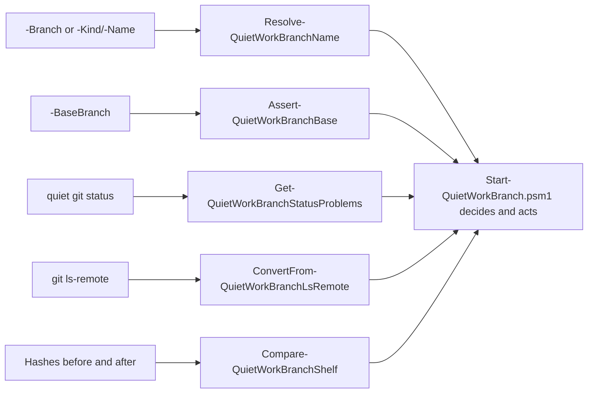

# WorkBranch.psm1

## Purpose and usage

The work branch policy of [Start-QuietWorkBranch.ps1](../Start-QuietWorkBranch.md), kept separate from its Git effects so every rule is unit tested without a process. Import is inert and no export reads or writes anything.

| Export | Contract |
| --- | --- |
| `Get-QuietWorkBranchKinds` | `fix`, `feature`, `chore`: the first segment of every work branch. There is no `release` kind: releases are tags, and the transient `release/*` branches with version commits belong to `Invoke-QuietRelease.ps1`. |
| `Resolve-QuietWorkBranchName` | Accepts either `-Branch feature/x` or `-Kind feature -Name x` and returns `{Branch, Kind, Name}`. The kind is compared case-sensitively. The name has at most 100 characters and one or more `/`-separated segments. Each segment starts and ends with a letter or a digit, may contain `.`, `_` and `-`, never contains `..` and never ends with `.lock`. Anything else throws `WorkBranchKindInvalid` or `WorkBranchNameInvalid`. |
| `Assert-QuietWorkBranchBase` | A base is a plain branch name, never a work or release branch: `feature/x` or `release/x` as base throws `WorkBranchBaseIsWorkBranch`, a malformed name throws `WorkBranchBaseInvalid`. This is the rule that keeps a feature from starting on a fix branch. |
| `Get-QuietWorkBranchStatusProblems` | Reads the data of `quiet git status` and lists, in a fixed order, `Detached`, `Unborn`, `Conflicted` and one `Operation:<name>` per in-progress merge, rebase, cherry-pick, revert, am or bisect. A missing status is `Unavailable`. Pending changes are not a problem: they are shelved. |
| `ConvertFrom-QuietWorkBranchLsRemote` | Parses `git ls-remote` into an ordinal dictionary from ref to id. Lines are `<oid>TAB<ref>` with a lowercase SHA-1 or SHA-256 id, LF or CRLF. Any other line, or the same ref with two ids, throws `WorkBranchRemoteOutputInvalid`. |
| `Compare-QuietWorkBranchShelf` | Compares the `{Path, Status, Hash}` of each pending path before shelving with what the restore produced, and returns the paths that went missing, appeared twice or changed status or content, in ordinal order. Paths that only exist after the restore are ignored. |

## Dependencies and side effects

None: no import, no process, no file access. The caller still runs `git check-ref-format --branch`, which stays the authority on ref syntax. These rules are a strict subset of it.

## Critical review and verdict

The name rules are deliberately narrower than Git's: they reject names Git accepts (for example a segment that starts with `_`), never the reverse. The integration test checks generated names against `git check-ref-format`, so a rule that let through a name Git refuses would fail there. The status rules depend on the field names of the Git companion's status data (`Detached`, `Unborn`, `Counts.Conflicted`, `Operations`). A renamed field reads as "no problem", which is why the integration test starts from a real merge in progress.

## Tests

- [`unit/lib/WorkBranch.Tests.ps1`](../../../test/scripts/unit/lib/WorkBranch.Tests.ps1) (87 tests):
  - tabulated valid and invalid names, bases and statuses;
  - a fuzz test that only allows the typed errors;
  - properties: both call forms agree, `ls-remote` output round-trips, and the shelf comparison is order-free and reports exactly the changed path.
- [`integration/entrypoints/Start-QuietWorkBranch.Tests.ps1`](../../../test/scripts/integration/entrypoints/Start-QuietWorkBranch.Tests.ps1) runs the entry point on fixture repositories.
- Mutation target `WorkBranch`, `Break` 80.

<!-- credits:begin -->
## Credits

This document is covered by the mandatory [CREDITS.md](../../../CREDITS.md), which records the licenses of [Git](https://github.com/git/git/blob/master/COPYING), [Vagrant](https://github.com/hashicorp/vagrant/blob/main/LICENSE) and [Microsoft .NET/PowerShell](https://github.com/PowerShell/PowerShell/blob/master/LICENSE.txt).
<!-- credits:end -->

<!-- script-contract:begin -->
## Execution contract

Purpose: Validates a work branch given whole (feature/x) or as a kind and a name, and returns its branch, kind and name.

Boundary: **Library**. Preview API: **Library**. Guarded functions: 0.

See [the complete review](../preview-support.md) for orchestration guards, delegated effects and static-analysis limits.
<!-- script-contract:end -->
